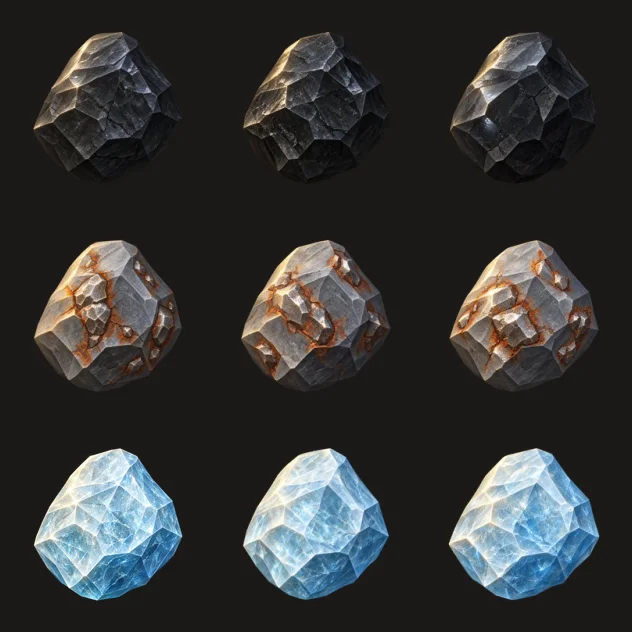
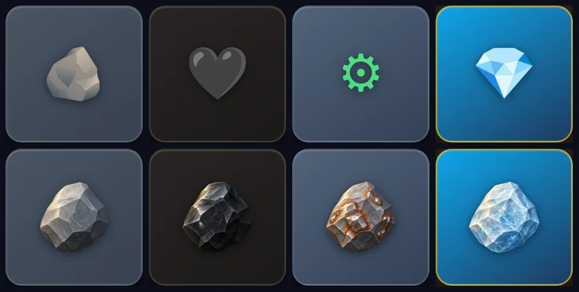

# Ticket #22 — T-15 : bibliothèque d'icônes (prototype pierre)

- **Ticket :** https://github.com/ReC82/Dig/issues/22
- **Date :** 2026-10-29
- **Branche :** `feature/22-icones-v1`, intégrée dans `develop`

## 1. État réel

> **Mise à jour du 30/10, 20:12 (voir §14) :** **les 14 icônes v1 sont affichées PAR DÉFAUT** pour tous les joueurs, sur les deux domaines (PC, mobile, PWA), sans paramètre d'URL. **Déployé en production (SHA `d0ff020`) — en attente de recette.** Retour arrière : `?icons=legacy` pour un navigateur, ou `"defaultLibrary": "legacy"` dans `library.json` pour tous. La règle « pas de profondeur maximale » (commentaire du 30/10, 12:48) **n'est pas encore traitée** : voir §14.6.

> **Mise à jour du 30/10, 13:29 (voir §13) :** **lot complet — les 14 blocs du jeu** ont leur icône v1, **déployé en production** (SHA `0f58670`). Visible seulement avec `?icons=v1` ; l'adresse normale garde les emoji. **Planche complète : https://dig.lodylands.com/assets/icons/planche-v1.webp**. En attente de **ta recette visuelle globale**.

> **Mise à jour du 30/10, 11:07 (voir §12) :** pilote **charbon, minerai de fer et diamant** **déployé en production** (SHA `4988e19`). Les icônes sont visibles seulement avec `?icons=v1` : l'adresse normale garde les emoji pour tous les joueurs. **En attente de ta recette visuelle.**

> **Mise à jour du 30/10 (voir §11) :** la pierre C est **en production depuis le 30/10 à 00:48** (SHA déployé `18e3881`, aujourd'hui `e32398d`). On la voit seulement avec `https://dig.lodylands.com/?icons=v1`. L'adresse normale garde les emoji pour tous les joueurs. **En attente de ton retour visuel sur téléphone.** Aucune autre image générée.
>
> *Historique (29/10) :* **Partiel — bloqué.** L'infrastructure est livrée et testée : bibliothèques `legacy` et `v1`, repli, rollback, chaîne de génération, contrôles et comparaison visuelle. En revanche, **aucune icône n'a été générée** : la seule clé OpenAI présente sur le serveur, celle de Jury Central, est **refusée par OpenAI** (401 `invalid_api_key`). Coût API engagé : **0 USD**. Rien n'est déployé, et `legacy` reste la valeur par défaut.

## 2. Ce qui est livré

| Élément | Rôle |
|---|---|
| `public/js/iconLibrary.js` | Choix `legacy` / `v1`. `legacy` est **par défaut** et rend **exactement** l'ancien affichage (`textContent = emoji`, aucun attribut ajouté). `v1` est activé matériau par matériau ; si l'image est absente ou en erreur, le rendu repasse en `legacy` |
| `public/assets/icons/library.json` | Configuration lue sans cache : `defaultLibrary: "legacy"` ; manifeste v1 **vide** (aucun asset) |
| `public/js/main.js`, `public/index.html`, `public/css/style.css` | Un seul point d'appel dans `renderBlock()` ; styles appliqués **uniquement** quand `data-icon-lib="v1"` est présent (jamais en `legacy`) |
| `tools/icons/openai-images.js` | Client OpenAI Images de Dig, hors ligne. Endpoints `generations` (JSON) et `edits` (multipart `image[]`, `input_fidelity`), avec `background: transparent` et `output_format: png`. Clé lue sur place et jamais affichée, messages d'erreur expurgés, budget plafonné, journal des coûts |
| `tools/icons/prompt-master.md`, `materials.json` | Prompt maître versionné (`v1.0`), avec clause de référence pour les matériaux suivants. Fiche **pierre** seule, avec ton texte **mot pour mot** |
| `tools/icons/generate.js` | 1 à 3 propositions. La référence officielle validée est jointe **systématiquement** dès qu'elle existe. Métadonnées complètes par proposition |
| `tools/icons/process.js` | Contrôle du **vrai** canal alpha (coins, part transparente, bords anti-crénelés) ; recadrage et recentrage avec une **marge de 12 %** ; PNG RGBA 1024 ; WebP 256 et 128 ; mesure de lisibilité sur fond sombre et aperçu de contrôle |
| `tools/icons/compare.js` | Captures du **vrai composant** `#block` pour les 14 matériaux, puis comparaison au pixel près |
| `docs/ICONS.md` | Mode d'emploi et **procédure de rollback** |
| `test/icons.test.js` | 13 tests |
| `sharp` (dépendance de développement) | Traitement d'image, pour l'outil uniquement (absent en production avec `npm ci --omit=dev`) |

## 3. Tentative de génération

- Configuration propre à Dig : `~/.config/dig/openai.env` (mode 600, sans aucune valeur secrète). Modèle `gpt-image-2.5-flare`, qualité `high`, 1024×1024, fond transparent. Plafond local de **3 USD**, au plus 3 images par commande.
- La clé indiquée est **celle de Jury Central**, lue sur place (`/srv/jury-central/.env`). L'exception est autorisée explicitement dans la configuration, et un avertissement s'affiche à chaque utilisation, car ce fichier est en mode 664.
- Premier appel (une seule proposition, pour limiter le risque) : **401 `invalid_api_key`**. La clé est révoquée ou invalide. Aucune image et **aucun coût**. Les deux autres propositions n'ont donc pas été lancées.
- **Fuite évitée :** le message d'OpenAI contenait la forme masquée de la clé (ses 4 derniers caractères). Ces caractères ont été retirés du journal des coûts. Toutes les erreurs passent désormais par un filtre (`redact`), couvert par un test.
- ⚠️ **À signaler pour Jury Central :** si sa génération d'images utilise cette même clé, elle est probablement en panne. Rien n'a été modifié dans ce projet.

## 4. Vérifications effectuées

| Contrôle | Résultat |
|---|---|
| `npm test` | **21/21** (13 tests #22, plus les tests #13). Le test de déploiement de #13 était fragile (il n'attendait pas le serveur) : il est corrigé |
| Comparaison visuelle, vrai composant, 14 matériaux, avant (`develop`) / après | **`legacy` identique au pixel près pour les 14 matériaux**. `v1` avec manifeste vide : identique pour les 14 |
| Mécanique v1 avec une pierre **factice** (polygones générés par programme, jamais committée), sur une copie jetable | Image affichée dans `#block`, à 70 % du bloc (≈ 119 px sur 170), en WebP 128 et 256 pour les écrans haute densité ; les **13 autres matériaux restent identiques** au pixel près ; marges mesurées 12,0 % (axe le plus long) |
| Repli : image v1 supprimée (404) | La pierre retombe sur l'emoji, **identique au pixel près** (14/14) |
| Production | Inchangée : `49faf2d`, aucun déploiement |

## 5. Rollback (voir `docs/ICONS.md`)

1. **Global, immédiat :** `"defaultLibrary": "legacy"` dans `public/assets/icons/library.json`. Pas de redémarrage, pas de migration, aucune donnée de joueur touchée.
2. **Un seul matériau :** retirer son entrée v1.
3. **Complet :** `git revert` des commits #22.

## 6. Choix techniques

- **La marge de 12 % est imposée en post-traitement**, pas confiée au modèle. Le recadrage sur l'alpha suivi d'un recentrage donne un cadrage identique pour tous les futurs matériaux (objet à ≈ 76 % de la toile, conforme à « environ 75 % »).
- **Pas de détourage « maison » si l'API ne fournit pas de vrai alpha** : la proposition est **refusée** par le contrôle. Une transparence peinte, en damier, ne passe pas.
- **Configuration côté client sans redéploiement :** fichier JSON lu sans cache, plutôt qu'un réglage serveur. Le rollback ne touche ni le code ni la base.
- **Taille d'affichage :** 70 % du bloc, une taille qui suit les media queries existantes du bloc.

## 7. Décisions demandées

1. **Clé OpenAI dédiée à Dig (bloquant).** Recommandation : un projet OpenAI « Dig » avec un **plafond de dépense mensuel**, et une clé limitée à l'API Images. Pour l'installer sans me la transmettre, tape dans cette session :
   `! umask 077; printf 'OPENAI_API_KEY=%s\n' 'sk-…' > ~/.config/dig/openai.key`
   Puis, dans `~/.config/dig/openai.env`, remplace `DIG_OPENAI_KEY_FILE=` par `/home/ubuntu/.config/dig/openai.key` et supprime la ligne `DIG_OPENAI_ALLOW_SHARED_KEY_FILE=1`. Je lance ensuite 3 propositions au plus, dans la limite de 3 USD.
2. **Plafond local :** 3 USD pour ce prototype, à confirmer.
3. **Clé de Jury Central :** à vérifier ou remplacer de ton côté (hors périmètre Dig).

## 8. Reste à faire

- Générer 2 ou 3 propositions de pierre. Pour chacune : contrôles automatiques et aperçus dans le composant réel (avant/après, fond sombre).
- Après ta validation visuelle :
  - enregistrer le PNG maître dans `art/icons/v1/reference/pierre.png` ;
  - remplir l'entrée `pierre` du manifeste v1 ;
  - garder `legacy` par défaut jusqu'à ta décision d'activation.
- Charbon, fer et diamant : **plus tard**, uniquement sur ta demande, avec la pierre comme référence.

## 9. Mise à jour — génération avec la clé dédiée (29/10, 22:55)

- **Clé dédiée Dig** installée par le propriétaire dans `~/.config/dig/openai.key` (mode 600). Configuration basculée dessus ; l'exception de clé partagée (`DIG_OPENAI_ALLOW_SHARED_KEY_FILE`) est supprimée. Le fichier contient la clé brute (sans `OPENAI_API_KEY=`) : ce format est désormais accepté (`b9ed934`, test ajouté, 14/14).
- **Vérification de la clé** par un appel gratuit (`GET /v1/models`) : HTTP 200, `gpt-image-2.5-flare` disponible.
- **Génération :** 3 propositions de pierre, texte V3 envoyé mot pour mot, sans image de référence (aucune « Pierre V3 » fournie dans le répertoire de travail). Aucun autre matériau.

| Proposition | Coût | Contraste bloc clair / foncé / page | Contrôles |
|---|---|---|---|
| A `pierre-20261029-215555-a` | 0,0712 USD | 1,72 / 2,35 / 4,05 | alpha, marge 12 %, exports : ok |
| B `pierre-20261029-215555-b` | 0,0712 USD | 1,46 / 1,99 / 3,42 | ok |
| C `pierre-20261029-215555-c` | 0,0712 USD | 1,49 / 2,03 / 3,50 | ok |

- **Dépense cumulée : 0,2136 USD** sur un plafond de 3 USD (estimation depuis l'usage renvoyé par l'API).
- **Vrai composant du jeu** (serveurs jetables en local, arrêtés ensuite) : pour chacune des trois, `legacy` identique au pixel près sur les 14 matériaux, et en `v1` seule la pierre change (13/13 autres identiques).
- **Fichiers :** `art/icons/v1/candidates/pierre-20261029-215555-{a,b,c}/`, sur le serveur, **non committés** : seul le PNG maître validé sera versionné.
- **En attente :** le choix A, B ou C par le propriétaire. Ensuite : référence `art/icons/v1/reference/pierre.png`, entrée `pierre` du manifeste v1, `legacy` toujours par défaut. Aucun déploiement.

## 10. Validation et intégration de la pierre (29/10)

- **Choix du propriétaire : proposition C** (`pierre-20261029-215555-c`), définitif.
- **Référence officielle :** `art/icons/v1/reference/pierre.png`, copie exacte du PNG maître présenté (sha256 `93527a1a0dc5…`). Sa provenance est dans `pierre.json`. Elle sera jointe automatiquement à toute future génération.
- **Bibliothèque v1 :** `public/assets/icons/v1/pierre-128.webp` et `pierre-256.webp`, identiques aux exports de la proposition C ; entrée `pierre` ajoutée au manifeste.
- **Inchangé :** `defaultLibrary` reste `legacy`. Les emoji ne sont ni modifiés ni supprimés, et les trois niveaux de rollback de §5 s'appliquent tels quels.
- **Vérifications :**
  - `npm test` : 23/23, dont un nouveau test de cohérence entre manifeste, exports et référence ;
  - vrai bloc du jeu : `legacy` identique au pixel près (14/14). En `v1`, seule la pierre change, avec un rendu identique à l'aperçu C validé.
- **Rien n'est déployé.** Aucun autre matériau n'a été généré. Les propositions A et B restent sur le serveur, hors Git.
- **Reste :** décider de l'activation de `v1` (au moment d'un déploiement validé), puis des matériaux suivants, sur ta demande.

## 11. Pierre C visible dans le vrai jeu (30/10)

**Réponse à la demande du 29/10, 22:48 :** voir la pierre C dans Dig, sur téléphone, avant toute autre image.

### État réel
**Déployé en production, en attente de ton retour visuel.** Aucun nouveau code ni nouveau déploiement n'a été nécessaire pour cette étape.

- **URL à ouvrir :** **https://dig.lodylands.com/?icons=v1** (ou `https://dig.lodygames.com/?icons=v1`).
- **Commit de la pierre C :** `0f37780`, sur `feature/22-icones-v1`, fusionné dans `develop` en `b7635b3`.
- **Mise en ligne :** avec le lot 1, le 30/10 à 00:48 (SHA `18e3881`).
- **Version servie aujourd'hui :** `1.0.0+e32398d`.

### Écart avec ta demande, en toute transparence
Tu demandais un déploiement ciblé, sans mettre `develop` en ligne d'un bloc. Ta directive du 30/10 a remplacé celle du 29 : elle autorise le déploiement ordinaire des tickets intégrés. Cette nuit, `develop` a donc été déployé en lots, avec #8 à #21. La pierre C est arrivée avec le premier lot, en tant qu'aperçu.

Aucun déploiement ciblé spécial n'a donc été fait, et il n'est plus utile : le code de #22 en production est exactement celui de `develop`. Chaque lot a été déployé avec :
- une sauvegarde vérifiée ;
- des empreintes des données joueurs identiques ;
- `quick_check` ok.

Le détail se trouve dans le rapport de nuit.

### Preuves d'isolation, vérifiées le 30/10 sur la vraie production
Essais navigateur Chromium (sans écran) sur `https://dig.lodylands.com`, en invité :
- **Téléphone :** 390×844, densité 3.
- **Ordinateur :** 1280×900.

| Adresse | Bloc « Pierre » obtenu en minant | Rendu |
|---|---|---|
| `/?icons=v1` | oui (téléphone : 63 coups ; ordinateur : 31 coups) | image v1 : `pierre-256.webp` sur téléphone, `pierre-128.webp` sur ordinateur, chargée |
| `/?icons=default` | oui | emoji 🪨 (legacy) |
| `/` (adresse normale) | oui | emoji 🪨 (legacy) |

Autres contrôles :
- **Aucune erreur JavaScript.**
- **Aucune requête d'écriture** vers le serveur pendant l'essai : l'invité ne sauvegarde rien, donc aucune donnée joueur n'a été touchée.
- Les fichiers servis sur les deux domaines (`library.json`, `pierre-128.webp`, `pierre-256.webp`) ont des empreintes identiques à ceux du dépôt.
- `defaultLibrary` vaut `legacy`, et seule l'entrée `pierre` existe dans `v1`. Les 13 autres matériaux restent donc en emoji, même avec `?icons=v1`.

### Rollback
Trois retours possibles, tous immédiats, sans redémarrage ni migration, et sans aucun effet sur la base :
- **Global :** `defaultLibrary` est déjà `legacy`, donc rien n'est à faire pour les joueurs ordinaires.
- **Retirer la pierre C même en aperçu :** supprimer l'entrée `pierre` de `public/assets/icons/library.json`, ou supprimer `pierre-*.webp`. Dans le second cas, le repli automatique remet l'emoji.
- **Pour ton navigateur :** `?icons=v1` est mémorisé dans le navigateur. Ouvre `/?icons=default` pour revenir au rendu normal.

### Test à faire sur ton téléphone
1. Ouvre **https://dig.lodylands.com/?icons=v1**, choisis la langue, puis joue en invité ou connecté.
2. Mine jusqu'à **5 m de profondeur** : la pierre n'apparaît qu'à partir de 5 m. Avant, ce sont la terre meuble et l'argile, toujours en emoji.
3. **Résultat attendu :**
   - un bloc « Pierre » montre la pierre C dessinée à la place de l'emoji 🪨 ;
   - grès, granite, charbon et les autres matériaux restent en emoji.
4. Ouvre ensuite **https://dig.lodylands.com/?icons=default** : la pierre redevient 🪨.

### Classement
**Après lancement**, car cosmétique : ce ticket ne bloque pas le MVP public.

### Décisions demandées
1. **La pierre C te convient-elle en jeu sur téléphone ?**
   - Si oui, je recommande de lancer ensuite le pilote charbon, fer et diamant : au plus 3 propositions par matériau, budget autour de 0,65 USD.
   - Si non, dis-moi ce qu'il faut ajuster : taille, contraste ou style.
2. **Activer `v1` par défaut pour tous ?** Je recommande d'attendre plusieurs matériaux : un seul matériau dessiné parmi 14 emoji donne un rendu hétérogène.

### Reste à faire
- Ton retour visuel.
- Les autres matériaux, seulement sur ta demande : aucune image générée dans cette session.
- La bascule par défaut.
- Le nettoyage de `art/icons/v1/candidates/`, non committé.

## 12. Pilote charbon / fer / diamant (30/10)

**Ce qui a déclenché cette étape :** ton commentaire du 30/10 à 09:45 — « Oui c'est très bien », la pierre C devient la référence, et tu demandes de commencer par un petit lot charbon/fer/diamant.

### État réel
**Déployé en production (SHA `4988e19`) — en attente de recette.** Visible seulement avec `?icons=v1`. `defaultLibrary` reste `legacy` : aucun joueur ne voit de changement sans ce paramètre.

### Ce qui a été fait
- **Fiches matériaux** ajoutées dans `tools/icons/materials.json` : `charbon`, `minerai_fer`, `diamant`. Chaque clé correspond exactement à l'identifiant du bloc dans le jeu.
- **Génération :** 3 propositions par matériau, soit 9 images. Elles passent par l'endpoint d'édition, avec la **pierre C jointe comme référence** et le gabarit maître `v1.0` complété par la clause « même rendu, seul le matériau change ».
- **Coût :**
  - 9 × ~0,082 USD = **0,74 USD** ;
  - cumul du ticket : **0,95 USD** sur un plafond local de 3 USD (le plafond n'a pas été modifié).
  - Une première tentative a échoué sans être facturée (0 USD) : HTTP 400, le modèle d'édition refuse `input_fidelity`.
- **Correctif outil** (`tools/icons/openai-images.js`, `generate.js`) :
  - `input_fidelity` n'est envoyé que si `DIG_IMAGE_INPUT_FIDELITY` est configuré ;
  - une erreur 4xx annule les propositions suivantes de la commande, pour ne pas répéter un appel voué à l'échec.
- **Contrôles `process.js`** : 8 propositions sur 9 sont conformes (alpha réel, marge 12 %, exports WebP 128/256). **Diamant A est refusé** : ses coins ne sont pas transparents.
- **Intégré en aperçu v1** (choix technique, modifiable, voir §12 Choix) : **charbon C, fer C, diamant C**. Fichiers `public/assets/icons/v1/<matériau>-{128,256}.webp`, entrée `"status": "pilote"` dans le manifeste, provenance complète dans `art/icons/v1/pilot/<matériau>.json` (modèle, prompt, coût, empreintes, alternatives).
- **Tests :**
  - un test vérifie chaque pilote : bloc existant, référence pierre C, empreintes des exports égales à la provenance ;
  - un autre vérifie que chaque fiche matériau correspond à un bloc réel ;
  - `docs/ICONS.md` explique comment changer de proposition ou retirer un pilote.

### Aperçus
Les 3 propositions par matériau, sur fond sombre (de gauche à droite : A, B, C ; ligne 1 charbon, 2 fer, 3 diamant) :



Dans le vrai bloc du jeu (en haut : emoji actuels ; en bas : v1). De gauche à droite : pierre, charbon, fer, diamant.



**Mon avis :**
- **Charbon :** convaincant, noir anthracite brillant, lisible sur le fond brun foncé de son bloc.
- **Fer :** bien identifiable, avec ses nodules métalliques et sa rouille sur la roche de la pierre C.
- **Diamant :** cohérent avec le style, mais il ressemble davantage à un bloc de glace ou de quartz qu'à un diamant. La clause « même forme que la référence » l'empêche d'avoir une silhouette de gemme. C'est le point faible du lot.

### SHA et procédure de test
- **Branche :** `feature/22-icones-v1`, commit `f857b09`.
- **`develop` :** `4988e19` (fusion `--no-ff`).
- **Test technique local :**
  ```bash
  npm test                                         # 149/149
  node tools/icons/compare.js --before https://dig.lodylands.com --after http://127.0.0.1:3101 --out /tmp/cmp
  ```
  Dans le vrai composant `#block`, sur les 14 matériaux :
  - `legacy` est identique au pixel près à la production précédente, 14/14 ;
  - en `v1`, seuls pierre, charbon, fer et diamant changent ;
  - différences inattendues : 0.

### Vérifications effectuées
- **Tests :**
  - `npm test` 149/149 sur la branche, sur `develop` (`4988e19`) et sur le worktree de release `4988e19` ;
  - un premier passage sur `develop` a échoué (`security.test.js`, HTTP 409) à cause d'un serveur de test orphelin resté sur le port 3111. Ce serveur venait d'un passage de test précédent et utilisait une base temporaire dans `/tmp`. Je l'ai arrêté, puis le passage complet a réussi (149/149). Le push de `develop` a eu lieu juste avant ce passage réussi, mais sur le même SHA, qui a ensuite été testé deux fois sans échec.
- **Copie de la base de production :**
  - démarrage de la release dessus, en `NODE_ENV=production` sur le port 3122 ;
  - `/health` 200 et version `1.0.0+4988e19` ;
  - empreintes `users`, `user_saves`, `season_rankings`, `seasons`, `leagues`, `player_click_tracking` identiques avant et après ;
  - copie supprimée ensuite.
- **Après déploiement :**
  - les 2 domaines répondent 200 avec la version `1.0.0+4988e19` ;
  - `library.json` et `diamant-256.webp` servis sont identiques au dépôt ;
  - `journalctl` sans erreur ;
  - `quick_check` ok ;
  - empreintes joueurs de la production identiques à la sauvegarde pré-déploiement.
- **Navigateur en production** (Chromium, 390×844 et 1280×900, chargement de la configuration des icônes sans lancer de partie) :
  - avec `?icons=v1` : `pierre`, `charbon`, `minerai_fer` et `diamant` affichent leur image (chargée) ; l'or reste en emoji ;
  - avec `?icons=default` : tous les blocs sont en emoji ;
  - 0 erreur JS, 0 requête d'écriture.
- **Non vérifié :** le minage réel jusqu'aux blocs charbon, fer et diamant. Ils sont trop profonds pour un essai automatique sans créer de progression en production.
- **Données joueurs :** aucun impact. Seuls des fichiers statiques et l'outil hors ligne ont changé.

### Déploiement
- **SHA déployé :** `4988e19` (précédent : `cab983d`), le 30/10 à 11:06, via `scripts/deploy.sh` de la release.
- **Sauvegarde vérifiée :** `~/backups/dig/dig-20261030-110645-pre-deploy-4988e19.sqlite`.
- **Retour arrière**, du plus léger au plus complet :
  1. retirer l'entrée d'un pilote dans `library.json` : le matériau repasse en emoji ;
  2. `?icons=default` dans le navigateur ;
  3. retour au SHA `cab983d` par la procédure standard.

### Test fonctionnel à faire par le propriétaire
1. Sur ton téléphone, ouvrir **https://dig.lodylands.com/?icons=v1** et jouer normalement.
2. **Résultat attendu :** en atteignant les blocs **Charbon**, **Minerai de fer** et **Diamant**, une icône 3D dans le style de la pierre C remplace l'emoji. Les autres blocs gardent leur emoji, sauf la pierre.
3. Pour comparer sans miner : regarder les deux planches ci-dessus.
4. Revenir à l'affichage normal : **https://dig.lodylands.com/?icons=default**.

### Classement
**Après lancement** (cosmétique, sans effet sur le MVP public ; les joueurs ne voient rien sans `?icons=v1`).

### Choix techniques faits seul
- **Proposition C pour chaque matériau :**
  - charbon C : le plus de reflets, donc le plus lisible sur fond sombre ;
  - fer C : le meilleur contraste (1,91 sur le bloc foncé) ;
  - diamant C : le bleu le plus profond, le plus distinct de la glace.

  Un échange se fait en deux minutes : copier deux fichiers WebP et mettre à jour la provenance.
- **Propositions non retenues :** elles restent sur le serveur (`art/icons/v1/candidates/`), hors Git, selon la même convention que pour la pierre. Seuls les exports retenus, la provenance et deux planches compressées sont versionnés.
- **Worktree du ticket conservé**, alors que tout est intégré : il contient ces propositions non versionnées, qui sont nécessaires si tu choisis A ou B.
- **Aucune 4e proposition :** la limite de 3 par matériau est respectée, y compris pour le diamant.

### Décisions demandées au propriétaire
1. **Charbon / fer / diamant en jeu : conviennent-ils ?**
   - Options : valider tel quel, ou échanger une proposition (A/B, voir la planche).
   - Recommandation : valider charbon C et fer C.
2. **Diamant :** il fait un peu « glaçon ».
   - Options :
     - a) l'accepter ;
     - b) prendre A (rejeté par le contrôle de transparence, donc non conseillé) ou B ;
     - c) m'autoriser une nouvelle série de 3 propositions, avec une consigne de **silhouette de gemme taillée brute** (le style reste celui de la référence, la forme peut différer), pour ~0,25 USD.
   - Recommandation : **c**.
3. **Lot suivant :** ma recommandation est **granite, grès, minerai d'or**, puis **rubis, émeraude**, au maximum 3 propositions chacun, pour ~0,25 USD par matériau. Les coffres et la terre/argile viendraient en dernier, car leur forme s'éloigne de la roche.

### Reste à faire
- Validation visuelle du pilote ; nouvelle série pour le diamant si tu choisis 2c.
- 10 matériaux restants : terre meuble, argile, grès, granite, minerai d’or, rubis, émeraude, et les 3 coffres (vieille caisse, coffre en bois, coffre en fer).
- Bascule de `defaultLibrary` vers `v1` seulement après validation visuelle **du lot complet**.

## 13. Lot complet : les 14 blocs (30/10)

**Ce qui a déclenché cette étape :** tes commentaires du 30/10 (10:15, 10:43, 11:21) — charbon C et fer C validés en jeu, diamant refusé (« glaçon »), puis : une seule génération par bloc restant, recensement exhaustif, planche accessible par URL, priorité immédiate.

### État réel
**Déployé en production (SHA `0f58670`) — en attente de recette visuelle globale.** `defaultLibrary` reste `legacy` : sans `?icons=v1`, aucun joueur ne voit de changement.

### Liens
- **Planche complète (téléphone ou PC) : https://dig.lodylands.com/assets/icons/planche-v1.webp** — les 14 blocs, dans l'ordre du jeu, sur le fond réel de leur bloc, avec nom, rareté, profondeur, statut et emoji remplacé.
- Même planche dans le dépôt : [`art/icons/v1/planche-v1.png`](https://github.com/ReC82/Dig/blob/develop/art/icons/v1/planche-v1.png).
- Avant / après dans le vrai composant du jeu (colonnes : avant, après sans paramètre, après `?icons=v1`) : [`art/icons/v1/pilot/en-jeu-lot-complet-20261030.png`](https://github.com/ReC82/Dig/blob/develop/art/icons/v1/pilot/en-jeu-lot-complet-20261030.png).
- En jeu : https://dig.lodylands.com/?icons=v1


### Inventaire exhaustif (source : `public/js/blocks.js`, 14 types — il n'en existe pas d'autre)

| Bloc | Rareté | Profondeur | Emoji remplacé | Icône v1 | Statut |
|---|---|---|---|---|---|
| Terre meuble | Commun | 1–12 m | 🟤 | motte de terre | à valider |
| Argile | Commun | 4–22 m | 🟫 | bloc d'argile terracotta | à valider |
| Pierre | Commun | dès 5 m | 🪨 | pierre C (référence) | **validée 29/10** |
| Grès | Commun | dès 12 m | 🏔 | roche à strates beige | à valider |
| Granite | Peu commun | dès 25 m | ⬛ | roche mouchetée noir/blanc/rose | à valider |
| Charbon | Peu commun | dès 8 m | 🖤 | charbon C | **validé 30/10** |
| Minerai de fer | Peu commun | dès 20 m | ⚙ | fer C | **validé 30/10** |
| Minerai d'or | Rare | dès 40 m | 🟡 | roche à pépites et veines d'or | à valider |
| Vieille caisse | Commun | dès 1 m | 🧰 | caisse en bois usée | à valider |
| Coffre en bois | Rare | dès 5 m | 📦 | coffre au trésor cerclé de laiton | à valider |
| Coffre en fer | Épique | dès 30 m | 🗃 | coffre blindé, cadenas | à valider |
| Rubis | Épique | dès 35 m | 🔴 | cristal de rubis brut | à valider |
| Émeraude | Légendaire | dès 70 m | 💚 | prismes d'émeraude sur roche | à valider |
| Diamant | Légendaire | dès 120 m | 💎 | **nouveau** : diamant brut octaédrique, gangue de kimberlite | à valider |

### Ce qui a été fait
- **Génération :** une image par bloc restant (11), toujours avec la pierre C jointe comme référence et le gabarit maître `v1.0`. Fiches ajoutées dans `tools/icons/materials.json` ; la fiche diamant est réécrite (« diamant brut minéral, pas un glaçon ni du verre, incolore avec feux prismatiques, fragments de kimberlite »).
- **Contrôles `process.js` :** 10/11 conformes du premier coup. La **vieille caisse** est sortie sur un fond opaque (refus automatique « coins non transparents ») : défaut technique, **une seule relance**, conforme. Aucune variante préventive.
- **Coût réel (journal `~/.local/state/dig-icons/ledger.jsonl`) :** 12 appels × ~0,082 USD = **0,98 USD** (dont 0,08 USD pour la caisse refusée). **Cumul du ticket : 1,93 USD sur le plafond de 3 USD** (non modifié). Reste ~1,07 USD, soit ~13 images : de quoi corriger les blocs que tu refuserais, sans risque de dépassement à ce stade.
- **Intégration v1 :** nouvel outil `tools/icons/promote.js` — copie les WebP 128/256, conserve le maître 1024 (WebP sans perte) et la provenance dans `art/icons/v1/pilot/`, met à jour le manifeste, **refuse de remplacer un matériau validé**, ne touche jamais `defaultLibrary`.
- **Charbon C et fer C** marqués validés (`"validated": "2026-10-30"`) suite à ta recette ; pierre C inchangée.
- **Planche :** nouvel outil `tools/icons/board.js` (Chromium headless, lit uniquement les fichiers du dépôt), publiée comme **image statique** dans `public/assets/icons/planche-v1.webp` — aucune page HTML ni route ajoutée.
- **Tests (`test/icons.test.js`, +4) :** les 14 blocs ont une image et dans l'ordre du jeu ; fichiers présents, aucun export orphelin ; validations conservées (pierre, charbon, fer ; diamant non validé) ; exports des pilotes nommés avec empreinte ; planche à 14 entrées.

### Vérifications
- `npm test` : **188/188** sur la branche, sur `develop` `0f58670` et sur la release `0f58670`.
- `compare.js` dans le vrai composant `#block` (production `ea23431` contre branche) : **0 différence inattendue** ; `legacy` identique au pixel près pour les 14 blocs ; `?icons=v1` montre une image pour les 14.
- Copie de la base de production démarrée en `NODE_ENV=production` sur `0f58670` : empreintes des 6 tables **identiques** avant/après.
- Après déploiement : 2 domaines → 200 et version `1.0.0+0f58670` ; planche → 200 ; `library.json`, planche et diamant servis identiques au dépôt ; `journalctl` sans erreur ; `quick_check` ok ; empreintes de production **identiques** à la sauvegarde pré-déploiement.
- Chromium sur la production, 390×844 et 1280×900 : `?icons=v1` → **14/14 images chargées** ; `?icons=default` → 0 image (emoji) ; 28 fichiers v1 accessibles ; `defaultLibrary` = `legacy` ; 0 erreur JS ; 0 écriture.
- Non fait : je n'ai miné aucun bloc en production (aucune progression créée) ; le rendu a été vérifié en forçant l'affichage du composant.

### Déploiement
- SHA déployé : **`0f58670`** (30/10, 13:29), depuis `ea23431`. Sauvegarde vérifiée : `dig-20261030-132909-pre-deploy-0f58670.sqlite`.
- Impact joueurs : aucun (fichiers statiques et outils hors ligne ; aucune migration, aucune donnée touchée ; taux d'apparition, économie et sauvegardes inchangés).
- Retour arrière : un bloc → retirer son entrée de `library.json` ; tout → `git reset --keep ea23431` + redémarrage (voir `docs/ICONS.md`).

### Test à faire par le propriétaire (une seule recette globale)
1. Ouvre **https://dig.lodylands.com/assets/icons/planche-v1.webp** : les 14 blocs, y compris coffres, rubis, émeraude et diamant, sans avoir à les rencontrer.
2. Réponds en listant **seulement les blocs à corriger** (une correction = une nouvelle image, ~0,08 USD).
3. Facultatif : https://dig.lodylands.com/?icons=v1 en jeu ; `?icons=default` pour revenir aux emoji.

Classement : **Après lancement** (cosmétique, rien ne bloque le MVP).

### Choix techniques faits seul
- **Noms d'export avec empreinte** (`diamant-24816390-128.webp`) : les assets sont servis « immutable » pendant un an ; remplacer le diamant sous le même nom t'aurait laissé l'ancien glaçon en cache. Pierre, charbon et fer gardent leurs noms (inchangés).
- **Relance unique de la vieille caisse** : c'était un rejet technique (fond opaque), pas une variante de style.
- **Planche en image statique** plutôt qu'une page : directement lisible sur téléphone, aucune route ni page ajoutée.
- **Maîtres 1024 versionnés** en WebP sans perte (~650 Ko chacun) : permet de régénérer d'autres tailles sans nouvel appel payant.

### Décisions demandées au propriétaire
1. Recette visuelle globale : quels blocs corriger ? *Recommandation : ne citer que ceux qui ne conviennent pas.*
2. Une fois le lot accepté : activer `v1` **par défaut** pour tous les joueurs (`"defaultLibrary": "v1"`, réversible sans redéploiement) ? *Recommandation : oui, après ta recette.*

### Reste à faire
- Corrections éventuelles demandées après ta recette.
- Bascule par défaut, sur ton accord.
- Les propositions non retenues restent hors dépôt (`art/icons/v1/candidates/`, dans le worktree du ticket, conservé).

## 14. Les 14 icônes v1 par défaut (30/10, 20:12)

**Demande :** commentaire du propriétaire du 30/10 à 14:31 (#issuecomment-6525262282). Les 14 images sont validées. Il faut les afficher par défaut, à la place des emoji, sans paramètre d'URL.

### 14.1 État réel

**Déployé en production (SHA `d0ff020`) — en attente de recette.**

- **SHA sur `develop` :** `d0ff020` (fusion de `a9a39aa`, branche `feature/22-icones-v1`).
- **Sauvegarde pré-déploiement vérifiée :** `dig-20261030-201229-pre-deploy-d0ff020.sqlite`.
- **SHA précédent (retour arrière) :** `9fd23e4`.

### 14.2 Changements

| Fichier | Changement |
|---|---|
| `public/assets/icons/library.json` | `defaultLibrary: "v1"`. Les 14 matériaux sont marqués `validated` : pierre le 29/10, les 13 autres le 30/10. Le statut `pilote` est retiré. **Images inchangées** (mêmes fichiers, mêmes empreintes). |
| `public/js/iconLibrary.js` | **Choix mémorisés :** nouvelle clé `dig.iconLibrary.2`. L'ancienne clé `dig.iconLibrary` est effacée à la lecture. Un navigateur qui avait gardé `?icons=legacy` pendant la recette voit donc aussi les images. **Pas de clignotement :** tant que `library.json` est en lecture (au plus 3 s), le bloc reste sans icône au lieu d'afficher l'emoji puis l'image. Hors ligne ou en cas d'erreur, le jeu revient aux emoji. |
| `public/js/main.js`, `public/css/style.css` | La fenêtre « coffre ouvert » (vieille caisse, coffre en bois, coffre en fer) affiche aussi l'image v1 (64 px). L'emoji reste en mode legacy. |
| `public/admin/admin.js` | Le libellé du catalogue indique « affichée par défaut ». Il ne mentionne plus « aperçu ?icons=v1 ». |
| `art/icons/v1/pilot/*.json` | Provenances : `status: validé`. |
| `tools/icons/board.js`, planche | Profondeurs affichées en « dès X m » quand il n'y a pas de maximum (avant : « 5–undefined m »). Planche régénérée avec les 14 statuts validés. |
| `test/icons.test.js`, `test/icon-studio.test.js` | Nouveaux tests : v1 par défaut, 14 blocs validés, diamant validé = diamant brut refait, ancien choix « legacy » ignoré et effacé. Pendant le chargement, ni emoji ni image ; puis rendu v1, ou repli emoji en cas d'erreur réseau ou de 404. Dans l'atelier (#40), les blocs v1 validés sont verrouillés : un remplacement demande un accord explicite. |

**Inchangé :** gameplay, taux d'apparition, récompenses, sauvegardes, base de données. Aucun appel OpenAI, coût 0 USD (cumul du ticket inchangé : 1,93 / 3 USD).

### 14.3 Vérifications

- `npm test` : **315/315** sur la branche et sur la release `d0ff020` (SHA exact).
- **Copie de la base de production** démarrée en `NODE_ENV=production` sur `d0ff020` : `/health` ok, version `1.0.0+d0ff020`. Empreintes des 6 tables (`users`, `user_saves`, `season_rankings`, `seasons`, `leagues`, `player_click_tracking`) **identiques** avant et après. Copie supprimée.
- **Déploiement :** `scripts/deploy.sh` de la release : sauvegarde vérifiée, santé et version OK.
- **Après déploiement :**
  - 2 domaines → 200, `/api/version` = `1.0.0+d0ff020` ;
  - `library.json` servi avec `defaultLibrary: "v1"` et `Cache-Control: no-cache` ;
  - `journalctl` sans erreur ;
  - `quick_check` = ok ;
  - empreintes de la base de production = sauvegarde pré-déploiement.
- **Chromium sur la production, sans paramètre d'URL,** sur les deux domaines, PC 1280×900 et mobile 390×844 :
  1. Première visite (sans cache) : image v1 (`data-icon-lib="v1"`, image chargée).
  2. Après une actualisation, service worker actif, avec un ancien choix `legacy` mémorisé (ancienne clé) : **toujours l'image v1**. L'ancienne clé est effacée.
  3. `?icons=legacy` → emoji ; `?icons=default` → retour aux images.
  4. 0 erreur JS, aucune écriture API.
- **Non vérifié :**
  - ouverture réelle d'un coffre en production (couverte par le même composant de rendu, testé) ;
  - application PWA installée sur un vrai téléphone. Le service worker est versionné à chaque déploiement et sert la page en « réseau d'abord » : l'actualisation suffit.

### 14.4 Test à faire dans le jeu (propriétaire)

1. Ouvre https://dig.lodylands.com (ou .com), **sans** paramètre, sur PC puis sur téléphone (aussi depuis l'icône PWA si elle est installée). Actualise une fois si l'onglet était déjà ouvert.
2. **Attendu :** le bloc affiche l'image v1 (pierre, terre, caisse…), plus aucun emoji. En ouvrant une caisse ou un coffre, la fenêtre de récompense montre aussi l'image.
3. Retour aux emoji pour un seul navigateur : `?icons=legacy`. Pour revenir au réglage par défaut : `?icons=default`.
4. Planche à jour (statuts validés) : https://dig.lodylands.com/assets/icons/planche-v1.webp?v=d0ff020. Ajoute `?v=…`, car l'ancienne planche peut rester en cache.

### 14.5 Retour arrière

- **Pour tous les joueurs, sans redéploiement :** remettre `"defaultLibrary": "legacy"` dans `public/assets/icons/library.json` (lu sans cache).
- **Retour du code :** `git -C /home/ubuntu/Dig reset --keep 9fd23e4` puis redémarrage. La base n'est pas concernée.

### 14.6 Reste à faire — règle « aucune profondeur maximale » (commentaire du 30/10, 12:48)

Ce point n'est pas traité dans cette livraison, comme demandé : il ne devait pas retarder le passage des icônes. **Constat en production :** l'essentiel est déjà en place depuis #37 étape B (déployé le 30/10 à 18:33). Le catalogue lu par le jeu (`/api/blocks/catalog?format=2`, version 3, 22 types) n'a **aucune borne maximale** :

- les 20 autres types, coffres compris, sont « dès X m » avec un poids constant ;
- **terre meuble** et **argile** sont seulement **atténuées** au-delà de 12 et 22 m, avec un poids de 2,1 et 1,35, donc une probabilité strictement positive.

**Bornes résiduelles à supprimer (prochaine session) :**
1. `public/js/blocks.js` (catalogue d'origine du client) garde `maxDepth: 12/22` pour terre et argile. Ce catalogue s'applique avant la réception du catalogue publié, ou si ce catalogue n'a jamais été reçu.
2. La projection `format` 1 de `server/blockCatalog.js` réécrit l'atténuation en borne pour les anciens clients.
3. L'admin accepte encore une « borne héritée » `maxDepth`, avec un simple avertissement.

**À faire ensuite :**
- convertir ces bornes en atténuation ;
- afficher « dès X m » partout (FR/EN/NL) ;
- ajouter des tests par bloc : au seuil, juste avant, puis à 500, 5 000 et 100 000 m, avec P > 0 ;
- déployer.

**Les 8 nouveaux minerais de #37** (quartz → cristal ancien, 150–800 m) n'ont pas d'icône v1 : ils gardent leur emoji. Ce point est hors du lot des 14 blocs validés.

### 14.7 Choix techniques faits seul

- **Nouvelle clé de stockage** plutôt qu'une migration de la valeur : simple et sans risque. Le choix `?icons=legacy` reste possible après coup.
- **Bloc vide pendant au plus 3 s** au lieu de l'emoji : c'est ce qui permet d'éviter les emoji par défaut. Au-delà, ou hors ligne, le jeu repasse aux emoji, comme avant.
- **Fenêtre de coffre en image :** elle est cohérente avec « plus d'emoji par défaut » et utilise le même composant (repli emoji intact).

### 14.8 Décisions demandées

Aucune décision n'est nécessaire pour les icônes. Pour la règle de profondeur, la décision est déjà prise par le propriétaire : elle est appliquée à la prochaine session.

**Classement :** icônes : Après lancement (cosmétique, livré). Règle de profondeur : déjà effective en jeu. Les bornes résiduelles relèvent de l'**Après lancement** : elles ne jouent qu'avant le chargement du catalogue.

## 15. Règle « aucune profondeur maximale » — bornes résiduelles supprimées (30/10, 20:35)

**Demande :** commentaire du propriétaire du 30/10 à 12:48 (#issuecomment-6523212731). Les 14 blocs, coffres compris, n'ont qu'un seuil « dès X m ». Une fois débloqué, un bloc doit rester possible à toute profondeur (P > 0). Le commentaire de 12:42 (#issuecomment-6523112117 : 6 blocs validés, ne pas activer v1 par défaut) est antérieur à l'autorisation de 14:31, déjà appliquée au §14. Il ne demande rien de plus.

### 15.1 État réel

**Déployé en production (SHA `d04a6ad`) — en attente de recette.**

- **SHA sur `develop` :** `d04a6ad`, fusion de `6168c65` (branche `feature/22-icones-v1`).
- **Sauvegarde pré-déploiement vérifiée :** `dig-20261030-203509-pre-deploy-d04a6ad.sqlite`.
- **SHA précédent (retour arrière) :** `d0ff020`.

### 15.2 Ce qui change

Depuis #37 étape B, le jeu publié (catalogue v3) n'avait déjà plus de borne : terre meuble et argile étaient seulement atténuées. Trois bornes subsistaient ailleurs. Elles sont supprimées.

| Fichier | Changement |
|---|---|
| `public/js/blocks.js` | Catalogue d'origine du client, utilisé avant la réception du catalogue publié ou sans réseau : terre meuble et argile passent de « jusqu'à 12 / 22 m » à « atténuées au-delà de 12 / 22 m » (poids 2,1 et 1,35). Ce sont exactement les valeurs du catalogue v3 en production. Le tirage ne tient plus compte d'un `maxDepth`, même s'il vient d'un ancien catalogue mémorisé. |
| `server/blockCatalog.js` | **Saisie admin :** toute profondeur maximale est refusée (400 « aucune profondeur maximale… utilisez « atténué au-delà de » »), y compris pour un bloc d'origine. **Anciennes versions à borne (v1 et v2 de la production) :** à la validation, la borne est convertie en atténuation, retour arrière compris. Terre et argile reprennent alors 2,1 et 1,35 ; une borne inconnue garde 3 % du poids, jamais 0. **Ancien format d'API (format 1) :** plus de borne. **Budget anti-bot :** inchangé (3 / 6 / 8 PV), car les anciennes bornes sont traitées comme des atténuations. |
| `public/admin/admin.js`, `index.html` | Champ « Borne héritée » retiré. La colonne profondeur affiche « dès X m », avec « (atténué > Y m : poids) » si besoin. Le calcul des chances de l'admin suit la même règle. |
| `tools/icons/board.js`, `public/assets/icons/planche-v1.webp` | La planche affiche « dès X m » pour les 14 blocs. Avant : « 1–12 m » pour la terre et « 4–22 m » pour l'argile. |
| `test/depth-rule.test.js` (nouveau) et tests adaptés | Pour chaque bloc, on vérifie : absent à X−1 m ; possible à X m, X+1 m, 500, 5 000 et 100 000 m ; somme des chances = 1. Les vérifications portent sur le serveur, le client (origine, format 2, format 1, ancien catalogue mémorisé), Chance 0 et 10, et l'historique de production (v1 à bornes → retour arrière sans borne, budget inchangé). Les tests Chance, anti-bot et catalogue sont mis à jour. |

**Inchangé :**
- Catalogue publié en production : toujours v3, aucune nouvelle version.
- Seuils « dès X m », poids, récompenses, PV, sauvegardes, classement.
- Icônes : 14/14 v1 par défaut, validations conservées, images inchangées, 0 USD.

**Conséquence économique :** aucune pour les joueurs à jour, qui reçoivent déjà le catalogue v3. Le catalogue d'origine du client, utilisé pendant le chargement ou hors ligne, donne maintenant les mêmes chances que v3. Exemple à 100 m : 11,7 % de blocs rares au lieu de 11,9 %, ce qui correspond déjà à la production. La carte Chance affiche ces valeurs après chargement du catalogue.

### 15.3 Vérifications

- `npm test` : **320/320** sur la branche, sur `develop` et sur la release `d04a6ad` (SHA exact).
- **Copie de la base de production** démarrée en `NODE_ENV=production` sur `d04a6ad` :
  - `/health` ok, version `1.0.0+d04a6ad` ;
  - catalogue v3 (22 types), 0 borne en format 2 comme en format 1 ;
  - empreintes des 6 tables identiques avant et après ; aucune nouvelle version de catalogue publiée.
- **Déploiement :** `scripts/deploy.sh` de la release ; sauvegarde vérifiée ; santé et version OK.
- **Après déploiement :**
  - 2 domaines → 200, `/api/version` = `1.0.0+d04a6ad` ;
  - `/api/blocks/catalog` : 0 borne ;
  - `journalctl` sans erreur ; `quick_check` = ok ;
  - empreintes (hachage complet) des 6 tables identiques à la sauvegarde pré-déploiement.
- **Chromium sur la production** (2 domaines, 1280×900 et 390×844), 0 erreur JS, 0 écriture :
  - catalogue d'origine (14 blocs) : 0 borne, aucun bloc manquant à 500, 5 000 et 100 000 m ;
  - catalogue publié v3 (22 blocs) : idem ; terre meuble à 100 000 m : 0,86 %.

### 15.4 Test à faire dans le jeu (propriétaire, 2 min)

1. **Planche :** https://dig.lodylands.com/assets/icons/planche-v1.webp?v=d04a6ad → les 14 blocs portent « dès X m ». Terre meuble : « dès 1 m » ; argile : « dès 4 m ».
2. **Admin** → 🧱 Blocs :
   - colonne profondeur en « dès X m » ; plus de champ « Borne héritée » dans le formulaire ;
   - régler « profondeur » des chances sur 5000 : tous les blocs actifs ont une probabilité > 0 (terre et argile faibles, mais présentes).
3. **En jeu :** rien ne change visiblement, puisque le catalogue publié était déjà sans borne. Aux grandes profondeurs, une terre meuble ou une argile apparaît encore de temps en temps (≈ 1,5 % à eux deux).

### 15.5 Retour arrière

`git -C /home/ubuntu/Dig reset --keep d0ff020` puis redémarrage. La base n'est pas concernée : aucune écriture, aucune nouvelle version de catalogue.

### 15.6 Choix techniques faits seul

- **Conversion plutôt que refus pour les anciennes versions :** un retour arrière vers v1 ou v2 (versions à borne) reste possible, mais sans jamais republier de borne. L'historique, en ajout seul, n'est pas réécrit.
- **3 % du poids pour une borne inconnue :** même ordre de grandeur que terre et argile (2,1 / 70 et 1,35 / 45). Aucune autre borne n'existe aujourd'hui.
- **Base neuve (tests, installation) :** la v1 est directement sans borne. La migration « surface-fade » n'y publie donc rien (v2 = 22 types). La production n'est pas concernée : elle est déjà en v3.
- **Anti-bot :** les blocs atténués restent exclus du minimum de PV, comme décidé dans #37. Sinon le budget tomberait à 3 PV partout. Les simulations de joueurs honnêtes passent.

### 15.7 Décisions demandées

Aucune décision utilisateur nécessaire.

### 15.8 Reste à faire

- Recette du propriétaire (icônes par défaut §14.4, règle de profondeur §15.4), puis clôture.
- Hors périmètre, à signaler : les 8 minerais de #37 (quartz → cristal ancien) n'ont pas d'icône v1. Ils gardent leur emoji. Ils peuvent passer par l'atelier #40.

**Classement :** Après lancement (règle déjà effective pour les joueurs à jour ; ici cohérence du catalogue d'origine, de l'admin et de l'ancien format).
