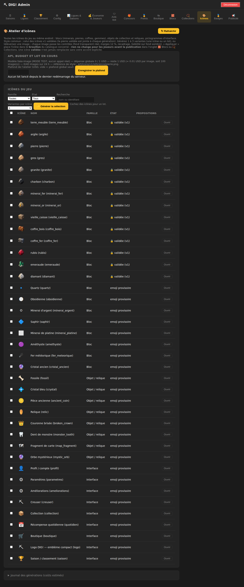
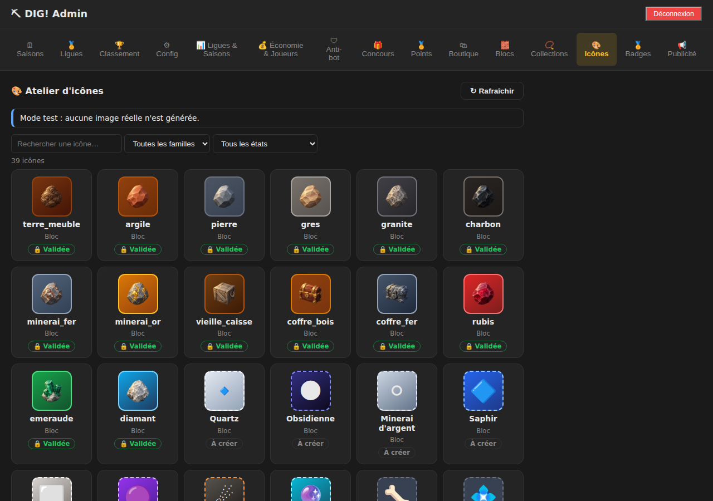
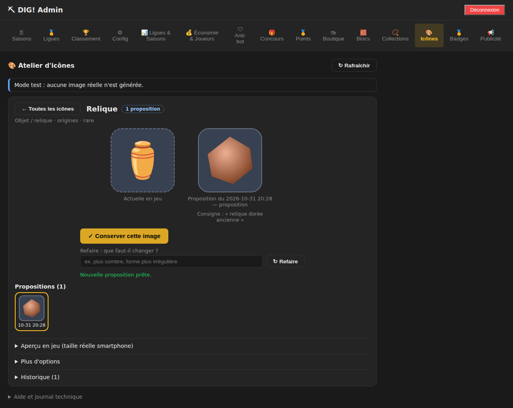
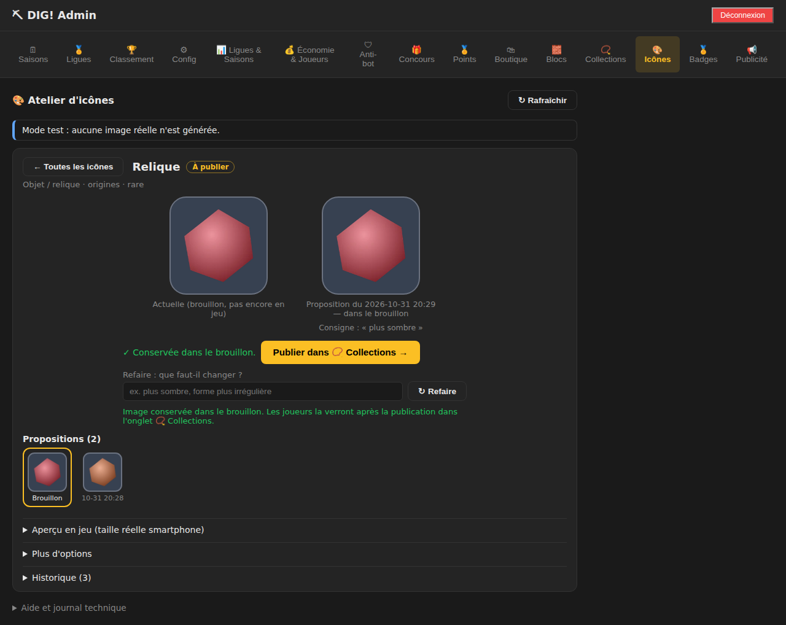
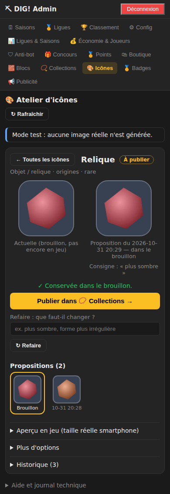
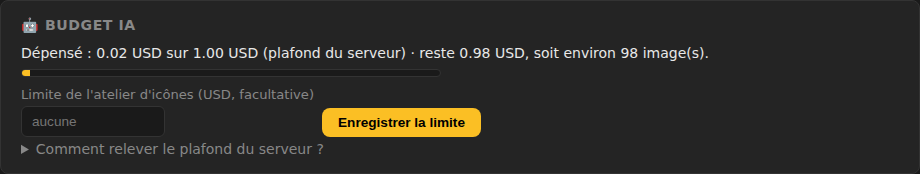

# Ticket #40 — Atelier d'icônes IA dans le panel : objets, reliques, blocs et cohérence graphique

Lien : https://github.com/ReC82/Dig/issues/40. Rapport du 30/10/2026, 19 h 20 (Bruxelles), rédigé par une session autonome digorch.

---

## Mise à jour du 31/10/2026, 21 h 45 (Bruxelles) — refonte UX demandée par le propriétaire

Demande : [commentaire du 31/10](https://github.com/ReC82/Dig/issues/40#issuecomment-6548563178). L'écran était trop chargé. Le propriétaire veut **une seule image à la fois** et un budget réglé ailleurs.

### État réel

**Déployé en production (SHA `e5b79fc`). En attente de recette.** Classement : **« Après lancement »** (outil d'administration, sans effet sur les joueurs).

### Ce qui change dans 🎨 Icônes

| Avant | Après |
|---|---|
|  |  |

- **Liste en cartes** : grandes miniatures (blocs sur leur fond de jeu), nom, famille et **un seul état lisible** : « À créer », « n propositions », « À publier », « En jeu » ou « 🔒 Validée ». Une recherche et deux filtres simples (famille, état). **Survol = aperçu agrandi**, **clic = fiche**.
- **Fiche d'une icône, une seule action principale par étape** :
  1. sans proposition : consigne facultative, puis **« ✨ Générer une image »** ;
  2. pendant la génération (≈ 1 min) : roue d'attente, boutons désactivés ;
  3. une proposition : **comparaison côte à côte** avec l'icône actuelle, **« ✓ Conserver cette image »** (brouillon seulement) et **« ↻ Refaire »** avec un champ « que faut-il changer ? » (« plus sombre »…). Refaire crée une **nouvelle** proposition, l'ancienne reste ;
  4. image conservée : « ✓ Conservée dans le brouillon » et **« Publier dans 🧱 Blocs / 📿 Collections → »**, qui ouvre l'onglet où la publication reste séparée et explicite.
- **Propositions précédentes** : bande de miniatures sous la fiche. Un clic l'affiche à côté de l'actuelle ; on peut la conserver à son tour (= revenir à elle).
- **Replié** : aperçu taille réelle smartphone, « Plus d'options » (téléverser, description de l'icône, verrouiller comme validée, écarter, revenir à l'emoji) et historique avec retour arrière. Jargon et journal des appels : dans « Aide et journal technique », en bas.
- **Supprimé** : génération par lots, choix 1–3 variantes, cases à cocher, estimation de lot, paragraphe d'explication, formulaire de plafond.
- **Budget IA** : nouvelle carte dans **⚙ Config**. Elle montre le montant dépensé et le plafond du serveur (barre), le reste et le nombre d'images possibles, et la **limite facultative de l'atelier** (réglable, ne peut que réduire). Une section repliée explique comment relever le plafond du serveur. Plafond atteint : l'atelier affiche **quoi modifier, et où**. Rien n'est jamais relevé automatiquement.

| Fiche : proposition | Fiche : image conservée | Smartphone 390 px | Budget IA (⚙ Config) |
|---|---|---|---|
|  |  |  |  |

(Captures prises sur un serveur de test en mode factice : les images violettes sont des formes de test, pas de vraies icônes.)

### Côté serveur

- `POST /api/admin/icons/targets/:key/generate` `{ instruction, basedOn }` : **une image**, en arrière-plan (le proxy coupe au bout de 60 s), suivie par `GET /api/admin/icons/job`. La consigne (≤ 300 caractères, nettoyée) est ajoutée à la fin du prompt, en gardant le style commun. `basedOn` (la proposition refaite) est enregistré dans la provenance et l'historique.
- **Route des lots `/api/admin/icons/jobs` retirée** : le serveur aussi impose une image par action.
- Garde-fous **inchangés** : plafond global du serveur, limite de l'atelier, quota de 40 images / 24 h, rate limit, une génération à la fois, verrou des icônes validées, « Conserver » = brouillon seulement.
- Nouveaux indicateurs d'état : `budgetReached` et `limitedBy` (quel plafond bloque) ; par image : `inDraft` et `published` ; par icône : `unpublished` (brouillon pas encore publié).
- **Aucune migration** : aucune table ni colonne ajoutée.

Fichiers : `public/admin/index.html`, `public/admin/admin.js`, `public/admin/admin.css`, `server/iconStudio.js`, `server/index.js`, `test/icon-studio.test.js`, `test/logo-identity.test.js`, `docs/ICONS.md`.

### SHA, tests et vérifications

- Branche `feature/40-atelier-icones` : `9f38f60`. **`develop` : `e5b79fc`** (fusion).
- `npm test` : **378/378** sur la branche, sur `develop` et sur la release `e5b79fc`. Tests réécrits : une image par action ; « Refaire » garde l'ancienne proposition et place la consigne dans le prompt ; `basedOn` inconnu refusé ; plafond de l'atelier non relevé ; message de plafond qui indique ⚙ Config → Budget IA ; route `/jobs` en 404 ; nouvelle route `…/generate`.
- Serveur de test (port 3101, base de test, mode factice, **aucun appel payant**), Chromium 1280×900 et 390×844 : liste, survol, fiche vide, génération en cours, proposition, Refaire « plus sombre », Conserver, comparaison, Budget IA. **Aucune erreur JavaScript, aucun débordement horizontal.**
- Copie de la base de production : empreintes des 6 tables joueurs identiques avant et après démarrage, aucune table ajoutée.
- Pas d'essai réel avec l'API d'images (pas de génération payante pendant les tests, à la demande du propriétaire).

### Déploiement

- `main` avancé en avance rapide `3abf761 → e5b79fc`. `scripts/deploy.sh` de la release a sauvegardé `~/backups/dig/dig-20261031-213634-pre-deploy-e5b79fc.sqlite` (vérifiée), redémarré, puis contrôlé la santé et la version.
- Avant déploiement : aucune génération IA en cours en production.
- Après : les 2 domaines répondent 200 avec `1.0.0+e5b79fc` ; `/api/admin/icons` et `…/generate` → 401 sans clé ; journal sans erreur ; `quick_check` ok ; empreintes joueurs **identiques** à la sauvegarde ; Chromium sans erreur (jeu et page admin, ordinateur et smartphone).
- Retour arrière : `git -C /home/ubuntu/Dig reset --keep 3abf761` puis `sudo systemctl restart dig` (pas de changement de dépendances ni de base).

### Test fonctionnel à faire par le propriétaire

1. Panel → **🎨 Icônes** : la liste montre des cartes. Survolez une carte (agrandissement), filtrez « À créer », cherchez « relique ».
2. Cliquez **Relique** : la fiche montre l'icône actuelle et « Aucune proposition ». Rien d'autre n'est à décider.
3. *(Facultatif, ≈ 0,25 USD)* « ✨ Générer une image » : la roue tourne ≈ 1 min, puis la proposition s'affiche à côté de l'actuelle.
4. « Refaire » avec « plus sombre » : une 2ᵉ miniature apparaît, la 1ʳᵉ reste. Cliquez l'une puis l'autre pour comparer.
5. « ✓ Conserver cette image » → « Publier dans 📿 Collections → » ouvre l'onglet ; **ne publiez que si l'image vous convient**.
6. **⚙ Config → Budget IA** : montant dépensé, plafond, limite de l'atelier (vide = aucune).

Résultat attendu : un seul bouton principal à chaque étape, aucun lot ni case à cocher, aucune icône remplacée sans votre clic.

### Lien avec #37

La création assistée d'un **nouveau bloc** (🧱 Blocs → ✨ Création assistée par IA) génère déjà une image par proposition, avec « régénérer l'image » : pas de lot, pas de contradiction. La fiche d'un bloc existant renvoie déjà vers cette fiche d'atelier (bouton « atelier d'icônes »). **Les deux partagent le même plafond du serveur**, visible dans ⚙ Config → Budget IA. Non fait (hors périmètre) : la consigne « Refaire » n'existe pas dans la création de bloc #37. Si vous voulez exactement le même geste aux deux endroits, c'est une petite suite possible.

### Choix techniques faits seul

- **« Refaire » envoie la consigne en texte**, avec la pierre validée comme référence de style. L'ancienne proposition n'est **pas** jointe comme seconde image. Raison : impossible de vérifier ce mode à 2 images sans génération payante, et une erreur aurait cassé « Refaire ». Amélioration possible : joindre l'image refaite pour des retouches plus fidèles.
- **Budget dans ⚙ Config** et non dans l'atelier. Le plafond du serveur reste dans `~/.config/dig/openai.env` : le panel ne peut pas le relever, c'est le garde-fou technique. Seule la limite de l'atelier (qui ne peut que réduire) se règle dans le panel.
- « Valider 🔒 », « Écarter », le téléversement et la description restent disponibles, mais **repliés** dans « Plus d'options ».

### Décisions demandées au propriétaire

Aucune décision n'est nécessaire pour cette refonte. Les questions du 30/10 restent ouvertes : relever le budget à 10 USD ; générer les 8 minerais de l'étape B.

### Reste à faire

- Recette du propriétaire (Après lancement).
- Facultatif : joindre l'image refaite à « Refaire » ; même consigne « Refaire » dans la création de bloc #37.

---

# Rapport initial du 30/10/2026

## 1. État réel

**Déployé en production (SHA `af523fb`). En attente de recette.**

Classement : **« Après lancement »**. Il s'agit de contenu graphique : le MVP fonctionne avec les emoji actuels.

## 2. Résultat et changements

Le panel admin a un nouvel onglet, **🎨 Icônes**. Il regroupe toutes les icônes du jeu :

- **Les 22 blocs du catalogue** : minerais, pierres, coffres et gemmes. Les 8 minerais de l'étape B #37 n'ont encore qu'un emoji.
- **Les objets de collection et les reliques.** Leurs icônes actuelles sont provisoires.
- **8 pictogrammes d'interface** :
  - profil 👤 ;
  - paramètres ⚙ ;
  - améliorations ⚙ ;
  - creuser, collection, quotidien, boutique et saison.
- **Profil, paramètres et améliorations ont désormais des briefs bien distincts.** Aujourd'hui, paramètres et améliorations utilisent le même ⚙. Les briefs imposent :
  - un **portrait de mineur** pour le profil ;
  - un **engrenage avec curseurs** pour les paramètres ;
  - une **pioche avec une flèche montante** pour les améliorations.

| Demande du ticket | Livré |
|---|---|
| Style graphique commun | La référence `pierre.png` validée est jointe à chaque génération. Les blocs gardent le prompt maître v1.0, inchangé. Les objets et l'interface utilisent de nouveaux gabarits v1.1 (même lumière, même angle, même finition, mêmes marges). Les icônes validées (pierre, charbon, minerai de fer) sont affichées à côté de chaque proposition pour comparer. |
| Génération unitaire ou par lot, variantes | 1 à 3 variantes. Un lot va jusqu'à 20 icônes et tourne en arrière-plan avec un suivi de progression. Une seule génération à la fois. |
| Upload manuel | PNG ou WebP avec fond transparent, 4 Mo maximum. Les JPEG et les images sans transparence sont refusés avec la raison. |
| Contrôles transparence / marges / cadrage | Ce sont les contrôles de `tools/icons/process.js` (#22) : vrai canal alpha, coins transparents, contour anti-crénelé, recadrage, marge de 12 %, contraste sur fond sombre. Une image refusée n'est pas stockée. |
| Aperçu à taille réelle mobile | Maquette 390 px : bloc en jeu, case de collection, fiche ou barre de navigation selon le type. Tailles 24, 36, 64 et 128 px. |
| Coût estimé et réel, budget plafond configurable | Estimation affichée et vérifiée **avant** chaque lot, puis coût réel par image et par icône, et journal des appels. Deux plafonds s'appliquent : le plafond global de la configuration (partagé avec #22 et #37) et un **plafond propre à l'atelier, réglable dans le panel**, qui ne peut pas dépasser le global. Quota : 40 images par 24 h. |
| Stockage, provenance, historique, rollback | Tout est stocké dans la base, donc sauvegardé avec elle, et en ajout seul. Pour chaque image : prompt, version du gabarit, modèle, référence, contrôles, coût et empreinte. L'historique trace génération, upload, choix, validation et application. Retour arrière possible vers l'emoji d'origine ou vers l'icône précédente, en plus de « Revenir à vN » dans le catalogue. |
| Ne pas modifier les icônes validées sans accord | Les icônes 🔒 validées (v1 #22, ou validées dans l'atelier) sont refusées sans confirmation explicite. Un remplacement confirmé est tracé. |
| Ne pas basculer le jeu sans recette | « Appliquer » écrit seulement dans le **brouillon** du catalogue Blocs ou Collections. Rien ne change pour les joueurs avant la publication. `defaultLibrary` reste `legacy`. |
| Sécurité | Les routes exigent la clé admin (401 sinon). La clé OpenAI reste côté serveur et les erreurs sont masquées. Les actions sont limitées à 60 par 15 min (`RATE_ICONS_MAX`). Le corps de 4 Mo de l'upload n'est lu qu'après vérification de la clé admin ; partout ailleurs, la limite reste 512 Ko. |

Fichiers :
- nouveaux : `server/iconStudio.js`, `test/icon-studio.test.js` (8 tests) ;
- modifiés : `server/index.js` (routes, `/media/icons/<sha>.webp`), `server/rateLimits.js`, `server/blockCatalog.js` et `server/collectionCatalog.js` (ils acceptent maintenant les images `/media/icons/…`), `public/js/iconLibrary.js`, `public/css/style.css` (image de catalogue dimensionnée comme les icônes v1 : 70 % du bloc), `public/admin/index.html`, `public/admin/admin.js`, `tools/icons/prompt-master.md` (gabarits v1.1), `docs/ICONS.md`.

## 3. SHA, branche, procédure de test

- Branche : `feature/40-atelier-icones`, commit `0f2f5c7`.
- **`develop` : `af523fb`**, qui est aussi le SHA déployé.
- `npm test` : **299/299** sur la branche, sur `develop` et sur la release.
- Essai complet sur un serveur de test (port 3101, base jetable, transport IA factice, traitement d'image réel) :
  1. lot de 2 objets × 2 variantes ;
  2. ouverture de la relique, aperçus et contrôles affichés, application au brouillon ;
  3. vérification du verrou sur la pierre ;
  4. génération pour « terre meuble », application, publication du catalogue de blocs ;
  5. dans le jeu, l'icône s'affiche (ordinateur 1280×900 et smartphone 390×844, aucune erreur JS).

## 4. Vérifications, limites, données joueurs

- Migration **additive** : 5 tables `icon_studio_*`, aucune colonne ni donnée existante touchée. Testée sur une copie de la base de production : les empreintes de `users`, `user_saves`, `season_rankings`, `seasons`, `leagues` et `player_click_tracking` sont identiques avant et après le démarrage, et `quick_check` est ok. La copie a été supprimée.
- **Aucune génération réelle (payante) n'a été faite** dans cette session : le budget est presque épuisé (voir décision 1). Tests et essais ont utilisé le transport factice. Le chemin réel est celui de #37, déjà validé par un essai réel le 30/10.
- Limites :
  - les pictogrammes d'interface sont stockés mais pas encore appliqués en jeu (#41) ;
  - les badges n'existent pas encore (#38) ;
  - un lot en cours est perdu si le serveur redémarre (les images déjà générées restent) ;
  - l'atelier et la création IA de blocs (#37) ont chacun leur verrou « une génération à la fois » : lancés en même temps, ils peuvent dépasser le plafond d'au plus une image ;
  - le panel est pensé pour l'ordinateur.

## 5. Déploiement

- SHA déployé : **`af523fb`**, par avance rapide de `main` `db94b8e` → `af523fb` puis `scripts/deploy.sh` de la release.
- Sauvegarde vérifiée : `~/backups/dig/dig-20261030-191746-pre-deploy-af523fb.sqlite`.
- Contrôles après déploiement :
  - dig.lodygames.com et dig.lodylands.com → 200, `/api/version` = `1.0.0+af523fb` ;
  - `/api/admin/icons` sans clé → 401 ;
  - journal sans erreur, `quick_check` ok ;
  - empreintes joueurs identiques à la sauvegarde ;
  - navigateur : le jeu se charge (emoji inchangés, aucune erreur) et l'onglet 🎨 Icônes est présent.
- Retour arrière : `git -C /home/ubuntu/Dig reset --keep db94b8e` puis redémarrage. Les tables ajoutées sont ignorées par l'ancien code. Une image `/media/icons/…` déjà **publiée** dans un catalogue ne serait plus servie après ce retour arrière : le jeu retomberait alors sur l'emoji. Dans ce cas, utiliser aussi « Revenir à vN » dans le catalogue.

### Test fonctionnel à faire par le propriétaire

1. https://dig.lodygames.com/admin/ → onglet **🎨 Icônes**. La ligne d'état indique le modèle, la dépense (≈ 2,02 / 3 USD) et le nombre d'images restantes.
2. Famille « Objets / reliques » → **Ouvrir** sur *Relique*. Vérifier le brief proposé, puis cliquer **✨ Générer** avec 1 variante (≈ 1 min, ≈ 0,08 à 0,25 USD).
3. Comparer la proposition aux icônes validées (pierre, charbon, fer) affichées en haut, et regarder la maquette smartphone et les tailles 24 à 128 px.
4. Si elle convient : **★ Retenir**, puis **Appliquer au brouillon**. Aller dans 📿 Collections : le brouillon contient l'image. **Publier** (facultatif), puis vérifier la fiche de l'objet dans le jeu.
5. Ouvrir *Pierre* : elle est marquée 🔒 validée. « Revenir à l'emoji » demande une confirmation explicite.
6. (Facultatif) **Téléverser** un PNG transparent : il est accepté et normalisé. Un JPEG est refusé.

Attendu : propositions dans le style des icônes validées, contrôles affichés, rien ne change en jeu avant la publication.

## 6. Choix techniques faits seul

- **Images stockées dans la base**, comme pour #37 : elles sont sauvegardées et restaurées avec la base, l'URL est persistante et rien n'est écrit dans le dossier du code. Seuls le WebP 256 et l'empreinte du maître 1024 sont conservés, pour éviter d'alourdir la base (≈ 1 Mo par maître).
- **Application par le brouillon** des catalogues existants, plutôt qu'un nouveau mécanisme de bascule : la recette, la publication et le retour arrière se font comme pour tout autre contenu.
- **Gabarit des blocs inchangé** (v1.0), pour que les icônes déjà validées restent reproductibles. Nouveaux gabarits v1.1 pour les objets et l'interface, avec la même lumière, le même angle et la même finition.
- **Plafond de l'atelier en plus du plafond global**, au lieu de modifier `~/.config/dig/openai.env` (fichier non modifiable par les sessions).
- **Briefs par défaut** construits à partir du nom anglais et de l'histoire de l'objet (aucun appel texte payant) ; ils restent modifiables.
- **Pictogrammes d'interface** : génération et stockage seulement. L'application en jeu touche à la navigation et relève de #41.

## 7. Décisions demandées au propriétaire

1. **Budget IA** : 2,02 / 3 USD sont consommés, ce qui laisse ≈ 3 à 4 images au tarif estimé (0,25 USD). C'est insuffisant pour remplacer les icônes des reliques et des 8 nouveaux minerais (≈ 16 icônes à 1 variante, ≈ 4 USD). Recommandation : relever `DIG_IMAGE_BUDGET_USD` à **10** dans `~/.config/dig/openai.env` (les sessions ne modifient pas ce fichier), puis régler au besoin un plafond d'atelier dans le panel.
2. **Validation visuelle** : après vos essais, marquez 🔒 Valider les icônes retenues. Une fois tout un lot validé, faut-il générer de la même façon les 8 minerais de l'étape B ? Recommandation : oui, en un lot de 1 variante, avec régénération ciblée sur demande (même règle que #22).

## 8. Éléments restant à réaliser

- Remplacer réellement les icônes des reliques, des objets et des 8 minerais. Cela dépend du budget (décision 1) et de votre validation visuelle.
- Appliquer les pictogrammes d'interface en jeu : #41.
- Icônes des badges : #38, quand il existera.
- Améliorations possibles : verrou commun avec la création IA de blocs (#37), reprise d'un lot après un redémarrage, panel adapté au smartphone.
