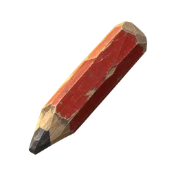
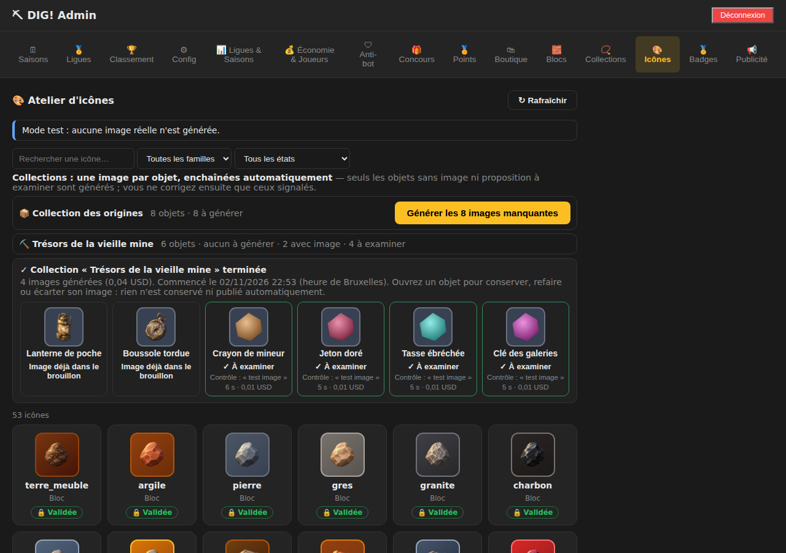
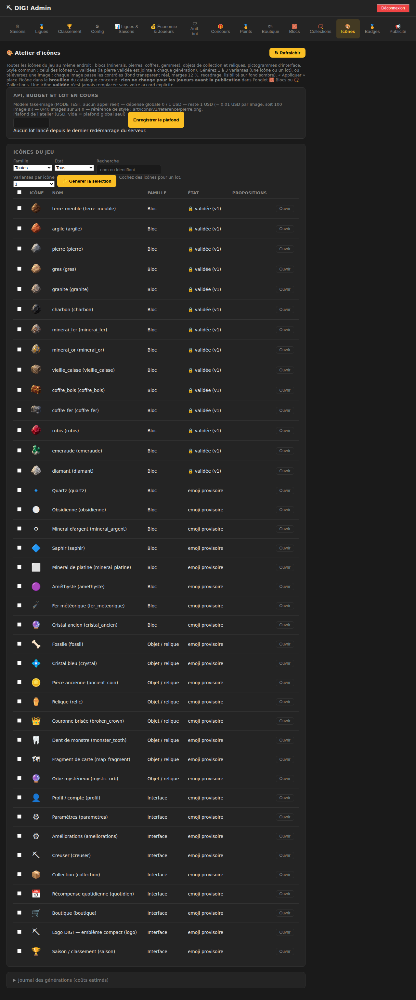
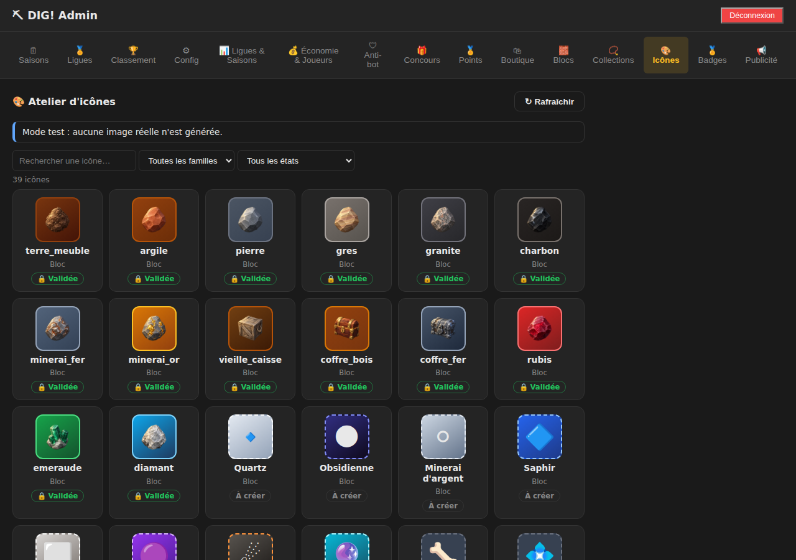
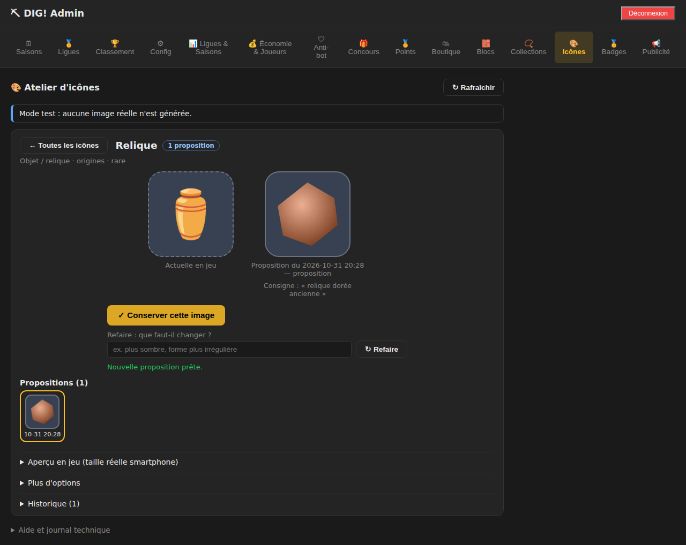
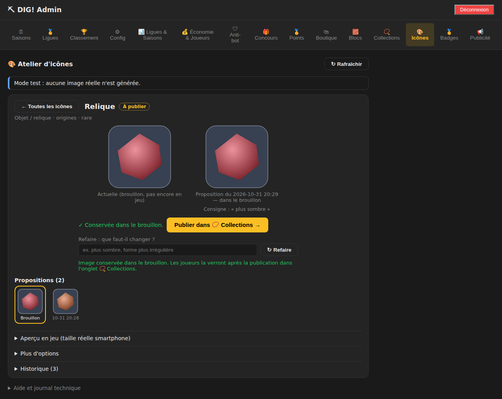
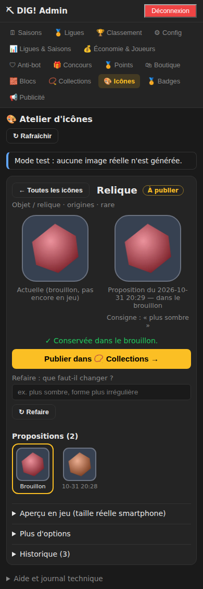
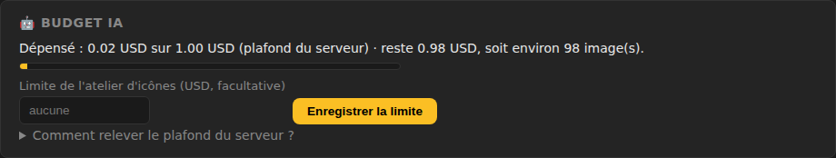

# Ticket #40 — Atelier d'icônes IA dans le panel : objets, reliques, blocs et cohérence graphique

Lien : https://github.com/ReC82/Dig/issues/40. Rapport du 30/10/2026, 19 h 20 (Bruxelles), rédigé par une session autonome digorch ; dernière mise à jour le 02/11/2026, 23 h 10.

---

# Mise à jour du 02/11/2026, 23 h 10 (Bruxelles) — recette réelle : jeton et crayon, collection entière en une action

**État réel : Déployé en production (SHA `8ec98ed`) — en attente de recette.** Classement : **Après lancement** (outil d'administration, sans effet sur les joueurs).

Demande traitée : [décision du propriétaire du 02/11, 21:22 UTC](https://github.com/ReC82/Dig/issues/40#issuecomment-6588787318). Elle demande des générations réelles ciblées pour le *Jeton doré* et le *Crayon de mineur*, la mesure du coût, de la réussite du sujet et du temps, puis une recette d'une collection entière : une image par objet, enchaînées automatiquement, correction manuelle des seuls échecs, plafond strictement respecté.

## 1. Mesures réelles (API payante, plafond respecté, aucun plafond relevé)

**Point de départ** (base de production, lecture seule) : le propriétaire a généré un nouveau *Jeton doré* à 22:28 (Bruxelles), avec le prompt v1.2. L'objet demandé était bien « Golden Token », mais l'image montre une **pépite dorée facettée**, pas un jeton :

Deux causes se cumulaient. La consigne par défaut (« A single golden token collectible ») recopiait l'histoire, qui parle d'un jeton « found wedged under a **rounded stone** ». Le gabarit et la référence pierre (« facet density », « darker lower faces ») tirent aussi vers une roche.

**Prompt v1.3** (objets et badges ; les blocs restent en v1.0) :
- le gabarit objet impose la forme réelle : « Keep the real-world silhouette, shape and proportions of this object…; the low-poly facets only describe its surface finish and must never turn it into a rock, crystal or nugget unless it is one » ;
- la consigne par défaut devient « A single <nom>, shown with its usual real-world shape ». L'histoire n'y apporte plus que l'usure et l'ambiance (« draw nothing else it mentions »).

**Essais réels** sur une copie de la base de production (le journal de dépense partagé est bien mis à jour), un seul essai par objet :

| Objet | Résultat | Contrôle automatique | Coût | Durée |
|---|---|---|---|---|
| Jeton doré | ✓ jeton plat à rebord, au 1er essai | « round coin-like token (flat disc) » ✓ | 0,0826 USD | 38 s |
| Crayon de mineur | ✓ crayon usé, au 1er essai | « short wooden pencil (hexagonal) with graphite tip » ✓ | 0,0830 USD | 38 s |

 

Ces deux images ne sont **pas** en production : elles ont été faites sur une copie, pour mesurer avant de vous proposer la recette. Elles servent de point de comparaison.

**Contrôle automatique du sujet** (nouveau). Après chaque image d'objet ou de badge, un modèle texte avec vision (gpt-5-mini, environ **0,0005 USD** et 3 s) dit ce qu'il voit et si l'objet est reconnu. La consigne a été réglée sur les 7 images réelles connues, en trois passages. La première version acceptait la pépite (« faceted golden token ») ; la deuxième refusait le bon crayon (pas assez « de mineur »). La version retenue est stricte sur la nature et la forme de l'objet, mais ignore les qualificatifs : **7 verdicts justes sur 7**.
- Refusés : pépite du jeton (« faceted gold nugget »), crayon du jeton (« short yellow pencil »), lanterne du crayon (« hanging metal lantern ») ;
- Acceptés : jeton v1.3, crayon v1.3, boussole, lanterne.

**Coût total de ces essais : 0,176 USD** (2 images à 0,083 USD et 19 contrôles à 0,0005 USD en moyenne). Coût réel constaté sur les 7 images de l'atelier : **0,082 USD par image** (de 0,0818 à 0,0830). C'est 3 fois moins que l'estimation prudente configurée sur le serveur (0,25 USD), qui sert au contrôle du plafond.

## 2. Collection entière en une action

Le bloc « Collections » apparaît en tête de l'onglet 🎨 Icônes, avec une ligne par collection : « 6 objets · 4 à générer · 2 avec image », puis le bouton **« Générer les 4 images manquantes »**.
- **Une image par objet**, l'une après l'autre, en arrière-plan sur le serveur. Vous pouvez quitter la page. Le bandeau indique « image k/N (« objet ») en cours ».
- **Objets ignorés, sans dépense** : ceux qui ont déjà une image dans le brouillon ; ceux qui ont une proposition v1.3 ou téléversée à examiner (une proposition écartée, douteuse ou refusée par le contrôle ne compte pas) ; ceux dont la consigne présente un **conflit de sujet**. Les anciennes propositions v1.1/v1.2 ne comptent pas : elles restent visibles dans la fiche.
- **Confirmation avant de lancer** : liste des objets, objets ignorés et raison, coût constaté et estimation prudente, budget restant, nombre d'images possibles avant le plafond, durée par image.
- **Plafond vérifié avant CHAQUE image**, contrôle du sujet compris. Une fois le plafond atteint, la génération s'arrête proprement (« ⏸ Non lancée » + message). Le plafond n'est jamais relevé automatiquement.
- **« ⏹ Arrêter après l'image en cours »** : aucun appel n'est interrompu ni perdu.
- **Résultat par objet** : « ✓ À examiner », « ⚠ À revoir » (le contrôle ne reconnaît pas l'objet), « ✗ Échec » (erreur API ou contrôle d'image), « ⚠ Conflit de sujet », « ⏸ Non lancée », ainsi que ce que voit le contrôle, la durée et le coût. Un clic ouvre la fiche, où l'on garde, refait ou écarte l'image. Rien n'est conservé, appliqué ni publié automatiquement.
- **Mêmes protections** que pour une fiche : panel obsolète (409 `stale_client`), cible différente (409 `target_mismatch`), conflit de sujet, une seule génération à la fois.
- Dans la fiche, chaque proposition affiche « ✓ Contrôle automatique : l'image montre « … » » ou « ⚠ … semble montrer « … », pas « Jeton doré ». Refaites-la ou écartez-la. » Le contrôle est aussi fait pour une génération unitaire. Le journal technique indique « (contrôle du sujet) », et son en-tête donne désormais l'heure de Bruxelles.

Fichiers : `server/iconStudio.js` (`seriesPlan`, `generateSeries`, `cancelJob`, `checkAsset`, contrôle du sujet, v1.3), `server/index.js` (GET `/api/admin/icons/series/:id`, POST `…/series/:id/generate`, POST `/api/admin/icons/job/cancel`), `tools/icons/prompt-master.md`, `public/admin/admin.js|css`, `public/admin/index.html`, `test/icon-studio.test.js`, `test/collection-ai.test.js`, `test/e2e/icon-studio-series.e2e.js` (nouveau), `test/e2e/icon-studio-subject.e2e.js`.

## 3. SHA, branche, tests

- Branche `feature/40-atelier-icones`, commit `8df5c1c` ; **`develop` = `8ec98ed`** ; **production = `8ec98ed`**.
- `npm test` : **415/415** sur la branche, sur `develop` et sur la release ; `npm run check` OK.
- Nouveau test unitaire « collection entière », IA simulée :
  - plan : 3 objets à générer, 1 conflit, propositions v1.3 non régénérées ;
  - panel obsolète et cible différente refusés ;
  - plafond permettant 2 images : 2 appels exactement, le 3e objet « non lancé », plafond inchangé, nouveau lancement refusé (402) ;
  - plafond relevé par l'admin : l'objet restant est généré et le contrôle le signale « à revoir » ;
  - arrêt demandé : l'image en cours se termine, la suivante est « arrêtée » ;
  - génération tracée avec son numéro de lot ; brouillon inchangé.
- Le test HTTP couvre 401, plan, `stale_client`, `target_mismatch`, et l'arrêt sans génération en cours (409).
- **Essai navigateur** (`test/e2e/icon-studio-series.e2e.js`, Chromium, IA simulée, 0 USD) sur une copie de la base de production (supprimée ensuite) : « Trésors de la vieille mine » affiche 4 objets à générer et 2 avec image ; la confirmation est complète ; le suivi indique k/4 et le bouton est désactivé pendant la génération ; une fiche ouverte puis refermée pendant la génération ne gêne rien ; à la fin, 4 « ✓ À examiner », lanterne et boussole intactes, 4 images + 4 contrôles, prompt v1.3 et contrôle visibles dans la fiche, brouillon inchangé ; aucun débordement en 390×844 ; aucune erreur JavaScript.

## 4. Données, limites

- Aucune donnée joueur touchée. Aucune migration : le contrôle du sujet est enregistré dans les tables existantes, en ajout seul (événement `subject_check`, appel `check:<cible>`).
- Le contrôle automatique est une aide. Réglé sur 7 images, il peut encore se tromper sur des cas limites ; « ⚠ À revoir » n'empêche pas de conserver l'image.
- Un redémarrage du serveur (déploiement) pendant une collection arrête la suite. Les images déjà faites sont conservées et un nouveau clic reprend les objets restants, sans les régénérer.
- Le contrôle du sujet passe par l'infrastructure texte de #37 : si une autre génération texte est en cours au même moment, il est marqué « indisponible » pour cette image.

## 5. Déploiement

- Release `8ec98ed` : 415/415. Copie de production démarrée en `NODE_ENV=production` (port 3122) : `/health` OK, `/api/version` = `1.0.0+8ec98ed`, empreintes des 6 tables joueurs identiques.
- Aucune génération IA en cours avant le déploiement (dernier POST de génération à 22:28, terminé).
- `main` avancé en avance rapide `0e1a561` → `8ec98ed` ; `scripts/deploy.sh` de la release : sauvegarde vérifiée `~/backups/dig/dig-20261102-230257-pre-deploy-8ec98ed.sqlite`, santé et version OK.
- Après : 2 domaines 200, `/api/version` = `1.0.0+8ec98ed`, `admin.js?v=1.0.0+8ec98ed`, journal sans erreur, `quick_check` ok, empreintes identiques à la sauvegarde.
- Retour arrière : `git -C /home/ubuntu/Dig reset --keep 0e1a561` + `sudo systemctl restart dig` (aucune migration à défaire).

## 6. Test fonctionnel à faire par le propriétaire

**Budget actuel** : plafond du serveur 2,71 / 3 USD (il reste 0,29 USD) ; limite de l'atelier 0,41 / 1 USD. Avec l'estimation prudente de 0,25 USD par image, **une seule image** peut être lancée (voir décisions 1 et 2). Sans réglage, la recette s'arrêtera proprement après la 1re image : c'est aussi un test du plafond.

1. Rechargez le panel (Ctrl+F5) : le bandeau « nouvelle version » s'affiche dans l'onglet resté ouvert.
2. (Recommandé) Relevez les plafonds (décisions 1 et 2).
3. Ouvrez 🎨 Icônes. Dans « Collections », « Trésors de la vieille mine » doit indiquer **6 objets · 4 à générer · 2 avec image** (crayon, jeton, tasse, clé ; lanterne et boussole sont ignorées).
4. Cliquez sur « Générer les 4 images manquantes », lisez la confirmation, puis OK. Comptez environ 40 s par image, soit environ 3 min ; vous pouvez quitter la page.
5. Résultat attendu : 4 cartes avec image, « ✓ À examiner » ou « ⚠ À revoir », pour environ 0,33 USD réels. Ouvrez chaque objet : « Conserver » si l'image est bonne, « Refaire » avec une précision sinon.
6. Notez le nombre d'objets qu'il a fallu corriger : c'est la mesure du temps d'intervention humaine.
7. Publiez la collection dans 📿 Collections quand tout est bon. Rien n'est publié avant.

## 7. Choix techniques faits seul

- Contrôle du sujet par un modèle texte avec vision, déjà configuré (gpt-5-mini, image 256 px en `detail: low`). Coût négligeable devant celui d'un « Refaire » humain, et il désigne les seuls objets à corriger.
- L'estimation prudente (0,25 USD) sert toujours au contrôle du plafond. Le coût constaté (moyenne des 20 derniers appels) n'est utilisé que pour l'information affichée. Abaisser l'estimation reste votre décision (question 2).
- Les propositions antérieures au prompt v1.3 ne comptent pas comme « à examiner » : la pépite actuelle du jeton sera donc régénérée par la collection.
- Pas de variantes multiples, ni de nouvel essai automatique en cas d'échec : un échec est signalé, et vous décidez de refaire ou non.

## 8. Décisions demandées au propriétaire

1. **Plafond du serveur** `DIG_IMAGE_BUDGET_USD` (fichier `~/.config/dig/openai.env`, pris en compte sans redémarrage) : il reste 0,29 USD. **Recommandé : 10 USD**, soit environ 115 images au coût constaté. Question ouverte depuis le 30/10.
2. **Estimation prudente** `DIG_IMAGE_EST_COST_USD` (même fichier) : 0,25 USD configurés, contre 0,082 USD constatés sur 7 images. **Recommandé : 0,12 USD.** Le plafond reste strict, et une collection n'est plus bloquée 3 fois trop tôt.
3. **Limite de l'atelier** (⚙ Config → Budget IA) : 0,41 / 1 USD. **Recommandé : 5 USD, ou vide** (plafond du serveur seul).
4. Ensuite : lancer la collection « Collection des origines » (8 objets) avec le même bouton ? Recommandé : oui, après la recette des « Trésors ».

## 9. Reste à faire

- Recette de la collection « Trésors » par le propriétaire (section 6), puis publication.
- Minerais de l'étape B (#22) : à faire un par un, via les fiches des blocs. La génération d'une collection ne concerne que les objets de collection. **Après lancement.**
- Suggestion, non implémentée : un bouton « Contrôler » pour les anciennes propositions. La fonction serveur `checkAsset` existe déjà.

---

# Mise à jour du 02/11/2026, 22 h 15 (Bruxelles) — 2e retour : « Jeton doré » devenu un crayon

**État réel : Déployé en production (SHA `00ae1ca`) — en attente de recette.** Classement : **Après lancement** (outil d'administration, sans effet sur les joueurs), mais traité en priorité comme test échoué du ticket.

Retour traité : [recette du 02/11, 20:38 UTC](https://github.com/ReC82/Dig/issues/40#issuecomment-6587886663). Le propriétaire voit une proposition « 20:36 » du Jeton doré qui représente un crayon, avec, sous l'image, la précision écrite pour le crayon. La seule proposition du crayon (« 19:48 ») montre toujours une lanterne.

## 1. Chronologie reconstituée (sans appel IA : base de production en lecture seule et journaux nginx)

**Les heures affichées par l'atelier étaient en UTC, sans que ce soit indiqué** : « 20:36 » = 21:36 à Bruxelles, « 19:48 » = 20:48 à Bruxelles. Un seul navigateur (même adresse, même navigateur) dans toute la séquence.

| Bruxelles | UTC | Événement (source) |
|---|---|---|
| 19:01:18 | 18:01:18 | L'onglet admin charge `admin.js?v=1.0.0+029e6cf` (nginx). **Ce code n'est plus jamais rechargé avant 21:36:40.** |
| 20:43–20:44 | 19:43–19:44 | Lanterne générée (prompt v1.1 « Worn brass miner's lantern » + précision « Ambiance ancienne mine… »), conservée à 20:47:09. **Image valide, préservée.** |
| 20:47:23 | 19:47:23 | Crayon : génération sans précision. Le prompt v1.1 était la consigne « lanterne » répétée (cause du 1er retour). Résultat à 20:48:05 : **une lanterne**. |
| 20:48–20:57 | 19:48–19:57 | Le propriétaire saisit, dans le champ « précision » de la fiche du crayon, la correction « L'image précédente représente une lanterne… Remplace entièrement la lanterne par un CRAYON DE MINEUR… ». **Il ne lance pas de génération pour le crayon** : aucun POST, aucun appel. À 20:57:05, il ouvre la fiche « Jeton doré » dans le même onglet. |
| 21:06:44 | 20:06:44 | Déploiement de `56a8cb4` (serveur). **L'onglet ouvert garde l'ancien client 029e6cf.** |
| 21:34:52 | 20:34:52 | Fiche « Jeton doré » rafraîchie dans le même onglet (pas de rechargement de la page). |
| 21:35:40 | 20:35:40 | **POST generate pour `item:jeton_dore`**, envoyé par l'ancien client. Ce client recopiait la valeur du champ affiché d'une fiche à l'autre ; c'est ce défaut que `56a8cb4` corrigeait, mais côté navigateur seulement. |
| 21:36:12–16 | 20:36:12–16 | Le serveur `56a8cb4` construit un prompt **v1.2** qui commence bien par `Object to depict: "Golden Token" (French name: "Jeton doré")`. Il est **suivi de la précision du crayon**, tronquée à 300 caractères. L'IA obéit à la précision : **un crayon**. Coût 0,0823 USD. |
| 21:36:40 | 20:36:40 | L'onglet est rechargé : le nouveau client `56a8cb4` est chargé à ce moment. |

Conclusions :
- `56a8cb4` fonctionnait côté serveur : l'identité était bien imposée. Il restait deux trous. (a) **Un onglet ouvert avant un déploiement continuait à tourner avec l'ancien code du panel.** (b) **Aucune vérification ne refusait une précision demandant un autre objet** : l'identité en tête du prompt ne suffit pas quand la précision dit « remplace par un crayon ».
- Le crayon n'a **jamais** été régénéré après le correctif : sa seule proposition reste la lanterne de 20:48 (prompt v1.1).
- Aucune image n'a été conservée ni publiée pour le crayon ou le jeton. La lanterne et la boussole restent intactes dans le brouillon. Rien n'a été modifié dans la base de production en dehors du déploiement.

## 2. Correction (`fd3ef3f`, intégrée dans `develop` en `00ae1ca`)

**Côté serveur, toute génération est refusée (409) avant tout appel et toute dépense**, dans trois cas :
1. **Panel obsolète.** Le panel envoie sa version (en-tête `X-Dig-Admin-Build`). Une version absente ou différente de la version en ligne est refusée avec « Rechargez la page (F5)… aucune image n'a été générée, rien n'a été dépensé ». Ce refus aurait bloqué la génération du jeton de 21:35.
2. **Fiche différente.** Le corps de la demande contient la clé de la fiche affichée ; elle doit correspondre à la cible de l'URL.
3. **Conflit de sujet.** La précision, ou la consigne d'illustration enregistrée, cite **un autre objet de la même famille** :
   - **Nom complet** (« Crayon de mineur », « Pocket Lantern ») : refus **définitif**. Il faut retirer la mention.
   - **Nom principal seul** (« crayon », « lantern », pluriel compris ; 5 lettres minimum ; mots trop courants exclus : fragment, pièce, relic…) : refus **confirmable**. Le bouton « Ce n'est pas un autre objet : générer quand même » relance la génération, et la confirmation est enregistrée dans la provenance.
   - Le nom de l'objet lui-même ne déclenche jamais de conflit (accents et casse ignorés). La consigne par défaut, tirée du nom et de l'histoire de l'objet, n'est pas contrôlée.

**Propositions douteuses.** Une proposition dont la provenance cite un autre objet est marquée « ⚠ Proposition douteuse : sa précision demandait « crayon de mineur » (objet « Crayon de mineur »), pas « Jeton doré » ». « Conserver » est alors refusé sans confirmation explicite, et une conservation confirmée est tracée (`doubtful`). Cela concerne en production la lanterne du crayon et le crayon du jeton. La lanterne et la boussole valides ne sont pas signalées.

**Panel admin :**
- La génération vise toujours la clé de la fiche **où l'on a cliqué**. Si l'on quitte la fiche pendant l'enregistrement de la consigne, rien n'est lancé.
- Les saisies sont rangées par clé d'objet. Une précision refusée reste sur **sa** fiche, pour être corrigée.
- Bandeau « Une nouvelle version du jeu est en ligne… Recharger » (vérification toutes les minutes, et immédiate en cas de refus pour version obsolète).
- **Heures affichées à l'heure de Bruxelles**, avec la mention « (heure de Bruxelles) » sur les propositions, la frise, l'historique et le journal des appels.
- Provenance lisible : « Objet demandé à l'IA : « Jeton doré » (Golden Token) · prompt v1.2 », ou « Prompt v1.1 : ancienne version, le nom de l'objet n'était pas transmis » ; « Précision de cette génération : … ». L'historique indique aussi l'objet demandé.
- Trois états distincts :
  - la consigne d'illustration : « ✓ Enregistrée pour cet objet », « ✎ Modifiée, pas encore enregistrée : elle sera enregistrée au clic sur Générer » ou « Consigne par défaut » ;
  - la précision : « pour cette seule génération, non enregistrée » ;
  - le rappel de l'objet du catalogue envoyé en premier.
- Aperçu immédiat d'un conflit pendant la saisie. Le serveur reste seul juge.

Fichiers : `server/iconStudio.js`, `server/index.js`, `public/admin/admin.js`, `public/admin/admin.css`, `test/icon-studio.test.js`, `test/e2e/icon-studio-subject.e2e.js` (nouveau).

## 3. SHA, branche, procédure de test

- Branche `feature/40-atelier-icones`, commit `fd3ef3f` ; **`develop` = `00ae1ca`** ; **production = `00ae1ca`**.
- `npm test` : **407/407** sur la branche, sur `develop` et sur la release `00ae1ca`. `npm run check` OK. Lors d'un premier passage, un échec isolé (`account-recovery` puis `security`) venait d'un serveur de test resté actif sur le port 3111 après une exécution partielle. Après son arrêt : 13/13, puis 407/407 complet.
- Nouveau test `recette du 02/11 (2)` :
  - la précision polluée envoyée au fossile est refusée (nom complet) : aucun appel, aucun coût, aucune image ;
  - un nom principal est refusé, puis accepté après confirmation tracée ;
  - le nom propre de l'objet passe ;
  - une consigne enregistrée qui cite un autre objet est signalée et bloque ;
  - une ancienne proposition douteuse est signalée et ne peut être conservée qu'avec confirmation.
- Test HTTP : sans en-tête ou avec l'ancienne version `029e6cf`, la réponse est 409 `stale_client` ; une fiche différente donne 409 `target_mismatch` ; un conflit donne 409 `subject_conflict` ; aucune génération n'est lancée.
- **Essai navigateur** (`test/e2e/icon-studio-subject.e2e.js`, Chromium headless, **transport IA simulé, 0 USD**) sur une **copie de la base de production** (supprimée ensuite), port 3101 :
  - Lanterne : saisie → Crayon : champ vide, ancienne lanterne signalée douteuse, heure « 20:48 (heure de Bruxelles) » ;
  - Jeton : champ vide, ancien crayon signalé, heure « 21:36 (heure de Bruxelles) » ; la précision du crayon collée ici est refusée (« Conflit de sujet… rien n'a été dépensé »), sans contournement possible, 0 appel ;
  - retour au Crayon : sa propre saisie est retrouvée ; refus « lanterne » confirmable → confirmation → image v1.2 `Object to depict: "Miner's Pencil"` ;
  - navigation vers le Jeton **pendant** l'appel (4 s simulées) : le Jeton n'hérite de rien, n'obtient aucune image, la fiche ne change pas ;
  - rechargement : tous les champs sont vides ;
  - Lanterne : génération acceptée (`Pocket Lantern`) ;
  - images de la lanterne et de la boussole inchangées ;
  - **redémarrage du serveur avec une autre version, onglet laissé ouvert** : génération refusée, bandeau « Recharger », 0 appel ;
  - aucune erreur JavaScript ; affichage vérifié en 1280×900 et 390×844.
  - Relancer : voir l'en-tête du fichier (`PW`, `BASE`, `ADMIN`, `RESTART_CMD`, serveur `DIG_AI_FAKE=1 DIG_AI_FAKE_DELAY_MS=4000`).

## 4. Vérifications, limites, données joueurs

- Aucune migration ni nouvelle table. Seules nouveautés : des champs JSON dans la provenance des **nouvelles** images (`acknowledgedConflicts`) et dans l'historique (`identity`, `doubtful`). Aucune donnée joueur touchée.
- Limites :
  - la détection repose sur les **noms du catalogue**. « Remplace par une épée », alors qu'aucun objet ne s'appelle épée, n'est pas détecté : l'identité placée en tête du prompt reste le seul garde-fou dans ce cas ;
  - un mot courant identique au nom principal d'un autre objet peut déclencher un refus confirmable ;
  - le contrôle de version ne concerne que la génération, pas les autres actions du panel (le bandeau invite à recharger).

## 5. Déploiement

- Release `00ae1ca` : `npm ci`, `npm test` 407/407.
- Copie de la base de production démarrée sur le port 3122 : `/health` OK, `/api/version` = `1.0.0+00ae1ca`, `/admin/` 200. Empreintes de `users`, `user_saves`, `season_rankings`, `seasons`, `leagues` et `player_click_tracking` identiques avant et après. Copie supprimée.
- Aucune génération IA en cours avant le déploiement : dernier appel à 21:46 Bruxelles, déploiement à 22:10.
- `main` avancé en avance rapide `56a8cb4 → 00ae1ca`. `scripts/deploy.sh` de la release : sauvegarde vérifiée `~/backups/dig/dig-20261102-221053-pre-deploy-00ae1ca.sqlite`, « OK : 00ae1ca en service ».
- Après le déploiement :
  - les 2 domaines répondent 200 avec `/api/version` = `1.0.0+00ae1ca` ;
  - `/admin/` sert `admin.js?v=1.0.0+00ae1ca` ;
  - journal sans erreur, `quick_check` ok ;
  - nombres de lignes (users, user_saves, season_rankings, icon_studio_assets) identiques à la sauvegarde.
- Retour arrière : `git -C /home/ubuntu/Dig reset --keep 56a8cb4` + `sudo systemctl restart dig` (lock inchangé).

## 6. Test fonctionnel à faire par le propriétaire (un objet à la fois, aucune génération collective)

1. **Recharger complètement le panel (Ctrl+F5)**, puis 🎨 Icônes. Si un onglet plus ancien reste ouvert ailleurs, il affiche le bandeau « Une nouvelle version… Recharger » et ne peut plus générer.
2. Ouvrir « Jeton doré ». Attendu :
   - « Proposition du 02/11/2026 21:36 (heure de Bruxelles) » ;
   - « Objet demandé à l'IA : « Jeton doré » (Golden Token) · prompt v1.2 » ;
   - l'avertissement « ⚠ Proposition douteuse : sa précision demandait « crayon de mineur »… ».
   Ne pas la conserver.
3. Dans « Refaire », coller l'ancienne précision du crayon → l'aperçu ⚠ apparaît pendant la saisie ; au clic, « Conflit de sujet… Aucune image n'a été générée et rien n'a été dépensé », sans bouton pour passer outre. Vider le champ, puis « ↻ Refaire » (≈ 0,08 USD) → attendu : **un jeton doré**.
4. Ouvrir « Crayon de mineur » : champ vide, ancienne lanterne marquée douteuse. « ↻ Refaire » sans précision (≈ 0,08 USD) → attendu : **un crayon** ; « Objet demandé : Crayon de mineur (Miner's Pencil) · prompt v1.2 ».
5. Revenir à « Lanterne de poche » et « Boussole tordue » : images inchangées, sans avertissement.

## 7. Choix techniques faits seul

- **Refuser plutôt qu'avertir** : aucune dépense tant qu'un conflit existe, comme demandé. Seul le nom principal seul est confirmable, pour ne pas bloquer définitivement un faux positif (par exemple un « jeton en forme de pièce »).
- **Contrôle de version sur la génération** (seule action payante) plutôt que sur tout le panel : cela évite de casser les autres onglets pendant un déploiement. Le bandeau couvre le reste.
- **Une précision refusée reste sur sa propre fiche** : elle n'est jamais reportée ailleurs, et l'admin peut la corriger.
- **Propositions douteuses signalées, jamais supprimées** (tables en ajout seul) ; leur conservation demande une confirmation tracée.

## 8. Décisions demandées au propriétaire

Aucune nouvelle décision. Questions ouvertes, inchangées :
1. Budget IA : relever `DIG_IMAGE_BUDGET_USD` dans `~/.config/dig/openai.env` (recommandé : 10) ?
2. Générer les 8 minerais de l'étape B, une image chacun via la fiche, avec « Refaire » ciblé ensuite ? (recommandé : oui, après la recette des points 2 à 4 ci-dessus)

## 9. Reste à faire

- Recette du propriétaire (points 1 à 5).
- La génération collective reste **non autorisée** par le propriétaire jusqu'à stabilisation. Rien n'a été fait dans ce sens.
- Suggestion (après lancement) : appliquer le même contrôle de version aux autres actions d'enregistrement du panel.

---

# Mise à jour du 02/11/2026, 21 h 10 (Bruxelles) — BUG : l'atelier générait l'image d'un autre objet

**État réel : Déployé en production (SHA `56a8cb4`) — en attente de recette.**

Retour traité : [bug du 02/11, 19:54 UTC](https://github.com/ReC82/Dig/issues/40#issuecomment-6586980341). Ouvrir « Lanterne de poche », générer : on obtient une lanterne, c'est correct. Ouvrir ensuite « Crayon de mineur » et générer : on obtient **une nouvelle lanterne**.

## Cause racine (établie sans aucun appel IA : base de production en lecture seule, journaux)

1. La proposition IA n° 1 de la collection « Trésors de la vieille mine » contenait **la même consigne d'illustration pour ses 6 objets** : « Worn brass miner's lantern — A small tarnished brass lantern with a frosted glass globe… ». C'est le défaut de l'IA de texte déjà signalé dans #39.
2. Le 02/11 à 14:33:58 UTC, « Ajouter au brouillon » a copié cette consigne dans l'atelier, pour chacun des 6 objets (6 lignes `icon_studio_briefs` portant le même horodatage). Le garde-fou #39 (`2396958`), qui refuse de reprendre une consigne répétée, a été déployé **après** cette copie, à 14:54 UTC. Il ne protégeait que les importations suivantes et n'a pas corrigé les consignes déjà enregistrées.
3. L'atelier signalait bien la consigne identique, mais il **l'utilisait quand même** pour générer. La proposition du crayon (19:48:05 UTC) a donc été demandée avec le prompt « Worn brass miner's lantern… » : ce prompt est enregistré dans la provenance de l'image, ce qui le prouve. Le prompt ne contenait nulle part le nom de l'objet.

Ce qui a été vérifié et **n'est pas** en cause :
- **Aucun prompt d'un autre objet réutilisé.** Le prompt est reconstruit à chaque génération à partir de la fiche de l'objet demandé (`_briefFor(t)` indexé par la clé de l'objet) et la tâche est rattachée à cette clé.
- **Aucune image précédente injectée.** La seule image jointe à l'appel est la référence de style `art/icons/v1/reference/pierre.png`, toujours la même. `basedOn` (« Refaire ») ne sert qu'à la provenance et n'est jamais envoyé à l'API.
- **Une fuite côté client a été trouvée et corrigée en passant.** Le champ « Précision supplémentaire » d'une fiche pouvait être repris sur la fiche suivante (lecture du champ encore affiché avant le nouveau rendu). Ce n'est pas la cause ici : la précision de la lanterne avait été vidée à l'envoi, et le prompt du crayon n'en contient aucune.

## Correction (`b4f842e`, intégrée dans `develop` en `56a8cb4`)

- **Prompt en trois parties distinctes** pour les objets et les badges :
  - l'**identité**, tirée du catalogue et jamais de la consigne : `Object to depict: "Miner's Pencil" (French name: "Crayon de mineur"); the icon shows this exact object and nothing else.` ;
  - la **description visuelle**, c'est-à-dire la consigne de l'objet ;
  - les **contraintes communes de style** : le gabarit, plus la référence pierre, qui ne donne que le style.

  Version de prompt `v1.2`. L'identité est enregistrée dans la provenance de chaque image.
- **Consigne répétée neutralisée.** Quand plusieurs objets distincts portent exactement la même consigne (sujet et détails identiques, casse ignorée), cette consigne **n'est plus utilisée**. Elle reste en base, rien n'est supprimé. La fiche affiche un avertissement et repart du nom et de l'histoire de l'objet. Exception : un objet pour lequel l'admin a réenregistré cette consigne plus tard, seul, la garde ; les autres restent neutralisés.
- **Refus à l'enregistrement.** Une consigne déjà retenue pour un autre objet de la même famille est refusée (409), avec le nom de l'objet concerné.
- **Admin.** L'avertissement est explicite (« elle n'est pas utilisée »). Une saisie en cours n'est jamais reprise d'une fiche à l'autre.

Sur une copie de la base de production (supprimée ensuite), les fiches de la collection donnent désormais :
- « Lanterne de poche » → `Object to depict: "Pocket Lantern"… A single pocket lantern collectible…` ;
- « Crayon de mineur » → `Object to depict: "Miner's Pencil"… A single miner's pencil collectible…` (plus aucune lanterne) ;
- jeton, tasse et clé : chacun son nom ;
- « Boussole tordue » : inchangée (sa consigne avait déjà été refaite seule).

## Données

- Aucune table et aucune colonne ajoutées. Aucune ligne supprimée ni réécrite.
- Les 6 consignes enregistrées sont conservées telles quelles (seulement ignorées).
- Les propositions existantes sont conservées, y compris la « lanterne » générée pour le crayon : vous pouvez l'écarter dans sa fiche. L'image de la lanterne et celle de la boussole, conservées dans le brouillon, sont inchangées.
- Données des joueurs non touchées.

## Tests

- Nouveau test `test/icon-studio.test.js` (« recette du 02/11 ») : 3 objets portent la même consigne « lanterne », écrite d'un coup comme en production. Ils sont générés à la suite, avec une précision sur le premier. Le test vérifie que :
  - chaque prompt commence par l'identité de son propre objet ;
  - aucun prompt ne contient « lantern » ;
  - la précision du premier objet ne passe pas au suivant ;
  - les 3 prompts sont distincts ;
  - chaque image n'a que la référence pierre, `basedOn` vide et la version `v1.2` ;
  - les propositions existantes sont conservées ;
  - la reprise manuelle de la consigne pour un seul objet fonctionne ;
  - une consigne dupliquée (casse et espaces différents) est refusée avec une 409.
- Test `test/collection-ai.test.js` adapté au cas de la production : les consignes dupliquées sont ignorées et n'entrent pas dans le prompt.
- `npm test` complet : **406/406** dans la branche, puis sur la release `56a8cb4`. `npm run check` OK.
- Aucun appel IA payant : transport factice uniquement.

## Déploiement

- `56a8cb4` déployé le 02/11 à 21:06 (Bruxelles). Sauvegarde vérifiée : `~/backups/dig/dig-20261102-210644-pre-deploy-56a8cb4.sqlite`.
- Avant le déploiement :
  - aucune génération IA en cours (dernier appel à 20:47) ;
  - copie de la base démarrée en production sur le port 3122 : santé et version OK, empreintes des 6 tables joueurs identiques.
- Après le déploiement :
  - les 2 domaines répondent 200 avec `/api/version` = `1.0.0+56a8cb4` ;
  - journal sans erreur, `quick_check` ok, nombres de lignes identiques à la sauvegarde ;
  - le nouveau `admin.js` est servi.
- Retour arrière : `git -C /home/ubuntu/Dig reset --keep 029e6cf` puis `sudo systemctl restart dig`. Aucune migration.

## Test fonctionnel à faire par le propriétaire (aucune génération par lot)

1. Panel → 🎨 Icônes → « Crayon de mineur ». Résultat attendu : un avertissement indique que la consigne « Worn brass miner's lantern » enregistrée est la même que pour 4 autres objets et qu'**elle n'est pas utilisée**. La consigne affichée parle d'un *miner's pencil*. « Voir le prompt » (Plus d'options) commence par `Object to depict: "Miner's Pencil"`.
2. Facultatif : complétez la consigne (par exemple « A short flat carpenter's pencil, chewed wooden end, graphite tip »), puis cliquez sur ✨ Générer une image. Résultat attendu : un **crayon**. Une seule image, environ 0,08 USD.
3. Ouvrez « Jeton doré » : la consigne parle d'un *golden token*, pas d'une lanterne.
4. Essayez d'enregistrer sur un autre objet exactement la consigne d'un objet déjà corrigé : un refus nomme l'objet qui l'utilise.
5. Dans la fiche du crayon, écartez l'ancienne proposition « lanterne » si vous le souhaitez.

**Classement : Bloquant MVP public** (l'illustration des collections en dépend). Les générations par lot restent à proscrire jusqu'à votre recette.

## Choix techniques faits seul

- **Neutraliser plutôt que supprimer** les consignes dupliquées. C'est non destructif, et les consignes restent visibles dans l'avertissement.
- **Désigner la consigne retenue** par le dernier enregistrement fait seul, ce qui permet de reprendre la consigne « lanterne » pour la seule lanterne. Des enregistrements à la même seconde, comme ceux d'une importation, sont tous neutralisés.
- **Protection étendue aux badges** (même famille d'objets uniques). Les blocs et les pictogrammes ne sont pas concernés.
- **Aucun contrôle lexical** du type « la consigne contient-elle le nom ? ». Il est trop fragile entre les langues (« miner's » figurait dans la consigne de la lanterne comme dans le nom du crayon). L'identité explicite en tête de prompt joue ce rôle.

## Décisions demandées

Aucune nouvelle décision. Les questions ouvertes (budget IA, 8 minerais de l'étape B) sont inchangées.

## Restant

- La recette ci-dessus.
- Après lancement : l'IA de collection répète encore parfois la même consigne. Elle est déjà signalée et refusée, mais l'avertissement pourrait devenir bloquant dès la relecture (#39).

---

# Mise à jour du 02/11/2026, 16 h 15 (Bruxelles) — consigne préremplie depuis une collection : déjà livrée

**État réel : Déjà livré — déployé en production (SHA `029e6cf`) — en attente de recette.**

Retour traité : [recette du 02/11, 14:37 UTC](https://github.com/ReC82/Dig/issues/40#issuecomment-6579870726). Navigation Collections → Atelier **validée**. Défaut : le champ « Consigne (facultative) » est vide et propose un exemple de minerai, au lieu de la consigne préparée par l'IA pour l'objet.

Le même retour a été publié sur #39 (commentaire 6579869348). La session #39 l'a corrigé dans `2396958`, intégré dans `develop` (`029e6cf`) et déployé à 15:54 (Bruxelles). Voir le [rapport #39](https://github.com/ReC82/Dig/blob/develop/docs/claude-reports/2026-10-30_ticket-39-collections-saisonnieres.md) et [son commentaire](https://github.com/ReC82/Dig/issues/39#issuecomment-6580436380). Cette session n'a rien recodé (pas de travail en double).

## Ce qui répond à chaque point de la demande (vérifié en lecture dans la production)

| Demande | Livré dans `029e6cf` |
|---|---|
| Préremplir la consigne de l'objet, modifiable | L'étape principale affiche « Consigne d'illustration de cet objet » (Sujet, Forme et matière, Couleurs), préremplie et modifiable. |
| Consigne retrouvée sans génération payante | La consigne existait bien. Elle était enregistrée à l'ajout au brouillon, mais repliée dans « Plus d'options ». Elle est lue telle quelle, sans appel IA. |
| Conserver le texte saisi au retour de la fiche | Les saisies sont conservées entre les fiches. Un bouton « ← Retour à la fiche de l'objet » est ajouté. |
| Pas d'exemple de minerai pour un objet | Chaque type a désormais son propre exemple : celui du minerai est réservé aux blocs. Pour un objet : « ex. vue de trois quarts, reflets plus chauds ». |
| Jamais d'image automatique | La consigne n'est enregistrée qu'au clic sur « ✨ Générer une image », qui produit une image par clic. |

Constat utile (session #39, lecture seule) : en production, l'IA des collections a renvoyé **la même consigne (une lanterne) pour les 6 objets** de « Trésors de la vieille mine ». L'atelier l'indique par l'avertissement « identique pour 6 objets ». Le bouton « Repartir du nom et de l'histoire » propose alors une consigne tirée du nom et de l'histoire de l'objet. Aucune consigne enregistrée n'a été réécrite automatiquement.

## Vérifications de cette session

- `https://dig.lodygames.com` et `https://dig.lodylands.com` répondent 200, avec `/api/version` = `1.0.0+029e6cf`.
- `public/admin/admin.js` en production contient la consigne d'objet, la mémoire des saisies (`_icTyped`) et le repli « Repartir du nom et de l'histoire ». L'exemple « minerai » n'est plus utilisé que pour les blocs.
- La branche `feature/40-atelier-icones` est déjà contenue dans `origin/develop`.
- Aucun nouveau test lancé et aucun déploiement, puisque le code est inchangé. Les tests complets et le contrôle de la base ont été faits par la session #39 sur `029e6cf`.
- Impact sur les données des joueurs : aucun.

## Test fonctionnel à faire par le propriétaire (identique à #39, étapes 3 à 5)

1. Admin → 📚 Collections → « Lanterne de poche » → « 🎨 Illustrer dans l'atelier ». Résultat attendu : la consigne (lanterne) est préremplie et modifiable, et aucun minerai n'est cité en exemple.
2. Ouvrir « Boussole tordue » dans l'atelier. Résultat attendu : l'avertissement « identique pour 6 objets » s'affiche. « Repartir du nom et de l'histoire » propose une consigne de boussole.
3. Taper une précision, cliquer « ← Retour à la fiche de l'objet », puis revenir dans l'atelier. Résultat attendu : la précision est toujours là.
4. Ne cliquer sur « Générer » que pour obtenir réellement une image (payant, une image par clic).

Classement : **Après lancement** (outil d'administration, sans effet sur le jeu des joueurs).

## Décisions demandées au propriétaire

Les questions encore ouvertes sur ce ticket sont inchangées :
1. Budget IA : relever `DIG_IMAGE_BUDGET_USD` à 10 ? Recommandé : oui (réglage expliqué dans ⚙ Config → Budget IA).
2. Générer les 8 minerais de l'étape B, une image chacun via la fiche, puis un « Refaire » ciblé ? Recommandé : oui.

## Reste à faire

- Recette du point ci-dessus, puis génération des images des objets (sur action explicite).

---

## Mise à jour du 31/10/2026, 21 h 45 (Bruxelles) — refonte UX demandée par le propriétaire

Demande : [commentaire du 31/10](https://github.com/ReC82/Dig/issues/40#issuecomment-6548563178). L'écran était trop chargé. Le propriétaire veut **une seule image à la fois** et un budget réglé ailleurs.

### État réel

**Déployé en production (SHA `e5b79fc`). En attente de recette.** Classement : **« Après lancement »** (outil d'administration, sans effet sur les joueurs).

### Ce qui change dans 🎨 Icônes

| Avant | Après |
|---|---|
|  |  |

- **Liste en cartes** : grandes miniatures (blocs sur leur fond de jeu), nom, famille et **un seul état lisible** : « À créer », « n propositions », « À publier », « En jeu » ou « 🔒 Validée ». Une recherche et deux filtres simples (famille, état). **Survol = aperçu agrandi**, **clic = fiche**.
- **Fiche d'une icône, une seule action principale par étape** :
  1. sans proposition : consigne facultative, puis **« ✨ Générer une image »** ;
  2. pendant la génération (≈ 1 min) : roue d'attente, boutons désactivés ;
  3. une proposition : **comparaison côte à côte** avec l'icône actuelle, **« ✓ Conserver cette image »** (brouillon seulement) et **« ↻ Refaire »** avec un champ « que faut-il changer ? » (« plus sombre »…). Refaire crée une **nouvelle** proposition, l'ancienne reste ;
  4. image conservée : « ✓ Conservée dans le brouillon » et **« Publier dans 🧱 Blocs / 📿 Collections → »**, qui ouvre l'onglet où la publication reste séparée et explicite.
- **Propositions précédentes** : bande de miniatures sous la fiche. Un clic l'affiche à côté de l'actuelle ; on peut la conserver à son tour (= revenir à elle).
- **Replié** : aperçu taille réelle smartphone, « Plus d'options » (téléverser, description de l'icône, verrouiller comme validée, écarter, revenir à l'emoji) et historique avec retour arrière. Jargon et journal des appels : dans « Aide et journal technique », en bas.
- **Supprimé** : génération par lots, choix 1–3 variantes, cases à cocher, estimation de lot, paragraphe d'explication, formulaire de plafond.
- **Budget IA** : nouvelle carte dans **⚙ Config**. Elle montre le montant dépensé et le plafond du serveur (barre), le reste et le nombre d'images possibles, et la **limite facultative de l'atelier** (réglable, ne peut que réduire). Une section repliée explique comment relever le plafond du serveur. Plafond atteint : l'atelier affiche **quoi modifier, et où**. Rien n'est jamais relevé automatiquement.

| Fiche : proposition | Fiche : image conservée | Smartphone 390 px | Budget IA (⚙ Config) |
|---|---|---|---|
|  |  |  |  |

(Captures prises sur un serveur de test en mode factice : les images violettes sont des formes de test, pas de vraies icônes.)

### Côté serveur

- `POST /api/admin/icons/targets/:key/generate` `{ instruction, basedOn }` : **une image**, en arrière-plan (le proxy coupe au bout de 60 s), suivie par `GET /api/admin/icons/job`. La consigne (≤ 300 caractères, nettoyée) est ajoutée à la fin du prompt, en gardant le style commun. `basedOn` (la proposition refaite) est enregistré dans la provenance et l'historique.
- **Route des lots `/api/admin/icons/jobs` retirée** : le serveur aussi impose une image par action.
- Garde-fous **inchangés** : plafond global du serveur, limite de l'atelier, quota de 40 images / 24 h, rate limit, une génération à la fois, verrou des icônes validées, « Conserver » = brouillon seulement.
- Nouveaux indicateurs d'état : `budgetReached` et `limitedBy` (quel plafond bloque) ; par image : `inDraft` et `published` ; par icône : `unpublished` (brouillon pas encore publié).
- **Aucune migration** : aucune table ni colonne ajoutée.

Fichiers : `public/admin/index.html`, `public/admin/admin.js`, `public/admin/admin.css`, `server/iconStudio.js`, `server/index.js`, `test/icon-studio.test.js`, `test/logo-identity.test.js`, `docs/ICONS.md`.

### SHA, tests et vérifications

- Branche `feature/40-atelier-icones` : `9f38f60`. **`develop` : `e5b79fc`** (fusion).
- `npm test` : **378/378** sur la branche, sur `develop` et sur la release `e5b79fc`. Tests réécrits : une image par action ; « Refaire » garde l'ancienne proposition et place la consigne dans le prompt ; `basedOn` inconnu refusé ; plafond de l'atelier non relevé ; message de plafond qui indique ⚙ Config → Budget IA ; route `/jobs` en 404 ; nouvelle route `…/generate`.
- Serveur de test (port 3101, base de test, mode factice, **aucun appel payant**), Chromium 1280×900 et 390×844 : liste, survol, fiche vide, génération en cours, proposition, Refaire « plus sombre », Conserver, comparaison, Budget IA. **Aucune erreur JavaScript, aucun débordement horizontal.**
- Copie de la base de production : empreintes des 6 tables joueurs identiques avant et après démarrage, aucune table ajoutée.
- Pas d'essai réel avec l'API d'images (pas de génération payante pendant les tests, à la demande du propriétaire).

### Déploiement

- `main` avancé en avance rapide `3abf761 → e5b79fc`. `scripts/deploy.sh` de la release a sauvegardé `~/backups/dig/dig-20261031-213634-pre-deploy-e5b79fc.sqlite` (vérifiée), redémarré, puis contrôlé la santé et la version.
- Avant déploiement : aucune génération IA en cours en production.
- Après : les 2 domaines répondent 200 avec `1.0.0+e5b79fc` ; `/api/admin/icons` et `…/generate` → 401 sans clé ; journal sans erreur ; `quick_check` ok ; empreintes joueurs **identiques** à la sauvegarde ; Chromium sans erreur (jeu et page admin, ordinateur et smartphone).
- Retour arrière : `git -C /home/ubuntu/Dig reset --keep 3abf761` puis `sudo systemctl restart dig` (pas de changement de dépendances ni de base).

### Test fonctionnel à faire par le propriétaire

1. Panel → **🎨 Icônes** : la liste montre des cartes. Survolez une carte (agrandissement), filtrez « À créer », cherchez « relique ».
2. Cliquez **Relique** : la fiche montre l'icône actuelle et « Aucune proposition ». Rien d'autre n'est à décider.
3. *(Facultatif, ≈ 0,25 USD)* « ✨ Générer une image » : la roue tourne ≈ 1 min, puis la proposition s'affiche à côté de l'actuelle.
4. « Refaire » avec « plus sombre » : une 2ᵉ miniature apparaît, la 1ʳᵉ reste. Cliquez l'une puis l'autre pour comparer.
5. « ✓ Conserver cette image » → « Publier dans 📿 Collections → » ouvre l'onglet ; **ne publiez que si l'image vous convient**.
6. **⚙ Config → Budget IA** : montant dépensé, plafond, limite de l'atelier (vide = aucune).

Résultat attendu : un seul bouton principal à chaque étape, aucun lot ni case à cocher, aucune icône remplacée sans votre clic.

### Lien avec #37

La création assistée d'un **nouveau bloc** (🧱 Blocs → ✨ Création assistée par IA) génère déjà une image par proposition, avec « régénérer l'image » : pas de lot, pas de contradiction. La fiche d'un bloc existant renvoie déjà vers cette fiche d'atelier (bouton « atelier d'icônes »). **Les deux partagent le même plafond du serveur**, visible dans ⚙ Config → Budget IA. Non fait (hors périmètre) : la consigne « Refaire » n'existe pas dans la création de bloc #37. Si vous voulez exactement le même geste aux deux endroits, c'est une petite suite possible.

### Choix techniques faits seul

- **« Refaire » envoie la consigne en texte**, avec la pierre validée comme référence de style. L'ancienne proposition n'est **pas** jointe comme seconde image. Raison : impossible de vérifier ce mode à 2 images sans génération payante, et une erreur aurait cassé « Refaire ». Amélioration possible : joindre l'image refaite pour des retouches plus fidèles.
- **Budget dans ⚙ Config** et non dans l'atelier. Le plafond du serveur reste dans `~/.config/dig/openai.env` : le panel ne peut pas le relever, c'est le garde-fou technique. Seule la limite de l'atelier (qui ne peut que réduire) se règle dans le panel.
- « Valider 🔒 », « Écarter », le téléversement et la description restent disponibles, mais **repliés** dans « Plus d'options ».

### Décisions demandées au propriétaire

Aucune décision n'est nécessaire pour cette refonte. Les questions du 30/10 restent ouvertes : relever le budget à 10 USD ; générer les 8 minerais de l'étape B.

### Reste à faire

- Recette du propriétaire (Après lancement).
- Facultatif : joindre l'image refaite à « Refaire » ; même consigne « Refaire » dans la création de bloc #37.

---

# Rapport initial du 30/10/2026

## 1. État réel

**Déployé en production (SHA `af523fb`). En attente de recette.**

Classement : **« Après lancement »**. Il s'agit de contenu graphique : le MVP fonctionne avec les emoji actuels.

## 2. Résultat et changements

Le panel admin a un nouvel onglet, **🎨 Icônes**. Il regroupe toutes les icônes du jeu :

- **Les 22 blocs du catalogue** : minerais, pierres, coffres et gemmes. Les 8 minerais de l'étape B #37 n'ont encore qu'un emoji.
- **Les objets de collection et les reliques.** Leurs icônes actuelles sont provisoires.
- **8 pictogrammes d'interface** :
  - profil 👤 ;
  - paramètres ⚙ ;
  - améliorations ⚙ ;
  - creuser, collection, quotidien, boutique et saison.
- **Profil, paramètres et améliorations ont désormais des briefs bien distincts.** Aujourd'hui, paramètres et améliorations utilisent le même ⚙. Les briefs imposent :
  - un **portrait de mineur** pour le profil ;
  - un **engrenage avec curseurs** pour les paramètres ;
  - une **pioche avec une flèche montante** pour les améliorations.

| Demande du ticket | Livré |
|---|---|
| Style graphique commun | La référence `pierre.png` validée est jointe à chaque génération. Les blocs gardent le prompt maître v1.0, inchangé. Les objets et l'interface utilisent de nouveaux gabarits v1.1 (même lumière, même angle, même finition, mêmes marges). Les icônes validées (pierre, charbon, minerai de fer) sont affichées à côté de chaque proposition pour comparer. |
| Génération unitaire ou par lot, variantes | 1 à 3 variantes. Un lot va jusqu'à 20 icônes et tourne en arrière-plan avec un suivi de progression. Une seule génération à la fois. |
| Upload manuel | PNG ou WebP avec fond transparent, 4 Mo maximum. Les JPEG et les images sans transparence sont refusés avec la raison. |
| Contrôles transparence / marges / cadrage | Ce sont les contrôles de `tools/icons/process.js` (#22) : vrai canal alpha, coins transparents, contour anti-crénelé, recadrage, marge de 12 %, contraste sur fond sombre. Une image refusée n'est pas stockée. |
| Aperçu à taille réelle mobile | Maquette 390 px : bloc en jeu, case de collection, fiche ou barre de navigation selon le type. Tailles 24, 36, 64 et 128 px. |
| Coût estimé et réel, budget plafond configurable | Estimation affichée et vérifiée **avant** chaque lot, puis coût réel par image et par icône, et journal des appels. Deux plafonds s'appliquent : le plafond global de la configuration (partagé avec #22 et #37) et un **plafond propre à l'atelier, réglable dans le panel**, qui ne peut pas dépasser le global. Quota : 40 images par 24 h. |
| Stockage, provenance, historique, rollback | Tout est stocké dans la base, donc sauvegardé avec elle, et en ajout seul. Pour chaque image : prompt, version du gabarit, modèle, référence, contrôles, coût et empreinte. L'historique trace génération, upload, choix, validation et application. Retour arrière possible vers l'emoji d'origine ou vers l'icône précédente, en plus de « Revenir à vN » dans le catalogue. |
| Ne pas modifier les icônes validées sans accord | Les icônes 🔒 validées (v1 #22, ou validées dans l'atelier) sont refusées sans confirmation explicite. Un remplacement confirmé est tracé. |
| Ne pas basculer le jeu sans recette | « Appliquer » écrit seulement dans le **brouillon** du catalogue Blocs ou Collections. Rien ne change pour les joueurs avant la publication. `defaultLibrary` reste `legacy`. |
| Sécurité | Les routes exigent la clé admin (401 sinon). La clé OpenAI reste côté serveur et les erreurs sont masquées. Les actions sont limitées à 60 par 15 min (`RATE_ICONS_MAX`). Le corps de 4 Mo de l'upload n'est lu qu'après vérification de la clé admin ; partout ailleurs, la limite reste 512 Ko. |

Fichiers :
- nouveaux : `server/iconStudio.js`, `test/icon-studio.test.js` (8 tests) ;
- modifiés : `server/index.js` (routes, `/media/icons/<sha>.webp`), `server/rateLimits.js`, `server/blockCatalog.js` et `server/collectionCatalog.js` (ils acceptent maintenant les images `/media/icons/…`), `public/js/iconLibrary.js`, `public/css/style.css` (image de catalogue dimensionnée comme les icônes v1 : 70 % du bloc), `public/admin/index.html`, `public/admin/admin.js`, `tools/icons/prompt-master.md` (gabarits v1.1), `docs/ICONS.md`.

## 3. SHA, branche, procédure de test

- Branche : `feature/40-atelier-icones`, commit `0f2f5c7`.
- **`develop` : `af523fb`**, qui est aussi le SHA déployé.
- `npm test` : **299/299** sur la branche, sur `develop` et sur la release.
- Essai complet sur un serveur de test (port 3101, base jetable, transport IA factice, traitement d'image réel) :
  1. lot de 2 objets × 2 variantes ;
  2. ouverture de la relique, aperçus et contrôles affichés, application au brouillon ;
  3. vérification du verrou sur la pierre ;
  4. génération pour « terre meuble », application, publication du catalogue de blocs ;
  5. dans le jeu, l'icône s'affiche (ordinateur 1280×900 et smartphone 390×844, aucune erreur JS).

## 4. Vérifications, limites, données joueurs

- Migration **additive** : 5 tables `icon_studio_*`, aucune colonne ni donnée existante touchée. Testée sur une copie de la base de production : les empreintes de `users`, `user_saves`, `season_rankings`, `seasons`, `leagues` et `player_click_tracking` sont identiques avant et après le démarrage, et `quick_check` est ok. La copie a été supprimée.
- **Aucune génération réelle (payante) n'a été faite** dans cette session : le budget est presque épuisé (voir décision 1). Tests et essais ont utilisé le transport factice. Le chemin réel est celui de #37, déjà validé par un essai réel le 30/10.
- Limites :
  - les pictogrammes d'interface sont stockés mais pas encore appliqués en jeu (#41) ;
  - les badges n'existent pas encore (#38) ;
  - un lot en cours est perdu si le serveur redémarre (les images déjà générées restent) ;
  - l'atelier et la création IA de blocs (#37) ont chacun leur verrou « une génération à la fois » : lancés en même temps, ils peuvent dépasser le plafond d'au plus une image ;
  - le panel est pensé pour l'ordinateur.

## 5. Déploiement

- SHA déployé : **`af523fb`**, par avance rapide de `main` `db94b8e` → `af523fb` puis `scripts/deploy.sh` de la release.
- Sauvegarde vérifiée : `~/backups/dig/dig-20261030-191746-pre-deploy-af523fb.sqlite`.
- Contrôles après déploiement :
  - dig.lodygames.com et dig.lodylands.com → 200, `/api/version` = `1.0.0+af523fb` ;
  - `/api/admin/icons` sans clé → 401 ;
  - journal sans erreur, `quick_check` ok ;
  - empreintes joueurs identiques à la sauvegarde ;
  - navigateur : le jeu se charge (emoji inchangés, aucune erreur) et l'onglet 🎨 Icônes est présent.
- Retour arrière : `git -C /home/ubuntu/Dig reset --keep db94b8e` puis redémarrage. Les tables ajoutées sont ignorées par l'ancien code. Une image `/media/icons/…` déjà **publiée** dans un catalogue ne serait plus servie après ce retour arrière : le jeu retomberait alors sur l'emoji. Dans ce cas, utiliser aussi « Revenir à vN » dans le catalogue.

### Test fonctionnel à faire par le propriétaire

1. https://dig.lodygames.com/admin/ → onglet **🎨 Icônes**. La ligne d'état indique le modèle, la dépense (≈ 2,02 / 3 USD) et le nombre d'images restantes.
2. Famille « Objets / reliques » → **Ouvrir** sur *Relique*. Vérifier le brief proposé, puis cliquer **✨ Générer** avec 1 variante (≈ 1 min, ≈ 0,08 à 0,25 USD).
3. Comparer la proposition aux icônes validées (pierre, charbon, fer) affichées en haut, et regarder la maquette smartphone et les tailles 24 à 128 px.
4. Si elle convient : **★ Retenir**, puis **Appliquer au brouillon**. Aller dans 📿 Collections : le brouillon contient l'image. **Publier** (facultatif), puis vérifier la fiche de l'objet dans le jeu.
5. Ouvrir *Pierre* : elle est marquée 🔒 validée. « Revenir à l'emoji » demande une confirmation explicite.
6. (Facultatif) **Téléverser** un PNG transparent : il est accepté et normalisé. Un JPEG est refusé.

Attendu : propositions dans le style des icônes validées, contrôles affichés, rien ne change en jeu avant la publication.

## 6. Choix techniques faits seul

- **Images stockées dans la base**, comme pour #37 : elles sont sauvegardées et restaurées avec la base, l'URL est persistante et rien n'est écrit dans le dossier du code. Seuls le WebP 256 et l'empreinte du maître 1024 sont conservés, pour éviter d'alourdir la base (≈ 1 Mo par maître).
- **Application par le brouillon** des catalogues existants, plutôt qu'un nouveau mécanisme de bascule : la recette, la publication et le retour arrière se font comme pour tout autre contenu.
- **Gabarit des blocs inchangé** (v1.0), pour que les icônes déjà validées restent reproductibles. Nouveaux gabarits v1.1 pour les objets et l'interface, avec la même lumière, le même angle et la même finition.
- **Plafond de l'atelier en plus du plafond global**, au lieu de modifier `~/.config/dig/openai.env` (fichier non modifiable par les sessions).
- **Briefs par défaut** construits à partir du nom anglais et de l'histoire de l'objet (aucun appel texte payant) ; ils restent modifiables.
- **Pictogrammes d'interface** : génération et stockage seulement. L'application en jeu touche à la navigation et relève de #41.

## 7. Décisions demandées au propriétaire

1. **Budget IA** : 2,02 / 3 USD sont consommés, ce qui laisse ≈ 3 à 4 images au tarif estimé (0,25 USD). C'est insuffisant pour remplacer les icônes des reliques et des 8 nouveaux minerais (≈ 16 icônes à 1 variante, ≈ 4 USD). Recommandation : relever `DIG_IMAGE_BUDGET_USD` à **10** dans `~/.config/dig/openai.env` (les sessions ne modifient pas ce fichier), puis régler au besoin un plafond d'atelier dans le panel.
2. **Validation visuelle** : après vos essais, marquez 🔒 Valider les icônes retenues. Une fois tout un lot validé, faut-il générer de la même façon les 8 minerais de l'étape B ? Recommandation : oui, en un lot de 1 variante, avec régénération ciblée sur demande (même règle que #22).

## 8. Éléments restant à réaliser

- Remplacer réellement les icônes des reliques, des objets et des 8 minerais. Cela dépend du budget (décision 1) et de votre validation visuelle.
- Appliquer les pictogrammes d'interface en jeu : #41.
- Icônes des badges : #38, quand il existera.
- Améliorations possibles : verrou commun avec la création IA de blocs (#37), reprise d'un lot après un redémarrage, panel adapté au smartphone.
