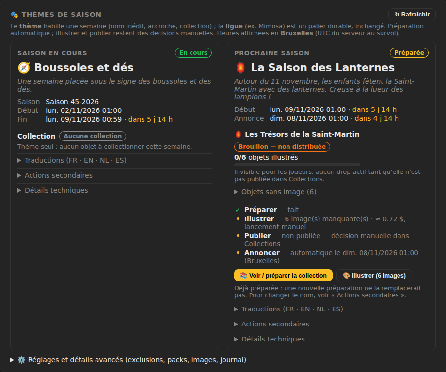
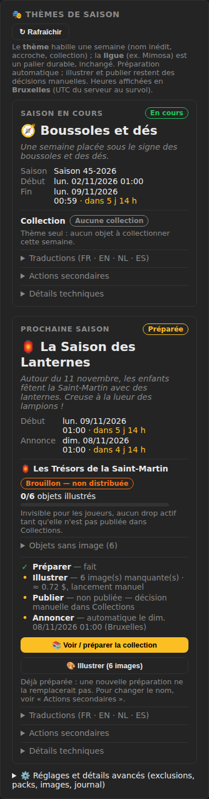
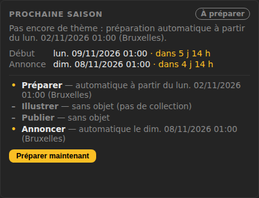
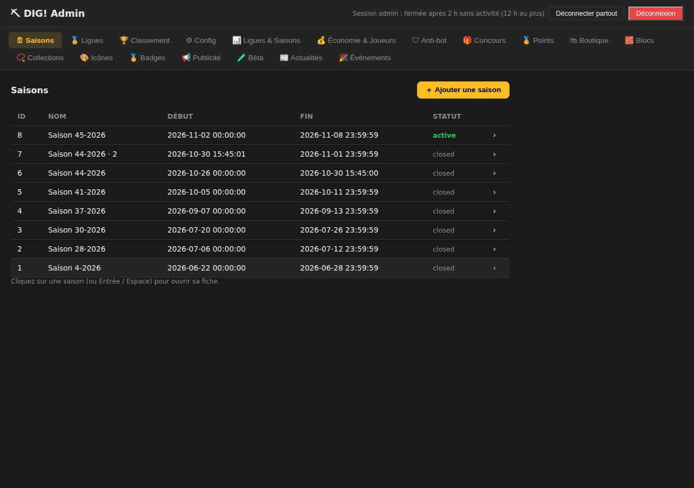
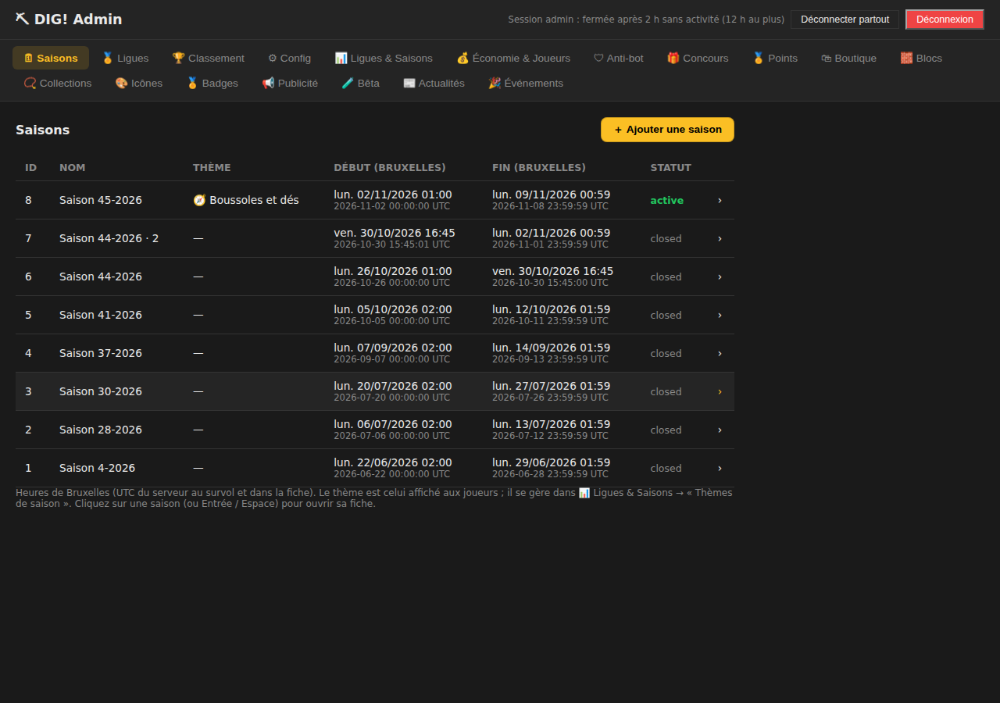
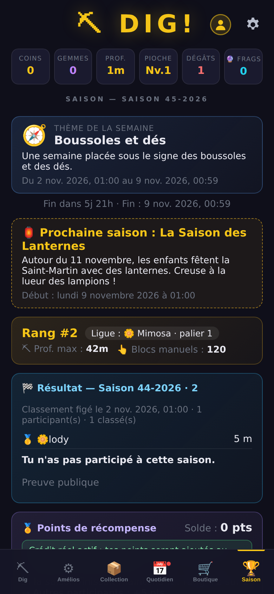
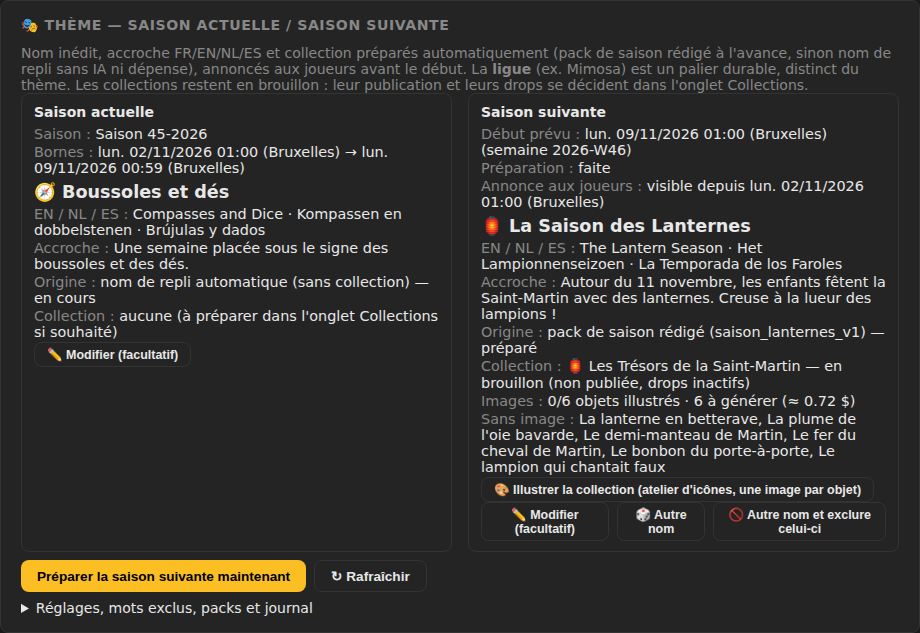

# Ticket #48 — Saisons thématiques automatiques : noms uniques, collections préparées et annonce anticipée

Lien : https://github.com/ReC82/Dig/issues/48 — session du 03/11/2026 (nuit).

## Mise à jour du 03/11/2026 (midi) : recette #48-D — onglet Saison du joueur plus lisible

### 1. État réel

**Déployé en production (SHA `33aac1b`). En attente de recette.** Branche : `feature/48-saisons-thematiques` (commit `c226575`). Classement : **Après lancement** (lisibilité, aucune règle ni donnée modifiée).

### 2. Retour du propriétaire traité

Recette #48-D (03/11, 10:39) : **affichage joueur de l'onglet Saison validé**. Sont validés : la séparation thème/ligue, les dates, le classement, les historiques et l'explication de la saison. Restent à recetter plus tard, comme demandé : l'annonce J-1, la bascule réelle du 09/11, les points à la clôture et les promotions. Ce qui vient d'être validé n'est pas à retester.

Retour ergonomique : la page est très dense. Le propriétaire préfère une synthèse en haut et des sections repliables pour les explications. Il demande aussi de vérifier la mise en page réelle avant de conclure que les textes collés (`22m`, `Rang 1 :lody5 m`, `Points de récompenseSolde`) révèlent un bug.

**Constat sur la mise en page réelle** (captures Chromium à 1280 et 390 px, copie de la base de production, compte `testeur`) : à l'écran, les espaces sont bien là (« Solde : 0 pts » séparé du titre, pseudo et profondeur dans des colonnes distinctes). Les concaténations viennent du copier-coller de blocs mis en page (flex), pas de l'affichage. Seul vrai écart typographique : la profondeur était écrite `22m` (carte joueur et classement). Elle s'écrit désormais `22 m`, comme dans le résultat archivé.

### 3. Changements réalisés (affichage seul : `public/js/main.js`, `public/css/style.css`)

Nouvel ordre de l'onglet 🏆 Saison :
1. **Synthèse, toujours visible** : thème de la semaine, fin de saison, annonce de la saison suivante (quand elle existe), carte joueur (rang, ligue, profondeur, blocs), points de récompense (solde et prévision), puis **classement**.
2. **Sections repliées par défaut**, avec un titre informatif même repliées :
   - « 🏁 Résultat — Saison … » : le titre affiche ton résultat (rang ou « pas participé ») ; un clic déplie le podium, la date de clôture et la preuve SHA-256.
   - « 🎁 Boutique de cadeaux » avec le solde : un clic déplie le catalogue et « Mes échanges ». Le bouton « Ouvrir la boutique » de la carte Points la déplie et y descend. Elle reste dépliée après un échange.
   - « ℹ️ Comment fonctionne la saison ? » et « Saisons précédentes », désormais en bas de page.
3. Les règles des points (conservés, non convertibles…) sont déplacées dans « Barème de fin de saison ».
4. L'état déplié ou replié de chaque section est conservé lors de l'actualisation automatique (toutes les 30 s).

Aucun texte ajouté ni retraduit (les titres existants servent de résumés) : les 5 langues restent complètes. Aucune route serveur, donnée, règle, date ou barème modifiés.

### 4. Tests

- `npm test` **521/521** sur la branche, sur `develop` et sur la release `33aac1b`. Le test statique de l'onglet Saison vérifie le nouvel ordre et les sections repliables.
- Essai navigateur `test/e2e/season-player-fold.e2e.js` (hors `npm test`), sur une copie de la base de production avec le compte `testeur`, en 1280×900 et 390×844. Il vérifie : l'ordre synthèse → classement → sections repliées, le résultat et la boutique repliés par défaut, « 22 m », le lien qui déplie la boutique, l'état déplié conservé après l'actualisation automatique, l'absence de défilement horizontal et 0 erreur JS. Copie supprimée ensuite.

### 5. Déploiement

- Copie de la base de production démarrée en `NODE_ENV=production` : santé ok, version `1.0.0+33aac1b`, empreintes des 6 tables identiques avant et après. Copie supprimée.
- Aucune génération IA en cours (dernier appel admin à 11:17, pas d'atelier).
- `scripts/deploy.sh` : `6fb4032 → 33aac1b`, sauvegarde vérifiée `~/backups/dig/dig-20261103-120759-pre-deploy-33aac1b.sqlite`, santé et version ok.
- Après le déploiement : les 2 domaines répondent 200 avec `1.0.0+33aac1b`, la nouvelle feuille de style est servie, le journal est sans erreur et `quick_check` = ok. `users`, `seasons` et `leagues` sont identiques à la sauvegarde. Sur `user_saves`, `season_rankings` et `player_click_tracking`, une partie était en cours : sauvegarde v331 → v332 et profondeur 31 → 32 m. C'est une progression, pas une perte.
- Retour arrière : `git -C /home/ubuntu/Dig reset --keep 6fb4032` puis `sudo systemctl restart dig` (code seul, aucune base).

**Test fonctionnel à faire par le propriétaire (≈ 2 min, lecture seule)** : jeu (Ctrl+F5), connecté, onglet 🏆 Saison, sur téléphone puis sur PC.
1. En haut, sans défiler beaucoup : thème, fin de saison, carte « Rang #… · Ligue … · Prof. max : 22 m », points, puis le **Classement**.
2. En dessous, 4 lignes repliées : « 🏁 Résultat — Saison 44-2026 · 2 » (avec ton résultat dans le titre), « 🎁 Boutique de cadeaux · Solde », « ℹ️ Comment fonctionne la saison ? », « Saisons précédentes ».
3. Toucher une ligne la déplie (chevron tourné) ; elle reste dépliée après 30 s.
4. Carte Points → « 🎁 Ouvrir la boutique de cadeaux » : la boutique se déplie et l'écran y descend.

### 6. Choix techniques faits seul

- J'ai remonté le classement juste sous les points. C'est le cœur de la page, et il passe avant le résultat de la saison précédente, qui est archivé.
- La carte Points reste dépliée (solde et prévision font partie de la synthèse). Seules ses règles longues sont rangées dans le barème.
- J'ai gardé des `
` natifs, comme pour l'info saison : accessibles au clavier et au lecteur d'écran, sans script.

### 7. Décisions demandées au propriétaire

Inchangées : 1) seuil de promotion en pré-bêta, recommandé (a) ; 2) illustrer et publier Saint-Martin avant le 09/11 ; 3) un 4ᵉ pack pour la S48.

### 8. Restant à réaliser

- Recette de cette mise en page.
- Recettes différées : annonce J-1 (dimanche 08/11), bascule du lundi 09/11 01:00 (Bruxelles), points à la clôture, promotions.
- Décisions 1 à 3.

## Mise à jour du 03/11/2026 (fin de matinée) : recette du 03/11 10:04 — onglet Ligues & Saisons pleine largeur et centré

### 1. État réel

**Déployé en production (SHA `6fb4032`). En attente de recette.** Branche : `feature/48-saisons-thematiques` (commit `8702ffd`). Classement : **Après lancement** (ergonomie du panel admin, aucun effet joueur).

### 2. Retour du propriétaire traité

Recette du 03/11 à 10:04 : la refonte est « un peu mieux », mais l'onglet « 📊 Ligues & Saisons » restait plafonné à 960 px et **collé à gauche** sur un grand écran. Demande : utiliser la largeur, centrer, deux cartes équilibrées, élargir aussi les KPI, les réglages et les classements, empiler sur mobile sans défilement horizontal.

**Cause** : le parent limitant était la règle commune `.tab-content { max-width: 960px }`, sans centrage. Les cartes elles-mêmes n'étaient pas en cause.

### 3. Changements réalisés (CSS seul, `public/admin/admin.css`)

- `#tab-season-overview` : `width: 100%`, `max-width: 1440px` (comme Blocs et Collections), **`margin-inline: auto`** (centré), marges latérales adaptées à l'écran (12 à 32 px).
- Cartes « Saison en cours » / « Prochaine saison » : **grille 2 colonnes égales** (`minmax(0, 1fr)`, donc un texte long ne peut pas élargir une colonne), **empilées sous 900 px**.
- Bandeau KPI « Saison en cours » : les 5 cases se répartissent sur toute la largeur (dates sur une ligne), 2 par ligne sur smartphone comme avant.
- Paramètres saisonniers : 2 colonnes sur grand écran au lieu d'une liste étroite.
- Paragraphes d'aide limités à une largeur de lecture (110 caractères). Le champ « Nouvelle fin » reste compact (260 px) au lieu de s'étirer sur 1 300 px.
- Tableaux Ligues, Classement par ligue et Journal anti-autoclicker : à 100 % de la nouvelle largeur (rien d'autre à changer).
- Aucun JavaScript, aucune donnée, aucun calendrier, nom, préparation, seuil, promotion ou collection n'a été modifié.

### 4. Mesures avant / après (Chromium headless, copie de la base de production)

| Écran | Avant : largeur, marge gauche / droite | Après : largeur, marge gauche / droite | Cartes de thème après |
|---|---|---|---|
| 1920×1080 | 960 px, 0 / **960** | **1440 px, 240 / 240** | 2 × 657 px, même hauteur de départ |
| 1440×900 | 960 px, 0 / 480 | 1440 px, 0 / 0 | 2 × 657 px |
| 1280×800 | 960 px, 0 / 320 | 1280 px, 0 / 0 | 2 × 577 px |
| 390×844 | 390 px | 390 px | empilées, 324 px |

Défilement horizontal de la page : 0 sur les 4 tailles, réglages avancés dépliés compris. Erreurs JavaScript : 0. Édition d'un paramètre saisonnier toujours possible (saisie puis rétablie, rien n'a été enregistré).
Essai reproductible : `test/e2e/season-overview-width.e2e.js` (hors `npm test`, navigateur requis ; `BEFORE_CSS=` sert l'ancienne feuille de style pour la comparaison).

### 5. Tests et déploiement

- `npm test` **521/521** sur la branche et sur la release `6fb4032`.
- Copie de la base de production démarrée en `NODE_ENV=production` : santé ok, version `1.0.0+6fb4032`, empreintes des 6 tables identiques avant et après. Copie supprimée.
- Aucune génération IA en cours avant le redémarrage (dernier appel de l'atelier : 02/11 à 23:25 UTC).
- `scripts/deploy.sh` : `3ba07c6 → 6fb4032`, sauvegarde vérifiée `~/backups/dig/dig-20261103-113938-pre-deploy-6fb4032.sqlite`, santé et version ok.
- Après le déploiement : les 2 domaines répondent 200 avec `1.0.0+6fb4032` ; la nouvelle feuille de style est bien servie ; le journal est sans erreur ; `quick_check` = ok. Les empreintes sont identiques à la sauvegarde pour `users`, `seasons` et `leagues`. Pour `user_saves`, `season_rankings` et `player_click_tracking`, une partie était en cours : la sauvegarde d'un joueur est passée de la version 270 à 271, avec un horodatage plus récent. C'est une progression, pas une perte.
- Retour arrière : `git -C /home/ubuntu/Dig reset --keep 3ba07c6` puis `sudo systemctl restart dig`. Il ne concerne que le code (CSS), pas la base.

**Test fonctionnel à faire par le propriétaire (≈ 2 min, lecture seule)** : recharger le panel admin (Ctrl+F5) sur un grand écran → 📊 Ligues & Saisons.
1. Attendu : le contenu est **centré**, environ 1 440 px de large, avec des marges égales à gauche et à droite sur un écran de 1 920 px.
2. Les cartes « Saison en cours » et « Prochaine saison » sont côte à côte et de même largeur.
3. Les 5 KPI tiennent sur une ligne ; les Paramètres saisonniers sont sur 2 colonnes.
4. En réduisant la fenêtre sous environ 900 px, les cartes s'empilent. Sur smartphone, il n'y a pas de défilement horizontal de la page.

### 6. Choix techniques faits seul

- Correction ciblée sur `#tab-season-overview`, et non sur la règle commune `.tab-content` : les 16 autres onglets ne changent pas. **Écart signalé** : Blocs et Collections font déjà 1 440 px mais restent alignés à gauche. On peut les centrer de la même façon (une ligne CSS chacun), mais c'est hors du périmètre de ce ticket.
- Le bouton « Rafraîchir » de l'onglet relève de l'audit transversal #60, comme demandé : il n'est pas modifié ici.

### 7. Décisions demandées au propriétaire

Inchangées (voir la section suivante) : 1) seuil de promotion en pré-bêta, recommandé (a) ; 2) illustrer et publier Saint-Martin avant le 09/11 ; 3) un 4ᵉ pack pour la S48.

### 8. Restant à réaliser

- Recette de cette mise en page par le propriétaire.
- Recette de la bascule réelle du lundi 09/11 01:00 (Bruxelles).
- Décisions 1 à 3.

## Mise à jour du 03/11/2026 (matin) : recettes #48-C, refonte de l'écran « Thèmes de saison » et promotions à petit effectif

### 1. État réel

**Déployé en production (SHA `d2a49fc`). En attente de recette.**
Branche : `feature/48-saisons-thematiques`. La lisibilité est un lot UX à part, **classé « Après lancement »** et non bloquant pour la pré-bêta. La recette de la bascule réelle (lundi 09/11 à 01:00, Bruxelles) reste à faire.

### 2. Ce que les recettes du propriétaire ont validé (03/11, 09:07 et 09:11)

Validé visuellement : saison actuelle 45-2026 « Boussoles et dés » ; saison suivante 2026-W46 « La Saison des Lanternes » préparée pour le lundi 09/11 à 01:00 ; collection Saint-Martin en brouillon, 0/6 images, drops inactifs ; classement de la ligue Mimosa correct (2 joueurs actifs).
Pas encore validé : la bascule, les drops, une promotion et une clôture.

### 3. Changements réalisés

**Panel admin, onglet 📊 Ligues & Saisons, carte « 🎭 Thèmes de saison »** : refonte complète de l'affichage. Aucune règle n'a changé.
- **Deux cartes, « Saison en cours » et « Prochaine saison »**. Chacune affiche une pastille d'état (En cours / À préparer / Préparée / Annoncée aux joueurs), le **thème en grand** avec son accroche, et des dates compactes en heure de Bruxelles (l'heure UTC du serveur apparaît au survol). Un **compte à rebours** se met à jour chaque minute.
- **Collection** : nom et pastille d'état **« Brouillon — non distribuée »**, « Publiée » ou « Aucune collection ». S'y ajoutent le nombre d'images (n/m) avec une jauge, la phrase « Invisible pour les joueurs, aucun drop actif tant qu'elle n'est pas publiée », et la liste repliée des objets sans image.
- **Les quatre étapes de la prochaine saison sont distinctes** : ✓ Préparer, • Illustrer (n images manquantes, coût estimé, lancement manuel), • Publier (décision manuelle dans Collections), • Annoncer (automatique à telle date). Aucune étape n'en déclenche une autre.
- **Action principale** : « 📚 Voir / préparer la collection ». Elle ouvre l'onglet Collections filtré sur la série, sans rien modifier. À côté, « 🎨 Illustrer (6 images) » ouvre l'atelier sans lancer de génération.
- **« Préparer maintenant »** n'apparaît que si la prochaine saison n'est **pas encore** préparée, avec une confirmation qui explique ce qui se passe (nom réservé, collection en brouillon, rien d'illustré, publié ni annoncé). Une saison déjà préparée affiche « Déjà préparée : une nouvelle préparation ne la remplacerait pas » (le serveur était déjà idempotent). L'ancien bouton permanent est supprimé.
- **Repliés par défaut** :
  - **Traductions** : tableau FR/EN/NL/ES, nom et accroche.
  - **Actions secondaires** : « Modifier les textes », plus, pour la prochaine saison seulement, « Tirer un autre nom » et « Autre nom et exclure celui-ci ». Une **confirmation** est demandée et le texte rappelle que l'ancien nom reste réservé.
  - **Détails techniques** : origine (« nom de repli », pack), numéro, semaine, série.
- **Réglages et détails avancés** (bloc replié) :
  - un **vrai commutateur** pour « Afficher thèmes et annonces aux joueurs » ;
  - des champs numériques bornés (3–14 jours, 0–168 h), chacun avec une aide courte et une **validation explicite** avant l'envoi ; seules les valeurs modifiées sont enregistrées ;
  - les mots exclus, les packs, le budget images et un **journal en clair** (« Saison suivante préparée », « Collection importée en brouillon »…).
- **Mobile 390 px** : cartes empilées, sans débordement horizontal.

**Onglet 🗓 Saisons** : nouvelle colonne **Thème** (ex. « 🧭 Boussoles et dés »). Les dates s'affichent **en heure de Bruxelles**, avec l'UTC en petit dessous (masqué sur smartphone) et au survol. La fiche d'une saison montre le thème et les deux heures. Les saisons antérieures au 02/11 n'ont pas de thème (« — »). Le bloc « Saison en cours » de Ligues & Saisons affiche aussi ses dates en Bruxelles (l'UTC au survol) : les deux onglets sont maintenant cohérents.

**Serveur** : `GET /api/admin/seasons` joint à chaque saison son thème (nom FR et icône, `null` s'il n'y en a pas). C'est une lecture seule (`seasonThemes.themesBySeason()`) ; une panne du module des thèmes ne masque pas la liste.

Fichiers : `public/admin/admin.js`, `public/admin/index.html`, `public/admin/admin.css`, `server/seasonThemes.js`, `server/index.js`, `test/season-themes.test.js`, `test/season-rotation.test.js`.

Avant :

Après, PC (détails repliés) :

Après, smartphone 390 px :

Prochaine saison pas encore préparée (état simulé sur une copie) :

Onglet Saisons, avant et après :

### 4. Promotions à petit effectif : stratégie de recette (rien n'a été modifié en production)

**Constat** : le seuil « Joueurs actifs min par ligue » (`min_active_players_per_league`) vaut **10**, et Mimosa compte **2** joueurs actifs. À la clôture du 09/11, il n'y aura donc **aucun promu**. C'est le comportement attendu avec ce réglage, pas un défaut.

**Simulation isolée** : copie de la base de production en `/tmp`, vrai code de clôture (`closeActiveSeason`), copie supprimée ensuite.

| Seuil simulé | Joueurs éligibles dans Mimosa | Résultat |
|---|---|---|
| 10 (actuel) | 2 | aucun promu (2 < 10) |
| 3 | 2 | aucun promu (2 < 3) |
| 3 | 3 (2 réels + 1 joueur fictif) | 1/3 promu (50 %) vers Bronze, créée automatiquement : le 1ᵉʳ du classement |
| 2 | 2 | 1/2 promu (50 %) vers Bronze : le 1ᵉʳ du classement |

La formule est conforme à la règle #19 : `max(1, floor(actifs × 0,50 / (1 + niveau × 0,45)))`, donc au moins 1 promu par ligue éligible. Avec 3 joueurs : 1 promu en Mimosa, 1 promu en Bronze (34 %).

**Compromis** : un seuil bas permet de tester la promotion dès la pré-bêta, mais avec 2 ou 3 joueurs, monter en Bronze revient presque à « être premier d'une poignée de testeurs ». La ligue Bronze serait créée pour un seul joueur, qui s'y retrouverait seul la semaine suivante. Un seuil haut (10) protège la logique de ligue pour le lancement public, mais aucune promotion n'est testée avant.

**Stratégie proposée (au choix du propriétaire)** :
1. **Recommandé** : garder 10 en production. La promotion est déjà vérifiée par les tests automatisés et par cette simulation sur une copie. Si une recette en jeu est souhaitée, la faire **délibérément** : baisser le seuil à 3 la veille d'une clôture (onglet Config), avec 3 comptes éligibles (au moins un bloc manuel dans la saison), noter le rapport de clôture, puis **remettre 10** juste après. Une ligue Bronze créée ainsi reste en place : c'est un effet durable à accepter.
2. Baisser le seuil à 2 ou 3 jusqu'au lancement public. Les promotions ont alors lieu chaque semaine pendant la pré-bêta, et il faut penser à le remonter.
3. Ne rien tester en jeu avant d'avoir au moins 10 joueurs actifs.

### 5. SHA, procédure de test, vérifications

- Tests : `npm test` **519/519** sur la branche (dont 2 nouveaux contrôles : thème joint à chaque saison, `themesBySeason` limité aux saisons qui ont un thème).
- Navigateur (Chromium headless, copie de la base de production, port de test), en 1280×900 et 390×844 : 0 erreur JavaScript, 0 débordement horizontal. Parcours vérifiés :
  - « Voir / préparer la collection » ouvre Collections filtré sur `tresors_saint_martin` ;
  - un réglage hors bornes est refusé avec un message, « Aucun changement » s'affiche si rien n'a changé ;
  - « Tirer un autre nom » annulé ne change rien ;
  - prochaine saison non préparée : le bouton « Préparer maintenant » apparaît ; s'il est annulé, rien ne change ; s'il est confirmé, la saison est préparée.
- Données joueurs : aucune modification. Pas de migration ni de nouveau réglage, et aucun contenu publié n'a changé.

### 6. Déploiement

- Commit de la branche : `cdc7668`. Fusion dans `develop` : **`d2a49fc`**, avec un arbre identique à celui de la branche testée. **SHA déployé : `d2a49fc`** (03/11/2026, 10:53, Bruxelles). Version précédente : `feecf11`.
- Release `d2a49fc` : `npm test` **519/519**. Une copie de la base de production a été démarrée en `NODE_ENV=production` : `/health` ok, version `1.0.0+d2a49fc`, empreintes (`users`, `user_saves`, `season_rankings`, `seasons`, `leagues`, `player_click_tracking`) identiques avant et après le démarrage. La copie a été supprimée.
- Avant le déploiement, aucune génération IA n'était en cours (dernier appel de l'atelier : 02/11 à 23:25 UTC).
- `scripts/deploy.sh` : sauvegarde vérifiée `~/backups/dig/dig-20261103-105336-pre-deploy-d2a49fc.sqlite`, sans `npm ci` (dépendances inchangées), santé et version contrôlées.
- Après le déploiement : les 2 domaines répondent 200 avec `1.0.0+d2a49fc` ; le panel sert bien la nouvelle carte ; le journal ne contient aucune erreur ; `quick_check` = ok ; les empreintes de la production sont identiques à celles de la sauvegarde.
- Retour arrière immédiat possible : `git -C /home/ubuntu/Dig reset --keep feecf11` puis `sudo systemctl restart dig`. Il ne concerne que le code : aucune migration, et la base n'est pas touchée.

**Test fonctionnel à faire par le propriétaire (lecture seule, ≈ 3 min)** :
1. Admin → 📊 Ligues & Saisons → « 🎭 Thèmes de saison ». Attendu : deux cartes. À gauche, « En cours » et « 🧭 Boussoles et dés », fin lun. 09/11/2026 00:59 avec un compte à rebours. À droite, « Préparée » et « 🏮 La Saison des Lanternes », début lun. 09/11/2026 01:00, collection « Brouillon — non distribuée », 0/6, étapes Préparer ✓ / Illustrer / Publier / Annoncer (automatique le dim. 08/11 01:00).
2. Survoler une date : l'heure UTC s'affiche.
3. Ouvrir « Traductions », puis « Détails techniques » : FR/EN/NL/ES, puis l'origine « pack de saison rédigé ».
4. Cliquer « 📚 Voir / préparer la collection » : l'onglet Collections s'ouvre, filtré sur la série Saint-Martin. Ne rien publier.
5. Onglet 🗓 Saisons : colonne Thème (« 🧭 Boussoles et dés » sur la saison 45) et dates en Bruxelles, avec l'UTC dessous.
6. Sur smartphone : mêmes écrans, sans défilement horizontal de la carte.
À éviter en recette de consultation : « Préparer maintenant » (absent tant que la saison est préparée), « Tirer un autre nom », « Clore la saison ».

### 7. Choix techniques faits seul

- Repli par `
` natifs plutôt que par onglets : aucune dépendance, accessibles au clavier, cohérents avec le reste du panel.
- Le bouton « Préparer maintenant » n'est affiché que s'il a un effet. Les « Autre nom » demandent une confirmation, parce qu'ils consomment un nom à vie.
- Le thème de l'onglet Saisons est joint côté serveur, dans une lecture seule protégée par `try`, plutôt que par un second appel du navigateur.
- Aucune donnée, règle, calendrier, seuil ou barème n'a été touché, comme demandé.

### 8. Décisions demandées au propriétaire

1. **Seuil de promotion en pré-bêta** : (a) garder 10 et, si souhaité, faire une recette délibérée à 3 puis remettre 10 ; (b) 2–3 jusqu'au lancement ; (c) ne rien tester avant 10 actifs. **Recommandé : (a).** Aucun changement sans votre écrit.
2. (Reprise) **Illustrer, puis publier, la collection Saint-Martin avant le 09/11 ?** Coût : ≈ 0,72 $, une image par objet. Sans réponse, le thème s'affiche seul et la collection reste en brouillon.
3. (Reprise) **Un 4ᵉ pack rédigé pour la S48 (23–29/11) ?** Sinon, nom de repli sans collection. Recommandé : un pack de plus.

### 9. Restant à réaliser

- Recette réelle de la bascule du lundi 09/11 01:00 (Bruxelles) : nouveau thème, annonce J-1, saison suivante préparée dès J-7. *Bloquant MVP : non, mais à vérifier.*
- Illustration et publication des collections : décision du propriétaire (question 2).
- Recette de promotion en jeu : selon la décision 1.

---

## Session de la nuit du 03/11/2026 (livraison initiale, 61a5cbc)

## 1. État réel

**Déployé en production (SHA `61a5cbc`). En attente de recette.**
Branche `feature/48-saisons-thematiques` (`f643c77`), intégrée dans `develop` (`61a5cbc`).

## 2. Diagnostic « Mimosa » (demande prioritaire du 03/11)

**Mimosa est la ligue de départ (niveau 0), pas le nom de la saison.** Cela confirme l'audit #19.
- La table `leagues` de la production ne contient qu'une ligue, Mimosa 🌼. Personne n'a jamais été promu : il y a un seul joueur actif par semaine, alors que le seuil est de 10.
- La rotation des saisons fonctionne. La production compte 8 saisons, toutes avec un nom différent (« Saison 45-2026 » est active jusqu'au 08/11 23:59:59 UTC).
- Le vrai défaut était ailleurs : l'onglet Saison n'affichait aucun nom de thème. On n'y voyait qu'un badge de ligue sans libellé, d'où la confusion.

Mimosa n'a pas été renommée, et aucune ligue ne change de nom chaque semaine.

## 3. Résultat et changements

### Ce que voit le joueur (onglet 🏆 Saison)
- **Carte « Thème de la semaine »** : icône, nom inédit, accroche dans la langue du joueur (FR/EN/NL/ES), puis la période « Du … au … » en heure locale. Le numéro « Saison 45-2026 » reste dans le titre.
- **Ligue étiquetée** : « Ligue : 🌼 Mimosa · palier 1 ». Une infobulle explique que la ligue est un palier durable et que le thème change chaque semaine.
- **Annonce « Prochaine saison : [nom] »** : affichée **24 h avant** le début avec son accroche et la date. La collection n'y est citée (nom et nombre d'objets seulement) que si l'admin l'a **publiée**. Aucune probabilité ni aucun objet secret n'est montré.
- **Point discret** sur le bouton Saison tant que l'annonce n'a pas été vue (aucune fenêtre surgissante). Au changement de saison, la notification devient « Nouvelle saison : Saison 46-2026 · La Saison des Lanternes ! ».
- **Historique replié « Saisons précédentes »** : les 6 dernières saisons avec leur numéro, leur thème et leurs dates.

### Ce qui se fait automatiquement (sans IA, sans dépense, sans intervention)
Le nouveau module `server/seasonThemes.js` est appelé par le planificateur chaque minute, après la rotation, et par `GET /api/seasons/current`.
1. **Saison suivante préparée dès qu'elle débute dans moins de 7 jours** (réglable de 3 à 14 jours). En rythme hebdomadaire, cela veut dire dès le début de la saison en cours, donc toujours au moins à J-3.
2. **Source du thème** :
   - en priorité, un **pack de saison** rédigé à l'avance (`server/content/seasons/*.json`) : nom, accroche en 4 langues et collection complète ;
   - à défaut, un **nom de repli déterministe** : deux mots d'un lexique traduit de 36 entrées, choisis à partir du numéro de semaine (630 paires, puis des triplets). Ce cas ne fournit pas de collection.
3. **Collection d'un pack** : elle est versée dans le **brouillon** du catalogue en réutilisant le moteur #39 (`importPack`), drops **inactifs** et **jamais publiée** automatiquement. Les consignes d'illustration de chaque objet vont dans l'atelier #40, sans générer d'image. Au début de la saison, la série est rattachée à cette saison dans le brouillon.
4. **Saison commencée sans thème préparé** (déploiement en cours de semaine, clôture exceptionnelle #44) : elle reçoit un nom de repli, sans collection. C'est le cas de la saison actuelle, « Boussoles et dés ».
5. **Archivage** : à la clôture, le thème passe en « archivé » et reste visible dans l'historique.

### Unicité durable
- Chaque nom attribué est inscrit dans le registre `season_theme_names`, dont la clé primaire est le nom normalisé : accents, casse, articles et ordre des mots ignorés (« Taupes et Lanternes » = « lanternes ET taupes »). Une clé n'est **jamais supprimée ni réattribuée**, même après un rejet ou un renommage. La clé primaire garantit l'unicité même en cas d'accès simultanés.
- Les noms de ligues (Mimosa, Bronze, Argent…) sont refusés comme noms de thème.
- L'admin peut **exclure des mots ou des noms** : tout nom contenant tous les mots d'une exclusion est écarté.

### Panel admin (onglet 📊 Ligues & Saisons → carte « 🎭 Thème — saison actuelle / saison suivante »)
- Saison actuelle et saison suivante : bornes (heure de Bruxelles), nom en 4 langues, accroche, origine (pack ou repli), état.
- Collection : brouillon ou publiée, images présentes/manquantes, liste des objets sans image, coût estimé. Un bouton **« Illustrer la collection »** ouvre l'atelier d'icônes, qui génère une image par objet en série (#40), sous le plafond déjà administré.
- Dates de préparation et d'annonce.
- Actions facultatives : « Modifier », « 🎲 Autre nom », « 🚫 Autre nom et exclure celui-ci », « Préparer la saison suivante maintenant ».
- Section repliée : réglages (`season_themes_public`, `season_prep_days`, `season_announce_hours`), mots exclus, packs disponibles ou utilisés, dépense d'images, journal.

### Contenu préparé (rédigé selon la ligne éditoriale #39, un clin d'œil réel différent par objet)
| Pack | Semaine | Collection (6 objets chacune) |
|---|---|---|
| 🏮 **La Saison des Lanternes** | 2026-W46 (09–15/11, contient le 11/11) | Les Trésors de la Saint-Martin : lanterne en betterave, plume de l'oie bavarde, lampion qui chantait faux, bonbon du porte-à-porte, fer du cheval de Martin, demi-manteau de Martin (légendaire) |
| 🎭 **La Saison des Géants** | première semaine libre (S47) | Les Affaires des Géants : bouton de veste, peigne de la Géante, ruban des noces de Gouyasse (Ath), osier fatigué, fronde de David, crinière du cheval Bayard (légendaire) |
| 🎁 **La Saison de Saint-Nicolas** | 2026-W49 (30/11–06/12) | Le Chemin de Saint-Nicolas : carotte de l'âne, chaussure près de la cheminée, spéculoos décapité, mandarine voyageuse, mitre trop grande, crosse dorée (légendaire) |

La semaine 48 (23–29/11) n'a pas de pack. Elle recevra donc un nom de repli, sauf si un pack est ajouté d'ici là.

Les 18 objets ont un nom et une histoire dans les 4 langues, une rareté et une consigne d'illustration propre à chacun. Les références réelles (Binche, Ath, Termonde, Saint-Martin, Saint-Nicolas) sont exactes, et les anecdotes inventées sont présentées comme légende ou rumeur. La relecture #39 et le détecteur de conflit de sujet #40 passent sans alerte : au premier essai, trois consignes citaient « orange » ou « ribbon », qui sont des noms d'autres objets, et elles ont été reformulées.

### Fichiers
`server/seasonThemes.js` (nouveau), `server/content/seasons/*.json` (3 packs), `server/seasons.js` (planificateur et réponse joueur), `server/collectionAi.js` (extraction de `importPack`, comportement inchangé), `server/index.js` (initialisation, validation des réglages, 6 routes admin), `public/js/main.js`, `public/js/i18n.js` (FR/EN/NL/ES), `public/css/style.css`, `public/admin/{index.html,admin.js,admin.css}`, `test/season-themes.test.js`.

## 4. SHA et procédure de test

- `develop` : `61a5cbc` · branche `feature/48-saisons-thematiques` (`f643c77`).
- `npm test` : **460/460**. `node --test test/season-themes.test.js` : 6 tests. Ils couvrent :
  - l'horloge simulée ;
  - **53 saisons** consécutives jusqu'au passage à l'heure d'hiver 2027, toutes avec un nom différent ;
  - chaque pack utilisé une seule fois et à sa semaine ;
  - l'annonce exactement à J-1 (ni une seconde avant, ni la collection tant qu'elle n'est pas publiée) ;
  - le fuseau de Bruxelles au changement d'heure : annonce à 02:00 heure d'été, début à 01:00 heure d'hiver ;
  - le redémarrage (`initDb` rejoué) sans doublon ;
  - les collisions (nom déjà utilisé, nom de ligue, mot exclu) ;
  - l'édition refusée sans aucune modification (atomicité) ;
  - « Autre nom » ;
  - **aucun appel IA ni réseau, 0 appel d'image** ;
  - une panne du module de thèmes qui ne bloque ni la rotation ni la réponse saison ;
  - le masquage complet par réglage.

## 5. Vérifications, limites, impact sur les données

- Essai navigateur (Chromium headless) sur une copie de la base de production avec un joueur de test, en 1280×900 et 390×844 : thème, annonce, ligue étiquetée, historique et point de nouveauté corrects ; aucun débordement horizontal ; aucune erreur JavaScript ; carte admin complète. Copie et serveur supprimés ensuite.
- **Données joueurs** : aucune ligne modifiée. Migration additive uniquement : 3 tables nouvelles (`season_themes`, `season_theme_names`, `season_theme_events`) et 3 réglages ajoutés.
- **Brouillon des collections (production)** : une 3ᵉ série, « Les Trésors de la Saint-Martin », s'est ajoutée aux deux séries déjà en brouillon. Rien n'est publié et les drops sont inactifs. Attention : une publication **globale** du brouillon avec « publier même incomplet » emporterait aussi cette série. La publication ciblée par série (#39) reste la voie recommandée.
- Limites :
  - pas de génération de thème par IA : ce n'est pas nécessaire, il y a les packs et le repli, et aucune dépense n'est autorisée ;
  - pas de génération automatique des images : lancement manuel en un clic pour toute la collection ;
  - le centre d'actualités (cloche, #50) n'est pas fait : l'annonce vit dans l'onglet Saison et `publicView()` est réutilisable par #50 ;
  - le repli ne fournit pas de collection.

## 6. Déploiement

- SHA déployé : **`61a5cbc`** (précédent : `cfa125c`). Sauvegarde vérifiée : `~/backups/dig/dig-20261103-035223-pre-deploy-61a5cbc.sqlite`.
- Avant le déploiement :
  - release : 460/460 ;
  - copie de la base de production démarrée en `NODE_ENV=production` (port 3122) : `/health` ok, version `61a5cbc` ;
  - empreintes `users`, `user_saves`, `season_rankings`, `seasons`, `leagues`, `player_click_tracking` identiques avant et après le démarrage ;
  - aucune génération IA en cours.
- Après le déploiement :
  - les deux domaines répondent 200 avec `1.0.0+61a5cbc` ;
  - journal sans erreur ; `quick_check` = ok ;
  - empreintes joueurs identiques à la sauvegarde ;
  - en production, la saison 45-2026 a reçu le thème « **Boussoles et dés** » et la saison 46 est préparée : « **La Saison des Lanternes** », annonce visible dimanche 08/11 à 01:00 (Bruxelles).
- Retour arrière : `git -C /home/ubuntu/Dig reset --keep cfa125c` puis `sudo systemctl restart dig`. Aucune dépendance n'a changé. Les tables ajoutées, inertes, peuvent rester.

### Test fonctionnel pour le propriétaire (3 minutes)
1. Dans le jeu, onglet 🏆 **Saison** : le titre affiche « Saison 45-2026 », puis la carte « Thème de la semaine : 🧭 **Boussoles et dés** » avec les dates. La carte joueur indique « **Ligue : 🌼 Mimosa · palier 1** ». La ligue et le thème sont donc bien distincts.
2. Panel → **📊 Ligues & Saisons** → carte « 🎭 Thème ». À droite, « Saison suivante : 🏮 La Saison des Lanternes », collection « Les Trésors de la Saint-Martin — en brouillon », 0/6 images, début prévu lun. 09/11 01:00, annonce à partir du **dim. 08/11 01:00** (Bruxelles).
3. Facultatif, pour voir l'annonce tout de suite : dans « Réglages… », mettre `season_announce_hours` à `168`, enregistrer, puis recharger l'onglet Saison du jeu. La carte « Prochaine saison : La Saison des Lanternes » apparaît, avec un point sur le bouton Saison tant qu'elle n'a pas été vue. **Remettre 24 ensuite.**
4. Lundi 09/11 après 01:00 : le jeu affiche « Saison 46-2026 » avec le thème « La Saison des Lanternes ». L'historique contient « Saison 45-2026 · Boussoles et dés ».

**Classement MVP : Bloquant pré-bêta pour la partie affichage saison/ligue/thème (livrée). Après lancement pour les illustrations et la publication des collections.**

## 7. Choix techniques faits seul

- **Le numéro de saison reste l'identifiant ; le thème est une couche à part** : aucune réécriture de `seasons.name`, ni des classements ou des points qui y font référence.
- **Préparation dès J-7 au lieu de J-3** : le ticket demande « au moins trois jours avant » et le propriétaire a demandé de « préparer immédiatement ». Le minimum réglable reste 3 jours.
- **La saison en cours reçoit un nom de repli, pas un pack** : les packs (avec leur collection) sont réservés à des saisons annoncées à l'avance.
- **Packs rédigés plutôt qu'IA** : la règle « aucune dépense API sans budget explicite » s'applique, le résultat est déterministe et relu, et aucune panne réseau n'a d'effet.
- **Thème public, collection en brouillon** : les noms et accroches viennent de packs relus ou d'un lexique fermé, donc rien d'imprévisible n'est publié. Les collections et leurs drops restent à la décision du propriétaire.
- **Packs coupés en test** et si `DIG_PREPARED_COLLECTIONS=0`, comme pour les collections préparées.

## 8. Décisions demandées au propriétaire

1. **Collection de la saison des Lanternes (dès que possible, au plus tard pour le 09/11)** : illustrer les 6 objets (une image par objet, ≈ 0,72 $ estimés, sous ton plafond) puis publier la série, drops compris ? Ou la laisser en brouillon ?
   *Recommandation : illustrer, puis publier la série seule avec le barème proposé, si tu valides ce barème.* Sans réponse, rien n'est publié et le thème s'affiche seul.
2. **Semaine 48 (23–29/11)** : accepter un nom de repli sans collection, ou faut-il un 4ᵉ pack rédigé ?
   *Recommandation : un pack de plus, écrit lors d'une prochaine session.*

## 9. Restant à réaliser

- Centre d'actualités et cloche (#50), qui réutilisera `seasonThemes.publicView()`. Après lancement.
- Lancement automatique et facultatif des illustrations d'une collection préparée sous un budget dédié, puis publication automatique conditionnelle : à décider (décision 1). Après lancement.
- Génération IA de packs quand la réserve est vide, derrière un réglage et un budget explicites. Après lancement.
- Événements mensuels (#56) : indépendants des thèmes hebdomadaires.
