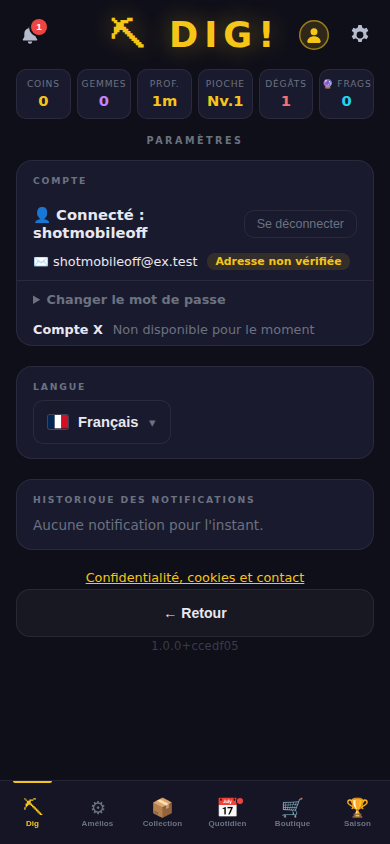
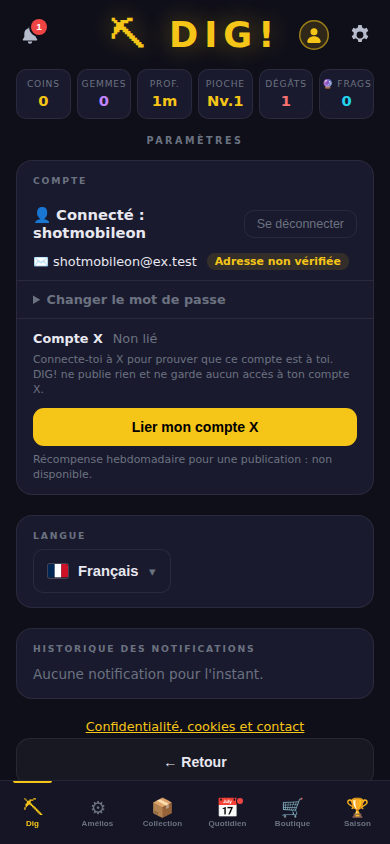
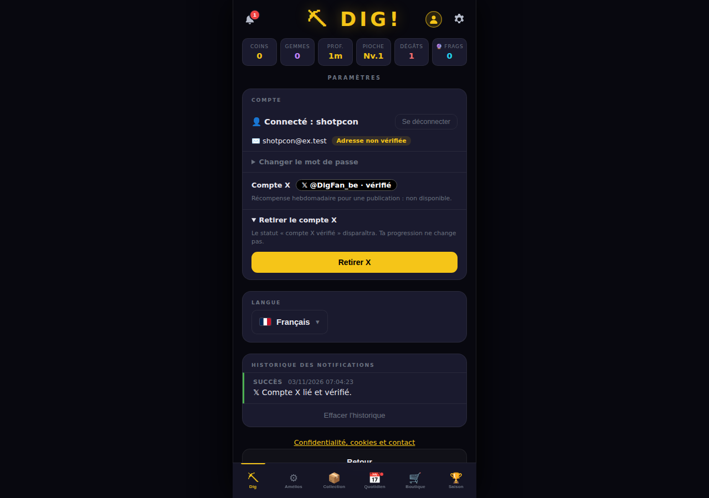

# Ticket #51 — Compte X lié, statut social et récompense hebdomadaire vérifiable

Lien : https://github.com/ReC82/Dig/issues/51 · Branche : `feature/51-compte-x-lie`

## Session du 3 novembre 2026

### 1. État réel

**Déployé en production (SHA `2c77dfa`) — en attente de recette.** La liaison X est livrée **désactivée** (`X_LINK=off`) et la récompense hebdomadaire est **verrouillée dans le code**.

Pour les joueurs, rien ne change tant que le propriétaire ne l'active pas. La seule nouveauté visible
est dans Paramètres → Compte : une ligne « Compte X : Non disponible pour le moment » et
« Récompense hebdomadaire pour une publication : non disponible ».

Classement : **Après lancement** (rien ici ne bloque le MVP public).

### 2. Constat préalable important : les règles X interdisent la récompense par points

Depuis le **15 janvier 2026**, la politique développeur de X interdit aux applications de
**récompenser les utilisateurs pour leurs publications** (jetons, points ou argent). X a coupé
l'accès API à des applications de ce type (« InfoFi »). Une récompense hebdomadaire en points DIG!
pour une publication sur X tombe directement sous cette règle. Le risque : X révoque la clé API, et
donc aussi la liaison de compte.

Le mécanisme de vérification demandé est donc **conçu, testé et verrouillé dans le code** :
`REWARD_ENABLED = false`, aucune route, aucun crédit, aucune demande de publication. Aucune
variable d'environnement ne peut l'ouvrir. Voir la décision n° 1.

Autres éléments de l'étude :
- **Coût de l'API X (2026)** : paiement à l'usage par défaut depuis février 2026 (l'offre
  gratuite n'est plus ouverte aux nouveaux comptes). Une lecture de profil (`/2/users/me`) coûte
  de l'ordre de 0,01 $ et une lecture de publication environ 0,005 $. La liaison fait **une**
  lecture par joueur. Une vérification de publication en ferait une par demande (au plus une par
  joueur et par semaine). Ces chiffres viennent de sources secondaires : à confirmer sur la page
  de tarifs du portail développeur avant activation.
- **OAuth** : OAuth 2.0 « Authorization Code + PKCE ». Portées minimales `users.read tweet.read`,
  exigées par `/2/users/me`. Aucune portée d'écriture : DIG! ne peut techniquement rien publier.
- **RGPD** : seules l'identité X (identifiant, nom, date de création du compte X) et l'historique
  de liaison sont conservés. Le jeton est révoqué aussitôt et n'est jamais stocké. Le traitement
  repose sur le consentement, retirable à tout moment (bouton « Retirer X »). La page Confidentialité
  est mise à jour.
- **Points (#33 / #34)** : les points de récompense sont attribués au mérite saisonnier. Une
  récompense « sociale » contournerait ce principe sans arbitrage. Aucune connexion n'a été faite
  avec `rewardPoints`.

### 3. Résultat et changements

| Fichier | Changement |
|---|---|
| `server/xLink.js` (nouveau) | Configuration `X_LINK` (off par défaut), client OAuth 2.0 PKCE, routes `/api/x/start`, `/api/x/callback`, `/api/x/unlink`, règles anti-comptes multiples, statut pour `/api/me`, récompense verrouillée (`weekKey`, `evaluatePost`, `recordVerifiedPost`) |
| `server/index.js` | Branchement du module, `x` ajouté à `/api/me`, `xLink.init()` |
| `public/js/main.js`, `public/css/style.css` | Bloc « Compte X » dans Paramètres → Compte, retour `?xlink=…` |
| `public/js/i18n.js`, `i18n/it.json`, `public/js/locales/it.js` | 19 textes en FR, EN, NL, ES et IT |
| `server/legal.js` | Ligne « Compte X lié (facultatif) » dans Confidentialité, date mise à jour |
| `docs/OPERATIONS.md` | Section « Compte X lié » : mise en service, variables, retour arrière, journal |
| `test/x-link.test.js` (nouveau) | 7 tests avec un faux serveur X local |

Comportement quand la fonction est activée (`X_LINK=link`) :
1. Le joueur connecté clique « Lier mon compte X ». Il se connecte chez X, puis revient dans
   Paramètres → Compte avec le statut **« 𝕏 @nom · vérifié »**.
2. Ce statut est une pastille noire, volontairement différente des badges honorifiques (#38). Il
   n'existe que tant que la liaison vérifiée existe et ne donne **aucun avantage en jeu**.
3. Le joueur peut cliquer « Retirer X » : le statut disparaît, la progression ne change pas.

Garanties :
- un compte X ne peut être lié qu'à un seul compte DIG!, et inversement (contraintes `UNIQUE`) ;
- un compte X retiré ne peut pas être lié à un **autre** compte DIG! avant 30 jours ;
- un compte DIG! ne peut pas changer de compte X avant 7 jours ;
- `state` à usage unique et lié au compte connecté au départ ;
- aucun jeton dans la base, les sessions ou les journaux ;
- journal d'audit : `user_events` (`x_linked`, `x_unlinked`, `x_link_refused` + raison) et
  table `x_link_history` ;
- liste pilote `X_LINK_USERS` pour une recette réservée au propriétaire.

Récompense hebdomadaire (verrouillée), prête si une règle conforme est validée :
- `evaluatePost` vérifie la publication **lue côté serveur chez X**, jamais une URL ni une capture
  fournie par le joueur :
  - l'auteur est le compte X lié ;
  - la publication date de la semaine ISO en cours (Bruxelles) et est postérieure à la liaison ;
  - c'est une publication originale (ni repost, ni réponse) ;
  - elle contient un lien vers un domaine du jeu (sous-domaines piégés refusés) ;
- `recordVerifiedPost` est idempotent : une demande par compte DIG!, une par compte X et par
  semaine, une publication ne sert qu'une fois. `points = 0`, `credited_at = NULL` : **aucun
  code de crédit n'existe**.

Captures (serveur de test, faux X) :

### 4. SHA et procédure de test

- SHA sur `develop` : **`2c77dfa`** (fusion de `0ac4fbe`)
- Tests automatisés : `npm test` (contient `test/x-link.test.js`) ;
  `node --test test/x-link.test.js` pour ce ticket seul.
- Test manuel sans compte X réel : lancer un faux X local (voir `test/x-link.test.js`), puis
  `X_LINK=link X_CLIENT_ID=c X_CLIENT_SECRET=s X_OAUTH_BASE=http://127.0.0.1:<port> X_API_BASE=http://127.0.0.1:<port> PORT=3101 DB_FILE=test-51.sqlite node server/index.js`.
  Ensuite : Paramètres → Compte, « Lier mon compte X ». Résultat attendu : « 𝕏 @… · vérifié »,
  puis « Retirer X » et retour à « Non lié ».

### 5. Vérifications, limites, impact sur les données

Vérifications effectuées :
- `npm test` complet : **510/510** réussis à trois reprises : sur la branche, sur `develop` (`2c77dfa`) et dans la release `2c77dfa` ;
- `npm run check` réussi ;
- contrôle i18n italien : 598/598 textes, 0 erreur ;
- parcours navigateur (Chromium headless, 1280×900 et 390×844) avec X désactivé, puis avec un faux
  X : non disponible → non lié → lié et vérifié → retrait. Aucune erreur JavaScript.

Limites :
- **non testé avec le vrai X** : il faut une application développeur X et ses identifiants, que
  seul le propriétaire peut créer ;
- le statut n'apparaît que dans Paramètres → Compte. Il n'est affiché ni dans le classement ni sur
  le profil public : à décider (question 3).

Données des joueurs : migration **en ajout seul** (3 nouvelles tables vides, `CREATE TABLE IF NOT
EXISTS`). Aucune table existante n'est modifiée.

### 6. Déploiement

- SHA déployé : **`2c77dfa`** le 03/11/2026 à 07:16 (Bruxelles). Précédent : `a7919e6`.
- Sauvegarde vérifiée avant déploiement : `~/backups/dig/dig-20261103-071636-pre-deploy-2c77dfa.sqlite`.
- Migration testée sur une copie de la base de production (`NODE_ENV=production`, port 3122) :
  - empreintes identiques (nombre de lignes + hachage) de `users`, `user_saves`,
    `season_rankings`, `seasons`, `leagues` et `player_click_tracking` ;
  - seules 3 tables vides sont ajoutées ; `quick_check` ok ; copie supprimée.
- Après déploiement :
  - https://dig.lodygames.com et https://dig.lodylands.com répondent 200, `/api/version` = `1.0.0+2c77dfa` ;
  - `/api/me` renvoie `x: { available: false }` et `/api/x/start` renvoie 404 ;
  - la page Confidentialité contient la ligne « Compte X lié » ;
  - journal sans erreur, `pragma quick_check` = ok ;
  - empreintes joueurs identiques à la sauvegarde pré-déploiement ;
  - jeu chargé sans erreur JavaScript en 1280×900 et 390×844.
- Retour arrière : `git -C /home/ubuntu/Dig reset --keep a7919e6` + `sudo systemctl restart dig`.
  Il n'y a pas de `npm ci` à faire (lock inchangé). Les 3 tables ajoutées restent vides et sans effet.

**Test fonctionnel à faire par le propriétaire :**
1. Ouvrir https://dig.lodygames.com, se connecter, puis aller dans Paramètres (⚙️) → Compte.
2. Résultat attendu : une ligne « **Compte X** — Non disponible pour le moment », sans aucun
   bouton. Le reste du compte est inchangé (mot de passe, e-mail, Google). La page « Confidentialité,
   cookies et contact » contient la ligne « Compte X lié (facultatif) ».
3. Pour tester la liaison réelle, si tu le décides : suivre `docs/OPERATIONS.md` → « Compte X lié »
   avec `X_LINK_USERS=<ton pseudo>`. Ensuite, Paramètres → Compte → « Lier mon compte X ».
   Résultat attendu : pastille « 𝕏 @toncompte · vérifié », puis « Retirer X » fonctionne.

### 7. Choix techniques faits seul

- **Module distinct de la connexion Google** (`user_x_links` plutôt que `user_identities`) : X
  n'est pas un moyen de connexion, seulement un statut social. Le mélanger aux identités de
  connexion aurait ouvert une connexion par X non demandée.
- **Aucun jeton conservé** (révocation immédiate) : pas besoin d'accès durable pour un statut, et
  rien de sensible à protéger en base. Conséquence : si le joueur renomme son compte X, le nom
  affiché n'est mis à jour qu'à une nouvelle liaison.
- **Pas de mot de passe exigé pour lier ou retirer X**, contrairement à Google : ce n'est pas un
  moyen de connexion. La preuve vient de X lui-même.
- **Délais anti-comptes multiples de 30 et 7 jours** : valeurs prudentes, modifiables dans le code.
- **Récompense verrouillée par une constante de code**, pas par une variable d'environnement, pour
  qu'une ouverture passe forcément par une revue.
- **Statut « Non disponible » toujours affiché**, à la demande du propriétaire (commentaire du
  2 novembre).

### 8. Décisions demandées au propriétaire

1. **Récompense hebdomadaire pour une publication X** : les règles X l'interdisent depuis janvier 2026.
   - A — Abandonner la récompense ; garder seulement la liaison et le statut social. **Recommandé.**
   - B — La remplacer par une récompense hors X, par exemple un parrainage mesuré par DIG! : un
     nouveau joueur inscrit via un lien de partage, sans lecture de publication X.
   - C — La maintenir malgré le risque de révocation de l'accès API X. Déconseillé.
2. **Activer la liaison X en production ?** Cela demande un compte développeur X (paiement à
   l'usage, environ 0,01 $ par liaison) et `X_CLIENT_ID` / `X_CLIENT_SECRET` dans `/etc/dig/dig.env`.
   - A — Oui, après le lancement du MVP, d'abord avec `X_LINK_USERS=<ton pseudo>`. **Recommandé.**
   - B — Pas pour l'instant ; le statut reste « non disponible ».
3. **Où afficher le statut social ?**
   - A — Seulement dans le compte, comme aujourd'hui.
   - B — Aussi une petite marque 𝕏 à côté du pseudo dans le classement. **Recommandé**, si la
     décision 2 est oui : petit ticket de suite.

### 9. Restant à réaliser

- Selon les décisions : activation (configuration seule, aucun code), affichage dans le
  classement, récompense alternative.
- Si la récompense est un jour autorisée sous une forme conforme : route de demande, lecture
  `GET /2/tweets/:id` avec un jeton d'application, arbitrage avec les points #33, puis crédit. Rien
  de tout cela n'est codé.
