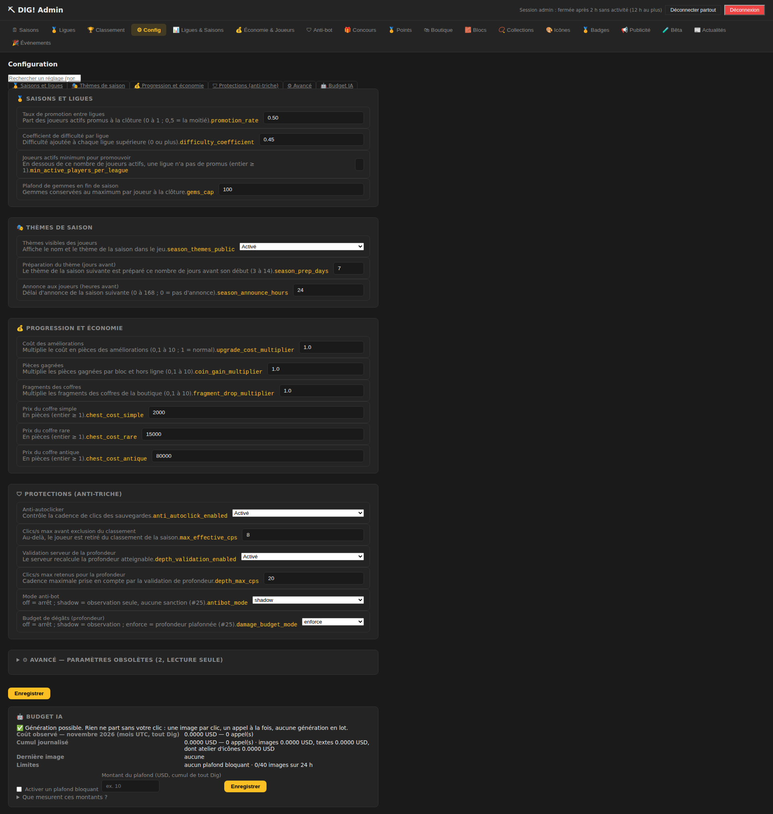
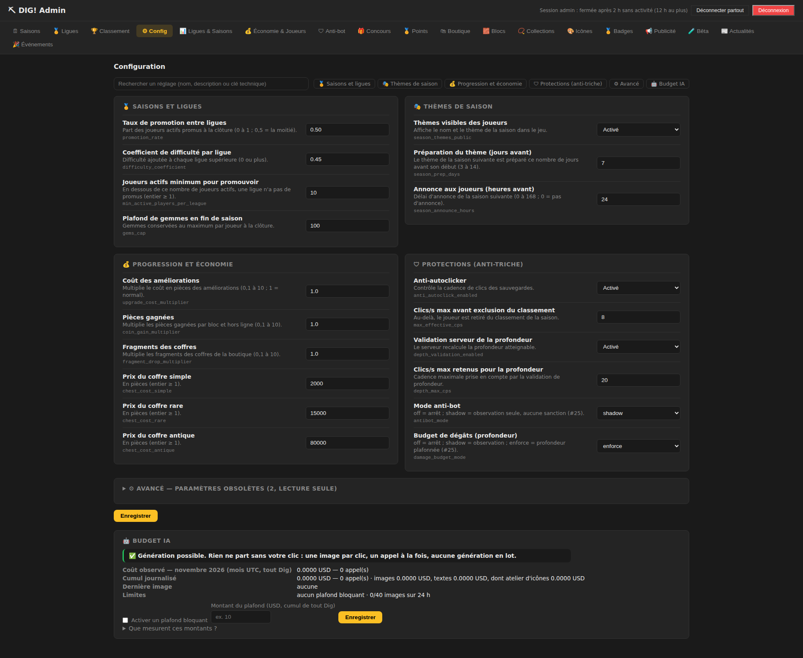
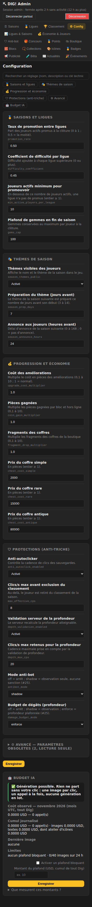
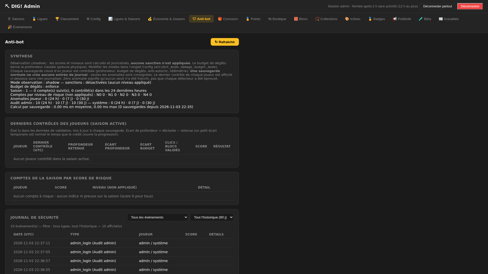
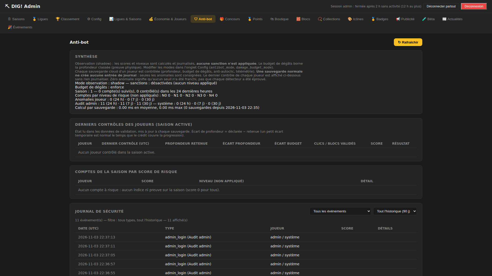
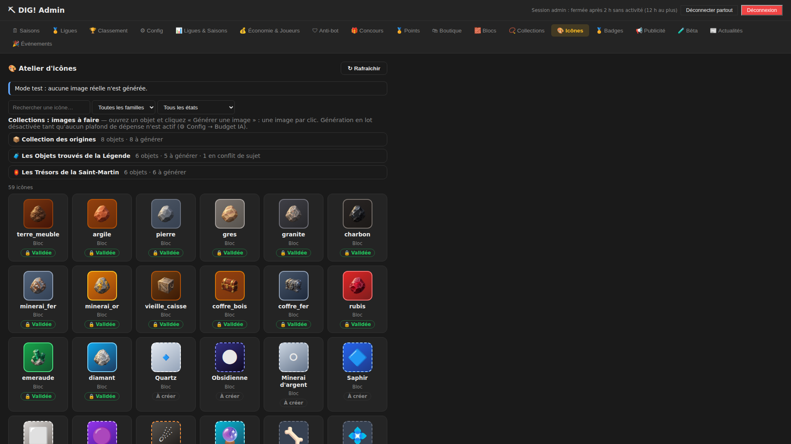
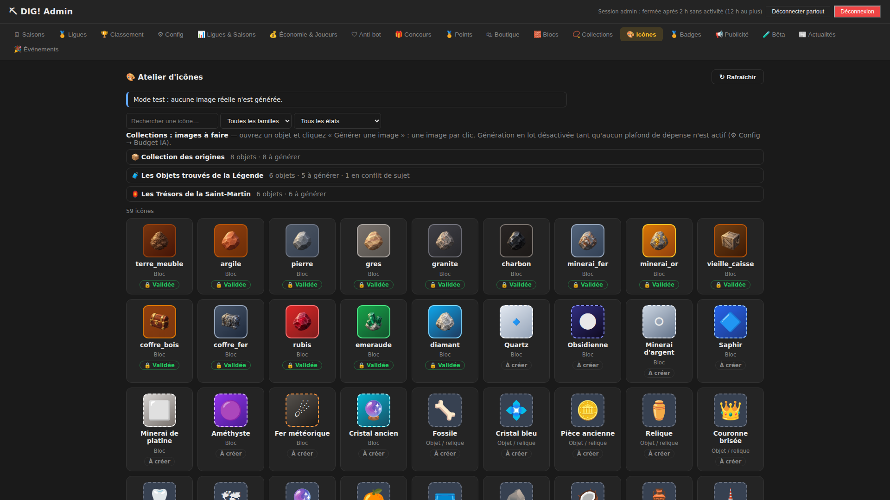
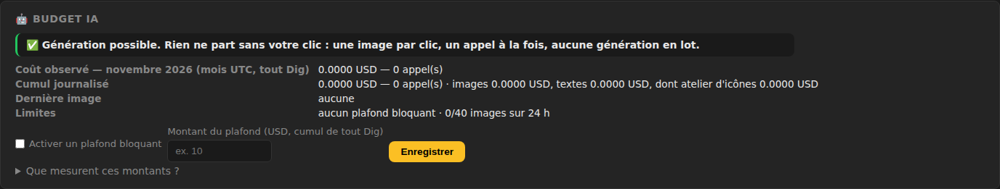
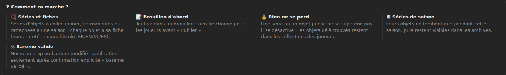

# Ticket #62 — Admin : largeur et centrage communs, refonte lisible de Config

- Ticket : [#62 — [P2] Admin — largeur et centrage communs, refonte lisible de Config](https://github.com/ReC82/Dig/issues/62)
- Branche : `feature/62-admin-largeur-config` (commit `20bc90c`)
- **SHA sur `develop` : `6eec3b4`**

## Section du 03/11/2026 (23:55, Bruxelles)

### 1. État réel

**Déployé en production (SHA `6eec3b4`) — en attente de recette.**

Classement MVP : **Après lancement** (outil d'administration, rien de visible pour les joueurs).

### 2. Résultat et changements

**Règle générale de largeur (demande explicite du propriétaire).** La cause était unique : la règle
`.tab-content { max-width: 960px }` s'appliquait à **tous** les onglets. Elle bloquait le contenu à 960 px, aligné à gauche.
Ensuite, quatre onglets avaient reçu leur propre exception (Blocs, Collections, Ligues & Saisons, Actualités). Désormais :

- **Un seul conteneur pour les 18 onglets** : `width: 100%`, `max-width: 1440px`, `margin-inline: auto`. Les marges
  latérales sont proportionnelles (12 à 32 px).
- **Les exceptions par onglet sont supprimées** : la règle commune les remplace et produit le même rendu que ce qui avait été validé (#48, #50). Blocs et
  Collections deviennent en plus centrés.
- **Les paragraphes gardent une largeur de lecture** (110 caractères) : seuls les tableaux et les grilles utilisent toute la largeur.
- Sur téléphone, rien ne change : champs en colonne, tableaux défilants dans leur carte, aucun défilement horizontal de la page.

| Écran 1920 px | Avant | Après |
|---|---|---|
| Config | 960 px, à gauche (marge droite 960 px) | 1440 px, centré (240 / 240) |
| Anti-bot | 960 px, à gauche | 1440 px, centré |
| Atelier d'icônes | 960 px, à gauche | 1440 px, centré (9 icônes par ligne au lieu de 5) |

| Config avant (1920) | Config après (1920) | Config après (390) |
|---|---|---|
|  |  |  |

| Anti-bot avant | Anti-bot après | Icônes avant | Icônes après |
|---|---|---|---|
|  |  |  |  |

**⚙ Config refondu**

- **4 catégories en cartes**, sur deux colonnes en grand écran : 🏅 Saisons et ligues · 🎭 Thèmes de saison · 💰 Progression et économie ·
  🛡 Protections (anti-triche). Des liens rapides mènent à chaque catégorie et à 🤖 Budget IA.
- **Une ligne par réglage.** On y lit d'abord le libellé en clair, puis une explication courte avec la plage admise, et enfin la clé technique en petit
  (par exemple `min_active_players_per_league`). Le champ est à droite. Le texte passe à la ligne : rien ne se chevauche ni n'est tronqué.
- **Choix sous forme de listes** pour les interrupteurs (Activé / Désactivé) et les modes (`antibot_mode` : off / shadow ;
  `damage_budget_mode` : off / shadow / enforce). Une valeur inattendue s'affiche telle quelle (« valeur actuelle ») : elle n'est jamais modifiée en silence.
- **Recherche** par nom, description ou clé. Si rien ne correspond, un message l'indique.
- **« ⚙ Avancé — paramètres obsolètes »** (replié, lecture seule) : `cps_limit` est un ancien nom, lu seulement si `max_effective_cps` est absent ;
  `season_duration` n'est plus utilisé, car les saisons sont hebdomadaires. Leur valeur ne change pas et n'est plus envoyée à l'enregistrement.
- **Enregistrer n'envoie que les réglages modifiés.** Avant, toutes les valeurs étaient renvoyées. Un compteur « N modification(s) non
  enregistrée(s) » et un liseré doré signalent les lignes modifiées. La protection des saisies de #61 est conservée.
- Une clé future, absente de cette liste, apparaît dans « 🔧 Autres réglages », modifiable comme avant.

**🤖 Budget IA** (suite de #40, sans contournement concurrent ; aucune règle de plafond n'a changé) :

- **L'état s'affiche en premier**, en couleur : « ✅ Génération possible », « ⛔ bloquée par le plafond », « ⛔ quota de 40 images / 24 h
  atteint » ou « ⏳ génération en cours ».
- Viennent ensuite les montants :
  - **coût observé** du mois, avec sa période (mois UTC) et son périmètre (tout Dig) ;
  - cumul journalisé (images, textes, dont atelier) ;
  - **coût de la dernière image** ;
  - **limites** : plafond (aucun par défaut) et quota.
- Les montants viennent du journal de Dig, jamais du solde OpenAI. Le formulaire du plafond et l'explication repliée sont inchangés.



**📿 Collections — « Comment ça marche ? »** (commentaire du 03/11) : le long bloc de texte devient une carte repliable. Elle présente 5 points
courts et titrés (Séries et fiches, Brouillon d'abord, Rien ne se perd, Séries de saison, Barème validé), en colonnes sur grand
écran. Le texte n'a pas changé. Les listes de séries et d'objets profitent de la largeur commune.



Fichiers : `public/admin/admin.css`, `public/admin/admin.js` (Config, Budget IA), `public/admin/index.html`,
`test/admin-layout.test.js` (nouveau), `test/e2e/admin-layout.e2e.js` (nouveau), `test/admin-news-ux.test.js` (assertion
de largeur adaptée au conteneur commun).

**Grille des onglets contrôlés** (1920, 1440, 1280, 390 px) : Saisons, Ligues, Classement, Config, Ligues & Saisons,
Économie & Joueurs, Anti-bot, Concours, Points, Boutique, Blocs, Collections, Icônes, Badges, Publicité, Bêta, Actualités,
Événements. Partout : largeur ≤ 1440 px, centrée, sans défilement horizontal de la page. Aucun autre élément n'a été retouché
« pour uniformiser ».

### 3. Procédure de test (technique)

```
npm test                                   # 589/589
node --test test/admin-layout.test.js      # 6 tests #62
# navigateur (serveur de test démarré, base de test) :
PW=…/playwright-core CHROME=…/chrome-headless-shell BASE=http://127.0.0.1:3101 ADMIN=<secret> OUT=/tmp/x \
  [BEFORE_CSS=ancien-admin.css] node test/e2e/admin-layout.e2e.js     # → OK admin-layout
```

### 4. Vérifications effectuées

- `npm test` : **589/589** sur la branche, sur `develop` (`6eec3b4`) et sur la release `6eec3b4`.
- Tests automatiques #62 :
  - un seul conteneur, sans exception par onglet ;
  - chaque réglage créé par le serveur est classé et libellé ;
  - les options et bornes des champs sont acceptées par la validation du serveur (`enforce` n'est pas proposé pour `antibot_mode`, que le serveur refuse) ;
  - les obsolètes sont en lecture seule ;
  - seuls les champs modifiés sont envoyés ;
  - le Budget IA ne fait que lire.
- Chromium, serveur de test (port 3101, base de test, IA factice), **18 onglets × 4 largeurs** :
  - largeur et centrage conformes ;
  - aucun débordement horizontal ;
  - **aucun chevauchement** entre libellé, explication, clé et champ dans Config (mesuré sur les rectangles affichés) ;
  - la recherche « minimum pour » ne garde que `min_active_players_per_league` ;
  - une seule modification produit **une seule requête `PUT`** (`gems_cap`), puis le compteur revient à zéro ;
  - aucune erreur JavaScript.
- **Non fait** : essai sur la production avec le compte admin réel. Le secret admin n'est jamais lu par les sessions.

**Impact sur les données des joueurs : aucun.** Ni migration, ni route serveur, ni valeur de configuration n'ont été modifiées.

### 5. Déploiement

- Release `6eec3b4` : `npm ci` + `npm test` 589/589.
- Copie de la base de production, démarrée en mode production sur le port 3122 : `/health` ok, version `1.0.0+6eec3b4`. Les empreintes des 6 tables joueurs sont **identiques**
  avant et après démarrage. La copie a été supprimée ensuite.
- Aucune génération IA en cours : dernier appel il y a plus de 5 h.
- `main` : avance rapide `b806db4 → 6eec3b4`, puis `scripts/deploy.sh` de la release. **Sauvegarde vérifiée**
  `~/backups/dig/dig-20261103-235339-pre-deploy-6eec3b4.sqlite` ; `npm ci` n'était pas nécessaire ; santé et version OK.
- Après le déploiement :
  - dig.lodygames.com et dig.lodylands.com renvoient 200 et `1.0.0+6eec3b4` ;
  - `journalctl` ne montre aucune erreur ;
  - `quick_check` = ok ;
  - les empreintes des joueurs sont identiques à la sauvegarde.
- Retour arrière : `git -C /home/ubuntu/Dig reset --keep b806db4` + `sudo systemctl restart dig`. La base n'est pas concernée.

### 6. Test fonctionnel à faire par le propriétaire (3 min, rien n'est enregistré)

1. Sur PC grand écran, ouvrir https://dig.lodygames.com/admin/ et faire **Ctrl+F5**, puis aller dans **⚙ Config**. Attendu :
   - la page est centrée, sans moitié droite vide ;
   - quatre cartes de catégories sont présentes ;
   - « Joueurs actifs minimum pour promouvoir » est lisible, avec `min_active_players_per_league` en petit en dessous, sans chevauchement.
2. Taper « coffre » dans la recherche : seuls les trois prix de coffre et « Fragments des coffres » restent.
3. Modifier un champ **sans enregistrer** : un liseré doré et « 1 modification non enregistrée » apparaissent. Remettre la valeur d'origine :
   le compteur disparaît.
4. Descendre à **🤖 Budget IA** : la première ligne dit tout de suite si la génération est possible ou bloquée.
5. Ouvrir **🛡 Anti-bot**, puis **🎨 Icônes**, puis **📿 Collections** (déplier « Comment ça marche ? ») : contenu centré, de largeur utile.
6. Sur téléphone : ⚙ Config. Les champs sont sous les libellés, sans défilement horizontal.

### 7. Choix techniques faits seul

- **Largeur maximale de 1440 px**, la valeur haute de la fourchette du ticket (1280 à 1440). C'est déjà la largeur validée pour #48 et #50 : elle évite deux
  largeurs différentes dans le panel.
- **Enregistrer n'envoie que les réglages modifiés** : c'est plus sûr, et aucune valeur n'est réécrite par la refonte. Le journal d'audit est inchangé.
- **Les obsolètes sont en lecture seule plutôt que masqués**, pour rester transparents. Ils ne sont ni supprimés ni réécrits.
- **Les paramètres de Ligues & Saisons n'ont pas été touchés** : #48 les a validés. Ils restent aussi modifiables dans Config, comme avant.
- **Budget IA** : seul l'affichage change. Les règles du plafond (#40, décision du 03/11) sont identiques.

### 8. Décisions demandées au propriétaire

Aucune décision utilisateur nécessaire.

### 9. Restant / suites possibles (non faites, hors périmètre)

- Certains anciens libellés de Ligues & Saisons répètent ceux de Config. Un renvoi « modifier dans ⚙ Config » pourrait éviter le double emploi : c'est à vous de choisir.
- La création IA de blocs a son propre quota d'appels texte (40 / 24 h). Il n'est pas affiché dans l'état du Budget IA, qui suit les images.
