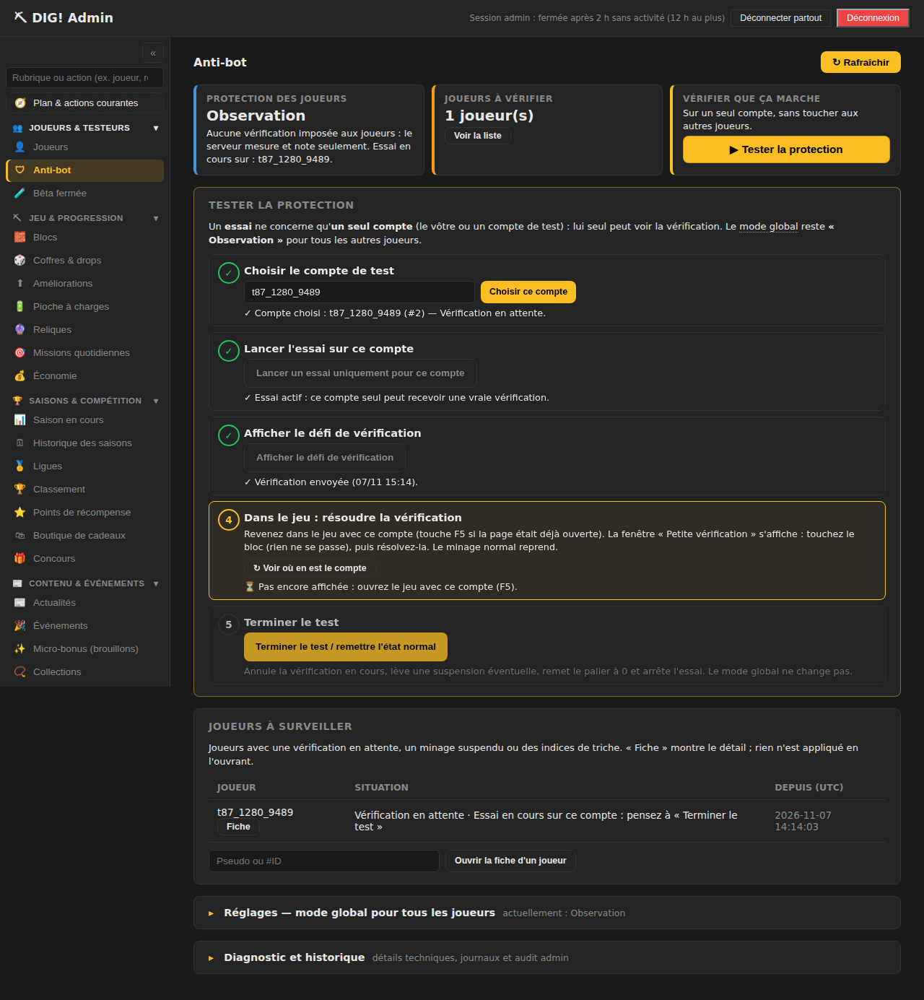
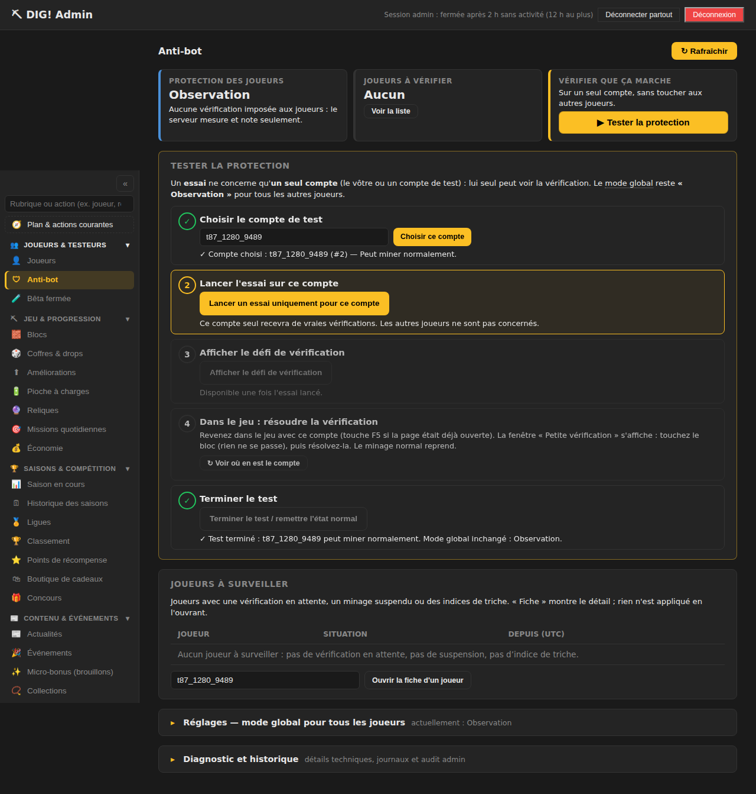
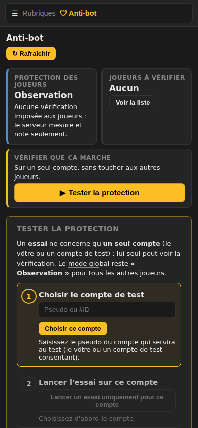
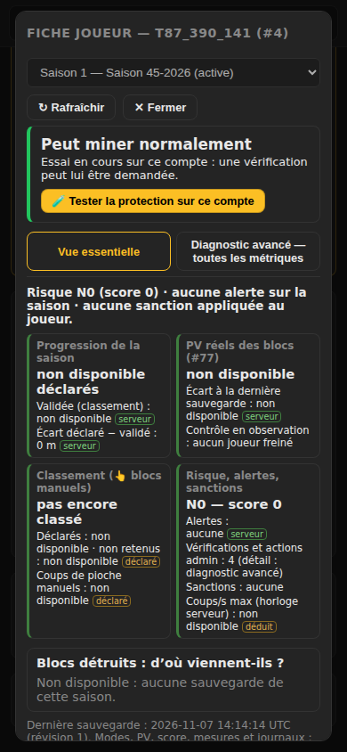

# Ticket #87 — Admin Anti-bot simplifié : parcours de test guidé, diagnostics repliés

## 1. Ticket

#87 — [P0][UX] Simplifier Anti-bot admin — parcours de test guidé, diagnostics repliés —
https://github.com/ReC82/Dig/issues/87 (ouvert par le propriétaire le 07/11 après le test #25-F non validé :
il ne savait pas où aller ; les boutons « Essai Appliqué sur ce compte » et « Émettre un défi d'essai »
étaient difficiles à trouver). Lié : #25 (lot C), #84 (bêta du 09/11).

## 2. État réel

**Déployé en production (SHA `4feed13`) — en attente de recette.** Classement : **Bloquant MVP public**
(outil de recette de l'anti-bot avant la bêta du 09/11). Refonte livrée en une seule fois : pas besoin de la
livraison en deux temps prévue par le ticket.

## 3. Résultat et changements

Admin → 🛡 Anti-bot, de haut en bas :

1. **Trois cartes courtes** : « Protection des joueurs » (*Observation — aucune vérification imposée aux
   joueurs : le serveur mesure et note seulement* ; Appliquée = vérifications réelles ; indique aussi
   « Essai en cours sur : … »), « Joueurs à vérifier » (nombre + « Voir la liste »), et le bouton primaire
   **« ▶ Tester la protection »**.
2. **Parcours guidé « Tester la protection »** en 5 étapes numérotées, l'étape en cours encadrée en jaune,
   les étapes faites cochées ✓ avec leur état en clair :
   1. Choisir le compte de test (pseudo ou #ID ; prérempli depuis la fiche avec « 🧪 Tester la protection
      sur ce compte », ou après F5 avec le compte en essai) ;
   2. **« Lancer un essai uniquement pour ce compte »** — la seule étape confirmée (elle rend une
      suspension réelle possible) ;
   3. **« Afficher le défi de vérification »** ;
   4. « Revenez dans le jeu et résolvez » — suivi : *pas encore affichée* → *affichée dans le jeu depuis
      hh:mm* → *résolue : le compte peut miner normalement* (bouton « ↻ Voir où en est le compte ») ;
   5. **« Terminer le test / remettre l'état normal »** : annule la vérification en cours, lève une
      suspension, remet le palier à 0, arrête l'essai, puis vérifie que le mode global n'a pas changé
      (« Mode global inchangé : Observation »).
   Boutons verrouillés pendant chaque appel (double clic = un seul défi), indisponibles quand l'étape n'a
   pas de sens. Info-bulle sur « mode global » ; texte expliquant qu'un essai ne concerne qu'un compte.
3. **Joueurs à surveiller** : suspensions actives, vérifications en attente, essais en cours (« pensez à
   Terminer le test »), indices de triche (niveau ≥ 1, « rien n'est appliqué »), triés par urgence ; champ
   « Ouvrir la fiche d'un joueur ».
4. **Réglages** (replié) : explication simple des trois modes globaux, boutons du mode (passage en Appliqué
   toujours confirmé, inchangé), seuils actuels.
5. **Diagnostic et historique** (replié) : synthèse technique, historique vérifications / suspensions,
   derniers contrôles, comptes par score, **journal des anomalies joueurs** (filtre « anomalies joueur »
   par défaut, 25 lignes puis « Afficher plus »), **audit admin à part** (chargé seulement à l'ouverture),
   protocole de recette complet (mis à jour pour pointer vers le parcours). Tableaux limités à 10 lignes
   (« Afficher les N autres lignes »). Aucune donnée retirée.

**Fiche joueur** : en tête, un statut compréhensible — **« Peut miner normalement »**, **« Vérification en
attente »** ou **« Minage suspendu jusqu'à jj/mm hh:mm »** (heure de Bruxelles) — avec une phrase
d'explication, l'action principale « 🧪 Tester la protection sur ce compte » et, selon le cas, « Annuler la
vérification » / « Lever la suspension ». La vue essentielle garde les **quatre indicateurs validés
(#25-E/#76)**, avec des explications raccourcies (plus de *shadow / enforce / applied:false*) ; l'explication
longue « ni manuels ni Auto-Dig » est repliée. Les mesures du lot C (série, temps actif, palier, boutons
d'essai) et les modes / PV réels passent dans « Diagnostic avancé » (nouvelle section repliable
« Vérification et suspension — mesures et actions », 12 sections au total). Les actions d'essai admin
(défi d'essai, essai Appliqué, résolution) ne sont plus comptées comme « alertes » du joueur dans la vue
essentielle (elles restent dans le diagnostic).

Fichiers : `public/admin/index.html`, `public/admin/admin.js`, `public/admin/admin.css`,
`docs/admin-navigation.md` (nouvelle action du plan « Tester la protection anti-bot sur un compte »,
`#a/sec-test` ; une cible dans une section repliée est maintenant ouverte automatiquement),
`test/antibot-admin-ux-87.test.js` (nouveau), `test/e2e/admin-antibot-87.e2e.js` (nouveau),
`test/antibot-player-report.test.js` et `test/e2e/admin-antibot-sheet.e2e.js` (section ajoutée).

**Non modifié** : aucun seuil, algorithme anti-bot, mode global, sanction, route serveur ni donnée joueur ;
le parcours n'appelle que les routes d'essai par compte déjà existantes (#25 lot C).

## 4. SHA et procédure de test

Branche `feature/87-antibot-parcours-guide` (`af7d48c`) ; **`develop` = `4feed13`** (déployé).
- `npm test` : 896/896 (branche, `develop`, release `4feed13`).
- Essai navigateur (serveur de test port 3101, base neuve, vrai jeu dans un 2e contexte) :
  `PW=… CHROME=… BASE=http://127.0.0.1:3101 ADMIN=… node test/e2e/admin-antibot-87.e2e.js` → **TOUT OK**
  à 1280×900, 390×844 et 320×640 ; `admin-antibot-sheet.e2e.js` (#76) → TOUT OK.

## 5. Vérifications, limites, impact données

Contrôlé dans le navigateur à chaque taille : carte Observation, bouton visible, réglages / diagnostic
repliés et journal masqué, pas de débordement horizontal ; confirmation annulée = aucun essai (clic
accidentel) ; **F5 en plein parcours** : compte et étape retrouvés ; double clic → un seul défi ; étape 4
*pas encore affichée* → *affichée* → résolue dans le vrai jeu (grille) ; fiche : statut + action en tête,
mesures dans le diagnostic ; « Terminer » : essai arrêté, état normal, palier 0 ; **mode global Observation
inchangé** ; un autre compte créé en même temps **jamais concerné** ; minage manuel normal ensuite ; audit
admin séparé chargé à l'ouverture ; aucune erreur JavaScript.

Limites : après F5, le compte est retrouvé seulement une fois l'essai lancé (le panel ne garde rien dans le
navigateur, règle de sécurité existante) ; avant cela il faut le ressaisir. Vrais autoclickers non testés
(recette #25). Impact données joueurs : aucun (affichage admin ; actions = routes d'essai existantes).

## 6. Déploiement

- Aucune génération IA en cours. Copie de la production : empreintes des 6 tables identiques avant / après
  démarrage de la release (`NODE_ENV=production`, port 3122), `quick_check` ok, copie supprimée.
- `main` avancé `b500256` → `4feed13` ; `scripts/deploy.sh` de la release : sauvegarde vérifiée
  `~/backups/dig/dig-20261107-153643-pre-deploy-4feed13.sqlite`, « OK : 4feed13 en service ».
- Après : dig.lodygames.com et dig.lodylands.com → 200 et `1.0.0+4feed13`, journal sans erreur,
  `quick_check` ok, empreintes identiques à la copie, `antibot_response_mode` = `observe`, routes admin → 401
  sans session, nouvel `admin.js` servi.
- Retour arrière : `git -C /home/ubuntu/Dig reset --keep b500256` + `sudo systemctl restart dig` (aucune
  migration, aucun changement de dépendances).

**Test fonctionnel à faire par le propriétaire (< 2 min, PC ou téléphone)** :
1. /admin/ (**Ctrl+F5** ou fermer/rouvrir l'onglet) → 🛡 Anti-bot. Attendu : 3 cartes en haut, « Observation ».
2. « ▶ Tester la protection » → saisir votre compte de test → « Choisir ce compte » → « Lancer un essai
   uniquement pour ce compte » → confirmer → « Afficher le défi de vérification ».
3. Dans le jeu avec ce compte (F5) : « Petite vérification » → la résoudre. Admin → « ↻ Voir où en est le
   compte » : étape 4 ✓ « Résolue ».
4. « Terminer le test / remettre l'état normal ». Attendu : « ✓ Test terminé … Mode global inchangé :
   Observation » ; dans le jeu, minage normal.

## 7. Choix techniques faits seul

- Parcours entièrement côté panel, en enchaînant les routes d'essai existantes : aucun risque serveur, aucun
  nouvel accès au mode global.
- Confirmation uniquement pour « Lancer l'essai » (seule étape rendant une suspension possible) ; « Terminer »
  et « Afficher le défi » sans confirmation (le défi n'a d'effet que sur le compte en essai).
- « Joueurs à vérifier » = suspension active, vérification en attente, essai en cours, ou niveau de risque ≥ 1
  (score ≥ 30) ; les scores inférieurs restent dans le diagnostic.
- Reprise après F5 par l'état serveur (compte en essai) plutôt que `sessionStorage`, interdit dans le panel
  (test de sécurité existant).
- Événements `antibot_admin`, `challenge_*`, `suspension_started` exclus du compteur « Alertes » de la vue
  essentielle (ce sont des réponses ou des actions admin, pas des anomalies du joueur).

## 8. Décisions demandées au propriétaire

Aucune décision utilisateur nécessaire. (Le passage global en Appliqué reste la décision ouverte de #25.)

## 9. Éléments restant à réaliser

- Recette du propriétaire ci-dessus.
- Proposé, non réalisé : la fiche « Joueurs » (onglet Joueurs → 🛡) pourrait proposer aussi « Tester la
  protection sur ce compte ».

---

# Mise à jour du 07/11/2026 (soir) — recette #87-B : recherche partielle du compte

## 1. Ticket

#87 — https://github.com/ReC82/Dig/issues/87. Recette du propriétaire du 07/11 : #87-A **validé**
(cartes et parcours visibles), parcours guidé complet **validé** (choix, essai, défi, résolution, « Autre
énigme », version texte, « Fermer », retour d'état, fin du test). **Une correction demandée (#87-B)** : « la
recherche ne fonctionne pas » — `teste` ne trouvait pas `testeur`. Le carré vide de l'icône « pièce » relève
de #25 (non traité ici, comme demandé).

## 2. État réel

**Déployé en production (SHA `5206c69`) — en attente de recette du point #87-B.** Classement : **Bloquant MVP
public** (outil de recette anti-bot avant la bêta du 09/11).

## 3. Diagnostic et correction

**Diagnostic confirmé par lecture du code** : l'étape 1 appelait `GET /api/admin/security/player?q=…`, dont la
fonction serveur `findPlayer` ne fait qu'une correspondance **exacte** (pseudo en minuscules, ou identifiant).
Aucune suggestion n'était branchée sur ce champ. Une autocomplétion admin existait déjà ailleurs (#37,
`/api/admin/players/suggest`, utilisée dans Joueurs, Événements, Missions) : elle a été **réutilisée**, aucun
doublon créé, aucune route serveur ajoutée ni modifiée.

Changements (`public/admin/admin.js`, `index.html`, `admin.css`) :

- **Étape 1 « Choisir le compte de test »** et **« Ouvrir la fiche d'un joueur »** (même onglet) : suggestions
  dès 2 lettres, **pseudo partiel, insensible à la casse**, sous la forme « pseudo · ID n » (les pseudos
  proches se distinguent par l'ID ; jamais d'e-mail), choix **en un clic** ou **au clavier** (↑/↓, Entrée,
  Échap).
- **Entrée ou « Choisir ce compte » sans suggestion surlignée** : `#12` / `12` = identifiant exact ; pseudo
  identique ou **un seul résultat** → compte choisi ; **plusieurs** → « 2 comptes contiennent « bobtest » :
  choisissez le bon dans la liste » et la liste se rouvre ; **aucun** → « ⚠ Aucun compte ne correspond à
  « … » », le compte déjà choisi est conservé. Le message s'affiche **sous le champ** (visible sur mobile).
- **Réseau lent** : « Recherche… » dans la liste au-delà de 0,4 s ; **réseau coupé** : « Recherche impossible
  pour le moment — réessayez » (auparavant la liste se fermait sans rien dire). Les réponses périmées sont
  ignorées.
- Défaut corrigé au passage dans le composant partagé : la liste rouverte après un clic sur le bouton était
  refermée 150 ms plus tard par la perte de focus du champ.
- Sécurité : uniquement des routes admin authentifiées (`requireAdmin`), réponse limitée à id + pseudo,
  10 résultats au plus (« Au moins 10 comptes… » au-delà). Aucun essai lancé, mode global jamais touché.

## 4. SHA et procédure de test

- Branche `feature/87-antibot-parcours-guide`, commit `f1b4499` ; **`develop` = `5206c69`**.
- `npm test` (dont `test/antibot-admin-ux-87.test.js` : partiel, casse, exact, #ID, inconnu, plusieurs,
  réseau coupé, pluriel, routes admin uniquement).
- Navigateur : `test/e2e/admin-antibot-87-search.e2e.js` (serveur de test, mode d'emploi en tête du fichier).

## 5. Vérifications

- `npm test` 910/910 sur la branche ; release `5206c69` : voir § 6.
- Chromium, **1280×900, 390×844, 320×640** : `admin-antibot-87-search` **TOUT OK** (teste → « testeur · ID 1 »
  en un clic, « TESTE » + Entrée, pseudo exact + bouton, #ID, inconnu, 2 résultats + ↓↓ Entrée, « Recherche… »
  avec réponse retardée de 1,5 s, réseau coupé, fiche joueur ouverte depuis « teste », aucune adresse e-mail,
  liste dans l'écran, aucun essai lancé, mode global inchangé, aucune erreur JS) ; `admin-antibot-87`
  (parcours complet dans le vrai jeu) **TOUT OK**.
- `admin-antibot-sheet` (#76) : 1 écart **préexistant** — « cartes visibles sans défiler » à 390×844
  (884 px pour 844) ; reproduit à l'identique sur `develop` 4e7dd54 **avant** ce changement (ajout « Ce que le
  serveur a vu » de #25 dans la fiche). Non corrigé ici (hors périmètre, cosmétique, « Après lancement »).
- Aucune donnée joueur modifiée, aucune migration.

## 6. Déploiement

- Release `5206c69` : `npm ci`, `npm test` **910/910**. Copie de la base de production : démarrage
  `NODE_ENV=production` (port 3122), `/health` ok, `/api/version` = `1.0.0+5206c69`, empreintes (lignes + hachage)
  de `users`, `user_saves`, `season_rankings`, `seasons`, `leagues`, `player_click_tracking` **identiques**,
  `quick_check` ok, copie supprimée. Aucune génération IA en cours avant déploiement.
- `main` avancé `4c65838` → `5206c69` (avance rapide) ; `scripts/deploy.sh` de la release : sauvegarde vérifiée
  `~/backups/dig/dig-20261107-182236-pre-deploy-5206c69.sqlite`, « OK : 5206c69 en service ».
- Après : dig.lodygames.com et dig.lodylands.com → 200 et `1.0.0+5206c69` ; journal sans erreur ;
  `quick_check` ok ; empreintes joueurs identiques ; `antibot_response_mode` = `observe` (inchangé) ;
  `/api/admin/players/suggest` → 401 sans session ; nouvel `admin.js` servi.
- Retour arrière : `git -C /home/ubuntu/Dig reset --keep 4c65838` + `sudo systemctl restart dig` (aucune
  migration, aucune dépendance modifiée).

**Test fonctionnel à faire par le propriétaire (≈ 1 min, PC ou téléphone)** :
1. /admin/ (**Ctrl+F5** ou fermer/rouvrir l'onglet) → 🛡 Anti-bot → « ▶ Tester la protection ».
2. Taper `teste` dans le champ de l'étape 1. Attendu : une liste « testeur · ID … » apparaît sous le champ ;
   un clic dessus → « ✓ Compte choisi : testeur (#…) ». Rien n'est lancé.
3. Taper `TESTE` puis Entrée → testeur choisi. Taper un pseudo inexistant puis Entrée → « ⚠ Aucun compte ne
   correspond… » sous le champ, le compte choisi reste testeur.
4. (Facultatif) même chose dans « Ouvrir la fiche d'un joueur » (bloc « Joueurs à surveiller »).
Attendu partout : mode global toujours « Observation ».

## 7. Choix techniques faits seul

- Réutiliser l'autocomplétion admin existante (#37) plutôt qu'élargir `findPlayer` côté serveur : aucune
  nouvelle route, réponse déjà limitée à id + pseudo, comportement identique aux autres écrans.
- Appliquer la même recherche au champ « Ouvrir la fiche d'un joueur » du même onglet (même défaut, même
  composant) ; les autres champs de recherche du panel ne sont pas touchés.
- Les pseudos sont uniques en base (minuscules) : les « homonymes » sont des pseudos proches, distingués par
  l'ID affiché ; choix toujours transmis par identifiant stable.

## 8. Décisions demandées au propriétaire

Aucune décision utilisateur nécessaire.

## 9. Éléments restant à réaliser

- Recette du point #87-B ci-dessus (le reste du parcours #87 est validé par le propriétaire).
- Signalé, non traité (« Après lancement ») : sur la fiche anti-bot à 390×844, les cartes d'en-tête dépassent
  l'écran de 40 px depuis l'ajout « Ce que le serveur a vu » (#25) — essai `admin-antibot-sheet`.
- Icône « pièce » en carré vide dans le défi : suivi dans #25.

---

# Mise à jour du 08/11/2026 — recette #87-C : parcours de test simplifié, résultat lisible

## 1. Ticket

#87 — https://github.com/ReC82/Dig/issues/87. Retour du propriétaire du 08/11
(https://github.com/ReC82/Dig/issues/87#issuecomment-6720465610) : le dispositif « Variante : tester un
autoclicker » restait trop dense (5 instructions longues, « minage continu », « 1 / 180 min », « clics
déclarés », deux sections de test superposées). Demande : **5 étapes simples et jolies**, le seuil court
1/2/3 min intégré au flux principal, un résultat clair au premier niveau (blocs validés au moment exact du
défi, pendant le défi, écart), diagnostics techniques **repliés**, états « prêt / essai en cours / défi en
attente / résolu / terminé ». Sans changer la logique anti-bot. Coordination #25 : afficher les relevés
horodatés à l'émission (livrés côté serveur par #25, `487ff7d`).

## 2. État réel

**Déployé en production (SHA `0c5d24e`) — en attente de recette (#87-C).** Classement : **Bloquant MVP
public** (outil de recette anti-bot, P0 avant la bêta collègues).

## 3. Résultat et changements

Admin → 🛡 Anti-bot → carte **« Tester la protection »** refaite (`public/admin/index.html`, `admin.js`,
`admin.css`), **aucune route serveur, migration, seuil ou réglage modifié** :

- **Pastille d'état** en haut à droite de la carte : **Prêt** → **Essai en cours** → **Défi en attente**
  (orange) → **Résolu** (vert) → **Terminé** (vert) ; « Minage suspendu » (rouge) si cela arrivait.
- **5 étapes, un seul bouton principal doré : celui de l'étape en cours** (les autres passent en contour) :
  1. **Choisir le compte de test** — autocomplétion existante (#87-B).
  2. **Lancer l'essai sur ce compte** — « Lancer l'essai », seule étape confirmée ; la carte rappelle que la
     protection des autres joueurs reste « Observation ».
  3. **Choisir le délai avant la vérification** — trois gros boutons **1 min / 2 min / 3 min** puis
     « Activer le délai de N min » (l'ancienne « Variante » éloignée et ses choix 5/10 min disparaissent).
     Alternative discrète : lien « Sans autoclicker : envoyer la vérification tout de suite ».
  4. **Tester dans le jeu** — « Ouvrir le jeu ↗ » ; trois consignes : *Lancez l'autoclicker sur le bloc. —
     Une vérification apparaîtra (N min + quelques secondes). — Stoppez l'autoclicker, puis résolvez la
     vérification.* Une barre de progression montre l'avancée vers le délai. Dès que le défi est émis, un
     **encadré « Résultat »** : trois tuiles **« Au moment du défi » (blocs validés, heure serveur à la
     seconde)**, **« Pendant le défi » (maintenant) / « À la résolution »**, **« Écart » (+0 en vert, sinon
     rouge)** avec le nombre de clics non crédités, et « Avant le défi : +N blocs depuis l'activation du
     délai ». Titre : « ⏳ Défi en attente : les blocs validés sont figés » puis « ✓ Gel vérifié : aucun bloc
     validé pendant le défi ». Le délai (≈ 12 s, une sauvegarde) et les coffres (ouverts seuls pendant
     l'essai) sont expliqués en une phrase. **Mise à jour automatique toutes les 10 s** pendant l'essai
     (onglet visible), plus le bouton « ↻ Actualiser le résultat ».
  5. **Terminer et remettre à l'état normal** — supprime délai court et essai, annule une vérification, lève
     une suspension éventuelle, palier 0 ; vérifie que le mode global n'a pas bougé.
- **« Diagnostic avancé de ce compte »** (replié par défaut, sous les étapes) : « Ce que le serveur a vu »
  (fenêtres 6/24 h, mesures, anomalies, défis simulés) et le tableau complet « Preuve du gel » (#25 :
  avant / émission / pendant / résolution / maintenant, reprise après résolution).
- **Fiche joueur** : en tête, le même encadré « Résultat » du dernier défi mesuré ; « Ce que le serveur a vu »
  et la preuve du gel détaillée passent dans l'onglet « Diagnostic avancé ».
- **Défaut corrigé** dans l'autocomplétion admin partagée : après avoir tapé un pseudo puis cliqué aussitôt
  sur « Choisir ce compte », la réponse d'une recherche encore en cours **rouvrait la liste** par-dessus
  l'étape 1 (vu sur capture). Fermer la liste annule désormais la recherche en attente.

## 4. SHA et procédure de test

- Branche `feature/87-antibot-parcours-guide`, commit `1bdf9ff` ; **`develop` = `0c5d24e`**.
- `npm test` — `test/antibot-admin-ux-87.test.js` mis à jour (5 titres d'étapes, choix 1/2/3, un bouton
  principal par étape, pas de « Variante » ni de jargon au premier niveau, tuiles du résultat, diagnostic
  replié, autocomplétion qui annule la recherche en attente).
- Navigateur (serveur de test, mode d'emploi en tête des fichiers) : **nouveau**
  `test/e2e/admin-antibot-87-guided.e2e.js` (autoclicker réel 8 clics/s, délai 1 min, 1280×900 et 390×844 ;
  mise en page à 320×640) ; `admin-antibot-87`, `antibot-freeze-proof`, `antibot-autoclicker-recipe` adaptés
  aux nouveaux identifiants.

## 5. Vérifications

- `npm test` **931/931** sur la branche, sur `develop` `0c5d24e` et sur la release `0c5d24e`.
- Chromium (serveur de test, port 3101, base de test) :
  - **`admin-antibot-87-guided` (nouveau) : TOUT OK** à 1280×900 et 390×844 avec autoclicker réel (défi
    après 59–60 s, tuiles « 17 / 17 / +0 » puis « Gel vérifié », pastilles Prêt → Essai en cours → Défi en
    attente → Résolu → Terminé, un seul bouton doré à chaque étape, aucun débordement, cibles ≥ 30 px,
    diagnostic replié, aucune erreur JS) ; à 320×640 (mise en page, délai, fin) : TOUT OK.
  - `admin-antibot-87` (parcours complet sans autoclicker) **TOUT OK** ; `admin-antibot-87-search` **TOUT OK** ;
    `antibot-freeze-proof` (#25) **TOUT OK** ; `antibot-autoclicker-recipe` **TOUT OK** ;
    `admin-antibot-sheet` (#76) **TOUT OK** — l'écart préexistant du 07/11 (cartes de la fiche hors écran à
    390×844) a disparu, l'en-tête de la fiche étant allégé.
  - Remarques de banc d'essai, sans lien avec le code livré : le limiteur d'inscriptions du serveur de test
    impose de le redémarrer entre deux scénarios ; `antibot-freeze-proof` a échoué une fois par aléa (coffre
    apparu avant la première sauvegarde, qui active le mode recette dans le jeu), puis réussi ; le nouveau
    test recharge le jeu après l'activation du délai, comme le dit la consigne « F5 si déjà ouvert ».
- Non vérifié : lecteur d'écran réel (rôles et `aria-live` contrôlés par les tests).

Impact données : aucun. Interface admin uniquement ; mêmes routes d'essai par compte qu'avant
(`test-mode`, `test-threshold`, `challenge`, `cancel`, `lift`, `violation-level`).

## 6. Déploiement

- **Déployé : `0c5d24e`** (avance rapide de `main` 487ff7d → 0c5d24e, `scripts/deploy.sh` de la release).
- Sauvegarde pré-déploiement vérifiée : `~/backups/dig/dig-20261108-133606-pre-deploy-0c5d24e.sqlite`.
- Avant : copie de la base de production démarrée sur la release (port 3122) → `/health` ok, version
  `1.0.0+0c5d24e`, empreintes des 6 tables identiques avant/après ; copie supprimée. Aucune génération IA en cours.
- Après : 2 domaines → 200 et `1.0.0+0c5d24e` ; journal sans erreur ; `quick_check` ok ;
  `antibot_response_mode` = `observe` ; nombres de lignes identiques ; seules différences : une sauvegarde de
  plus pour les 2 comptes en jeu (révision +1, blocs et profondeur inchangés) — progression, aucune perte.
  Panel servi avec `admin.js?v=1.0.0+0c5d24e` (onglet admin à recharger).
- Retour arrière : `git -C /home/ubuntu/Dig reset --keep 487ff7d` + `sudo systemctl restart dig` (aucune
  migration, interface seulement).

**Test fonctionnel à faire par le propriétaire (recette #87-C, ≈ 5 min)** — Admin → Anti-bot → « ▶ Tester la
protection » :

1. Étape 1 : tapez le début du pseudo du compte de test, choisissez-le. → pastille « Prêt », étape 2 dorée.
2. Étape 2 : « Lancer l'essai » → confirmez. → pastille « Essai en cours ».
3. Étape 3 : touchez **1 min**, puis « Activer le délai de 1 min ».
4. Étape 4 : « Ouvrir le jeu ↗ » avec ce compte (F5 si déjà ouvert), lancez l'autoclicker sur le bloc.
   Après ≈ 1 min, la vérification apparaît : stoppez l'autoclicker. Dans l'admin (mise à jour seule en 10 s),
   pastille « Défi en attente » et encadré : **Au moment du défi = Pendant le défi, Écart +0**. Résolvez la
   vérification → « ✓ Gel vérifié », pastille « Résolu ».
5. Étape 5 : « Terminer le test » → pastille « Terminé ».

Attendu : un seul bouton doré à la fois, aucun texte technique avant d'ouvrir « Diagnostic avancé de ce
compte » ; lisible sur téléphone.

## 7. Choix techniques faits seul

- Délais proposés limités à **1, 2 et 3 min** (demande du propriétaire) ; le serveur accepte toujours 1–10 min
  (inchangé). Le délai peut être changé pendant l'essai (« Passer à N min »).
- « Envoyer la vérification tout de suite » conservé comme **lien secondaire** de l'étape 3 (parcours sans
  autoclicker, déjà validé le 07/11) plutôt qu'un deuxième bouton.
- « Terminer le test » sans confirmation : action de remise en état, sans risque (la seule confirmation reste
  le lancement de l'essai).
- Rafraîchissement automatique de 10 s limité au compte de test, onglet visible et essai en cours.
- Résultat affiché seulement pour un défi **émis pendant l'essai** et disposant du relevé horodaté
  d'émission (défis antérieurs au 08/11 : dans le diagnostic avancé seulement).

## 8. Décisions demandées au propriétaire

Aucune décision utilisateur nécessaire.

## 9. Éléments restant à réaliser

- Recette #87-C par le propriétaire (ci-dessus), puis clôture.
- Après lancement (suggestion, non faite) : rendre `antibot-freeze-proof.e2e.js` insensible à l'aléa du
  coffre en rechargeant le jeu après l'activation du délai, comme le nouveau test.
